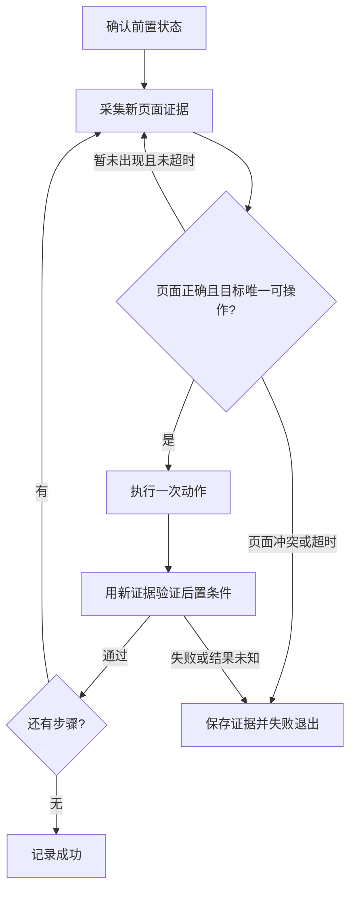

# 设备自动化脚本编写与回归

将用户目标落实为可独立运行、失败可诊断的设备脚本。复用现有请求客户端、SDK 和定位工具，不另建请求层或自动化框架。

## 开始前

1. 确认目标流程、成功条件、服务地址、设备 serial 和本次是否包含实机执行。优先采用当前会话已经确认的信息；缺少目标信息时，先完成不依赖设备的实现，不猜地址、包名、Activity、按钮或坐标。
2. 编写脚本不等于授权实机操作。用户已要求在指定设备执行或测试时，继续完成范围内的动作；只要求编写时不自动唤醒、解锁或点击。不要从历史案例继承支付、发消息、领奖等额外动作的授权。
3. 读取 [my-scrcpy-use](../my-scrcpy-use/SKILL.md)，按当前 OpenAPI 和实际响应确认所需接口、字段与认证方式。服务启动、重启或设备重连仅在本次任务包含这些操作时执行。
4. 需要 XML 定位时读取 [my-scrcpy-ui-dump](../my-scrcpy-ui-dump/SKILL.md)，复用其采集、页面关联、分析和 XPath 测试工具。只读采集与脚本中的实际动作分别遵守各自授权范围。
5. Python 运行时优先使用本仓库 SDK，先核对 [SDK 文档](../../../packages/python-sdk/README.md) 与实际安装版本、方法签名。缺少依赖时使用项目选定的 Python 环境，不改系统 Python；确需安装时从项目根目录执行 `python -m pip install ./packages/python-sdk`。

当前源码中 `Client`、`client.device(serial)` 支持上下文管理，`device.adb(args, timeout=...)` 可执行服务端 ADB 命令。调用前仍应核对 [Client](../../../packages/python-sdk/src/mywebscrcpy/client.py) 和 [Device](../../../packages/python-sdk/src/mywebscrcpy/device.py)。当前 `device.page_info()` 只返回屏幕宽高，不暴露完整页面上下文；包名、Activity、窗口信息使用通用请求客户端读取当前 `/api/ui/page-info`。不要编造 SDK 的 XML 或 XPath 方法，也不要为缺少的公开方法调用其私有请求函数。

## 编写流程

### 页面识别与新快照

- 每个步骤写清前置页面、定位条件、动作和后置条件。包名或 Activity 只能证明对应的观察值；业务页面还需真实文字、ID、容器或经过验证的其他证据。
- 按 `page-info → XML → page-info` 采集同一设备，检查时间、前后页面与屏幕基准。前台包不在 XML 中、只有 System UI、空树或页面变化时，不把快照作为目标页面的操作依据。需要等待时在截止时间内重新采集。
- 每次运行新建证据目录，采集失败不读上次响应。如果任务明确采用 ADB 直接 dump，每次使用本次运行独立的设备文件并在 dump 前移除它，核对实际生成确认、有效 XML 和页面上下文后才能使用。UIAutomator 退出码为 0 也可能没有生成 XML；记录实际输出，不能只检查退出码。
- 标准 API 失败时报告实际错误，不偷偷切到本机 ADB 或其他采集路径。若任务确需另一种采集方式，先明确其用途并核对命令与输出结构；不能用旧快照补齐失败。
- 锁屏状态依据当前设备可验证的信息判断，不从 System UI 节点直接推定。流程要求解锁且已获授权时，验证唤醒及解除无密码锁屏的结果；安全锁屏或状态未知时停止，等待用户手工解锁。具体厂商的 dumpsys 字段不能作为通用设备契约。

### 唯一定位与操作

- 复用 UI dump 技能生成和测试 XPath：优先 ID、文字及组合，其次明确的相邻或容器特征，再评估描述和 bounds。确认恰好命中目标语义，不能用 `(表达式)[1]` 隐藏多匹配。
- 测试表达式所用引擎与脚本运行时一致；现有工具使用 lxml XPath 1.0，标准库 ElementTree 不支持完整 XPath。不要把工具验证过的表达式直接放入不支持该语法的运行时。
- 点击目标或其已核实的可点击父节点须明确启用且可操作。涉及坐标时，检查本次矩形非空、屏幕尺寸和旋转基准一致且完整在界内；不固化历史坐标，不推测缩放、旋转或缺失尺寸。
- 动作前重新核对页面与目标；采集后发生导航、旋转或其他状态变化须重新定位。同一设备的脚本串行运行，避免并发点击使证据失效。
- 等待使用单调时钟截止时间和轮询间隔；单次请求的超时不超过剩余预算，并按需设置整体运行上限。只读采集可有限重试；动作超时或响应丢失时先查询后置状态，不自动重发点击、输入或启动命令。无法确认结果时记录未知并非零退出。
- 应用强制停止、返回桌面、清除数据等操作不能成为所有脚本的默认前置动作。只有目标流程确实需要且在授权范围内时使用，并说明影响。

### 后置验证与脚本结构

- 每个关键动作后重新采集，等待明确的页面或控件状态变化。点击接口成功只代表命令执行，不能证明业务完成。若 XML 无法观察目标，可使用当前任务已核实的截图、页面状态或其他只读证据，并说明覆盖范围；不能仅凭类名猜测页面含义。
- 脚本放在项目约定目录，例如 `scripts/automation/`；服务地址和 serial 必须来自参数或明确配置。不要把案例中的设备地址、端口或账号写成默认目标。
- 按采集、页面判定、定位、动作、验证拆分必要函数；用上下文管理或 finally 释放资源，仅清理本次创建的设备临时文件，保留本地失败证据。
- 记录步骤、耗时、匹配数量、请求或命令错误及验证结果。成功须满足完整目标；失败和未知返回非零退出码。凭据不写入命令参数、文件或日志；包含页面资料的原始证据留在本地，不提交仓库。
- 只有用户要求任务面板上报时才使用 [my-scrcpy-task-run](../my-scrcpy-task-run/SKILL.md)；调度和上报不作为普通设备脚本的必备模块。

## 回归

按实际流程选择适用场景并记录预期结果；无法准备的场景明确标为未验证，不为了凑覆盖改变设备配置或进入额外业务。

| 场景 | 验证重点 |
|---|---|
| 正常起步 | 从声明的前置状态完成目标，用新证据证明最终状态 |
| 锁屏起步 | 需唤醒或解锁的流程验证授权操作；安全锁屏或未知状态停止，无越界点击 |
| 重复运行 | 从目标页或中间页再次运行，按明确状态分支完成或结束，不重复产生业务副作用 |
| 快照失败 | 超时、空树、无效 XML 或 dump 未生成时，不读取旧文件，不执行依赖该快照的动作 |
| 定位异常 | 零匹配按预算等待，多匹配、禁用、非法 bounds 或错误页面停止操作 |
| 动作结果不明 | 命令失败、响应丢失或后置条件不满足时，查询实际状态，不盲目重发 |

定位、状态判定、超时和拒绝误操作逻辑适合离线测试。使用最小合成样本或脱敏数据验证行为，不引入真实账号资料；离线测试不替代实机验收。仅编写技能或脚本但没有执行授权时，到此完成静态与离线验证即可。

可参考 [现有自动化脚本说明](../../../scripts/automation/README.md) 了解真实失败案例与验证边界；它是特定设备和应用的案例，不把其启动、解锁方式或页面识别规则推广为默认策略。

## 交付

提供脚本位置、依赖和准确运行命令；说明实际使用的设备、服务及验证时间，逐项列出已通过和未验证场景。动作验证与业务验证分开表述，例如“进入任务中心”不能写成“任务已完成”。说明关键证据位置及提交、推送状态。

用户只要求方案时输出状态流程与定位依据；要求编写时交付可运行脚本和适用的离线验证；明确要求实机回归时，在授权设备与范围内完成执行。缺少服务或设备时报告具体阻塞，保留已完成成果，不宣称实机通过。
