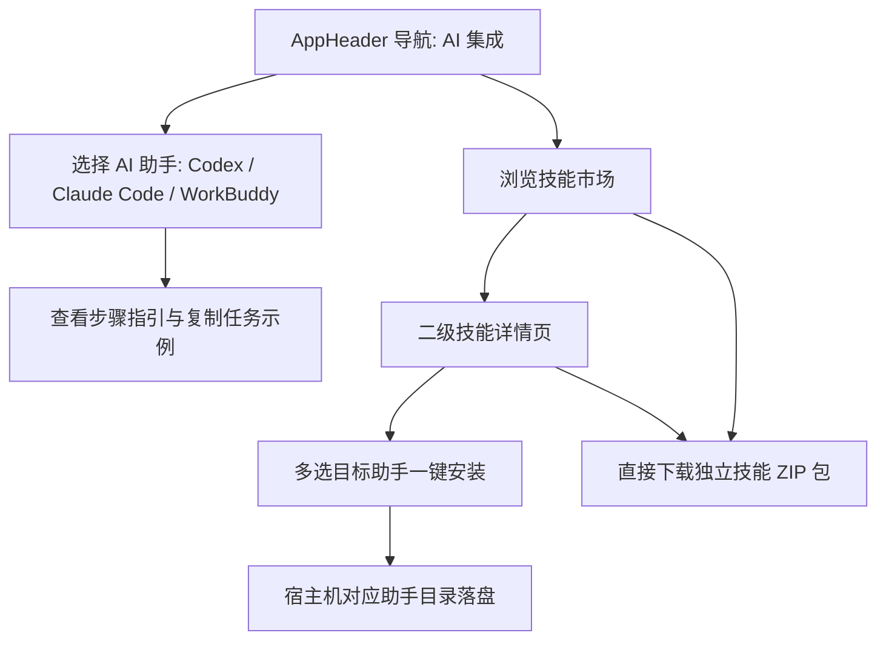

# AI 集成与技能市场

`v1.26.0-feature` 实现了内置 AI 助手集成指南与 APP 自动化技能市场；正式版本号和发布仍按项目既有流程推进。

## 概述与边界

MyWebScrcpy 本身专注于提供稳定高效的 Android 设备连接、实时投屏、UI 控件结构分析（UIAutomator XML 与 PageInfo）以及拟人化输入执行能力。AI 对话、多模态视觉理解与流程编排由外部 AI 助手（如 Codex、Claude Code、WorkBuddy）负责。

本模块提供：
1. **AI 助手接入指引**：覆盖 Codex、Claude Code、WorkBuddy 三种主流 AI 助手，展示接入步骤、任务示例提示词与宿主机上的实际安装目录。
2. **自动化技能市场**：提供通用设备、快手、微信等常用场景技能的检索、分类筛选、二级详细介绍、直接 ZIP 下载与多目标一键安装。

## 支持的 AI 助手与安装契约

> **重要**：所有安装操作的目标均为**运行 MyWebScrcpy 服务的宿主机电脑**，而非远程通过浏览器访问的前端客户端机器。

1. **Codex**
   - 官方契约：`$HOME/.agents/skills/<skill-dir>/SKILL.md`
   - 官方规范参考：`https://developers.openai.com/codex/skills`
   - 自动发现机制：Codex 自动发现该目录下的合法技能变更。

2. **Claude Code**
   - 官方契约：`$HOME/.claude/skills/<skill-dir>/SKILL.md`
   - 官方规范参考：`https://code.claude.com/docs/en/skills`
   - 默认作用域：用户级全局技能目录。

3. **WorkBuddy**
   - Desktop 目标目录：`$HOME/.workbuddy/skills/<skill-dir>/SKILL.md`，已核对本机 WorkBuddy 的技能解压安装逻辑。
   - [官方技能市场与 ZIP 导入说明](https://www.codebuddy.cn/docs/workbuddy/From-Beginner-to-Expert-Guide/Function-Description/Skills-Market)。

## 技能包内容与规范

所有技能目录以 `mywebscrcpy-` 为前缀命名，避免与用户已有自定义技能发生重名冲突。每个技能包包含：
- `SKILL.md`：符合规范的合法 YAML frontmatter（包含 `name` 与 `description`）及针对当前任务的提示词指令。
- `scripts/request_client.py`：完全独立的通用 HTTP 请求客户端（基于 Python 标准库，无外部三方依赖），用于与当前 MyWebScrcpy 服务的 REST API 交互。
- `.mywebscrcpy-manifest.json`：由本应用生成的内容完整性校验清单，记录管理权属及各文件的 SHA256 校验和。

### 市场收录技能

1. **手机操作基础 (`mywebscrcpy-device-base`)**
   - 适配应用：通用设备
   - 能力：屏幕捕获、UI 控件结构分析 (`/api/ui/xml`, `/api/ui/page-info`)、ADB 发送按键与手势输入 (`/api/sendkey`, `/api/adb/commands`)。

2. **快手日常助手 (`mywebscrcpy-kuaishou-daily`)**
   - 适配应用：快手
   - 能力：快手推荐流自动滑动浏览、页面状态识别、日常签到与打卡任务辅助流转。不宣称已实机回归。

3. **微信消息助手 (`mywebscrcpy-wechat-helper`)**
   - 适配应用：微信
   - 核心原则：**仅读取与草拟回复，绝不自动向外发送任何消息**。所有外发内容必须由人工在微信端审阅并手动点击发送。

## API 接口规范

- `GET /api/ai-integrations`：获取支持的 AI 助手配置及宿主机技能目标路径。
- `GET /api/skills`：获取技能市场列表及各助手在宿主机上的实时安装状态。
- `GET /api/skills/{id}`：获取指定技能完整二级详情及各助手实时安装状态。
- `GET /api/skills/{id}/download`：生成并下载独立技能 ZIP 压缩包（以技能名为根目录，不改变任何安装状态）。
- `POST /api/skills/{id}/install`：多选目标助手一键原子安装。

### 安全保障与已有改动保护

1. **白名单校验**：接口仅接受白名单技能 ID 及有效目标 AI 助手 ID，严禁任意路径输入或外部 URL 下载。
2. **跨域与 CSRF 防御**：写接口校验请求 Origin 与 Host，拒绝跨域 (`Sec-Fetch-Site: cross-site`) 调用。
3. **路径逃逸与符号链接防御**：禁止路径遍历，校验宿主机父级与目标路径中的符号链接（Symlink），拒绝向符号链接写入。
4. **用户自定义技能保护**：
   - 目标目录已存在且缺少本应用 manifest，或文件内容被用户修改过，或包含非本应用管理的其他文件时，状态判定为 `conflict`。
   - 安装器明确拒绝覆盖并保留原文件，不进行静默兜底。
5. **部分失败与原子性**：
   - 多目标安装逐项独立落盘与校验，返回各目标的精确状态 (`installed`, `already_installed`, `failed`)。
   - 某一个目标失败不会撤销已成功的其他目标，亦不会伪报批量成功。

## 安装实现与验证边界

- macOS/Linux 使用受控父目录句柄与不覆盖目标的原子重命名；Windows 使用目录句柄和 `NtSetInformationFile`，不设置 `ReplaceIfExists`。其他未实现安全发布的平台返回明确失败。
- 状态读取限制文件大小、目录条目和深度，拒绝非普通文件，核对清单和内嵌文件集合；请求取消和失败均保留用户已有内容。
- 已在 macOS 上验证生产前端与真实 Go 接口、临时助手目录的多目标安装、冲突保护与仅重试失败目标。已验证三个下载包独立内容及请求脚本；未操作真实设备，未验证助手客户端热加载或 Windows/Linux 原生行为。
