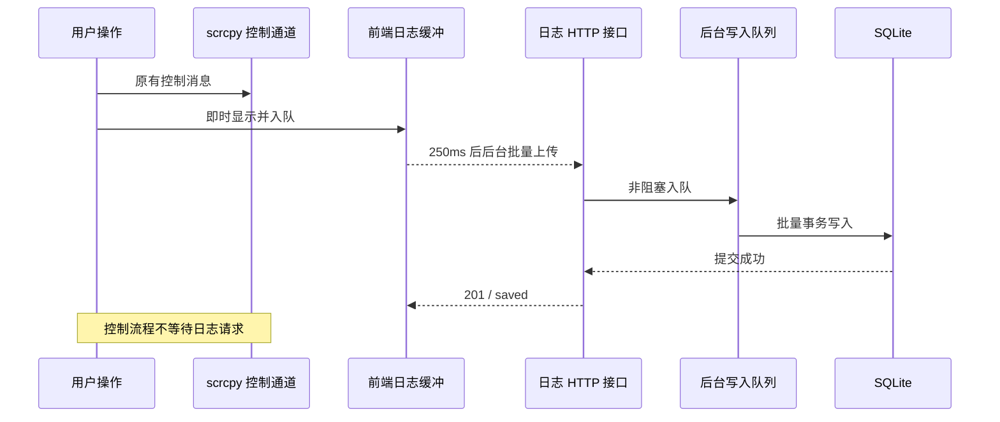

# 手机操作日志持久化

现有投屏操作日志继续即时显示，描述和 ADB 复现命令同时保存。SQLite 复用 `data/mywebscrcpy.db`，新增 `operation_logs` 表；不会执行日志中的命令，也不改变 scrcpy 控制消息。

## 接口

完整结构见 `web/openapi.json`，可通过现有 `/api-docs.html` 查看。

| 方法 | 路径 | 用途 |
| --- | --- | --- |
| POST | `/api/operation-logs` | 提交 `{ "items": [...] }`，每批 1–50 条；落库成功才返回 201 |
| GET | `/api/operation-logs?serial=设备&limit=100&before=游标` | 最近 7 天记录，按入库序号倒序；`serial`、`before` 可省略，`limit` 为 1–500 |
| DELETE | `/api/operation-logs?serial=设备` | 删除指定设备记录；省略 `serial` 清空全部设备记录，返回 `deleted` |

每条记录包含 `id`、`serial`、`type`、`description`、`adb_command`、`occurred_at`（Unix 毫秒）。类型支持 `tap`、`longpress`、`swipe`、`key`、`text`。`id` 唯一，同一次上传重试沿用 ID，重复记录不插入。查询返回 `items` 和 `next_before`，游标为 0 表示没有下一页。

## 留存、失败和清理

- 查询严格排除操作时间超过 7 天的记录。启动时及运行期间每分钟物理删除过期行；离线期间不执行清理，下次启动补做。`occurred_at` 必须在最近 7 天内，允许 1 分钟未来时钟偏差。
- 前端最多显示 500 条，在打开日志页时加载服务器历史并与即时记录按 ID 合并。时间显示包含日期，便于区分多天记录。
- 前端等待队列最多 1000 条，每批最多 50 条；服务端队列最多 128 批。日志请求使用独立 HTTP 调用，不等待或复用手机控制通道。请求体上限 256 KiB，描述上限 8192 UTF-8 字节，命令上限 16384 UTF-8 字节。
- 网络及服务端暂时故障最多尝试 3 次，使用原 ID 去重。请求超时为 10 秒。超出队列上限或重试耗尽时保留即时显示，报告未保存状态，控制操作继续。前端待上传队列只在内存中，页面关闭前尚未保存的记录可能丢失。
- 清空按钮沿用现有全部设备范围。清空排在既有上传之后，后续新操作排在清空之后；服务器删除成功才移除当时显示的记录，删除失败保留记录。历史加载用版本标识防止较早的查询结果恢复已清空记录。
- 服务退出先尝试排空日志队列，5 秒后取消尚未完成的工作。成功上传表示 SQLite 已提交；崩溃、页面关闭及强制退出前尚未确认的记录不保证保存。

## 验证

`go test -race ./internal/db ./internal/operationlog` 验证持久化、重复上传、分页、设备筛选、到期过滤和物理清理、清空顺序、数据库锁定期间独立控制请求、队列上限、不可用和关闭状态。

`node scripts/verification/operation-logs.mjs` 使用真实日志模块和受控网络、时钟验证后台上传、重试去重、清空期间新操作、历史加载竞态和队列上限，不连接手机。

真机验收需确认：操作正常、刷新后可读取日志、清空后刷新仍为空，以及保存服务不可用时手机仍可操作。
