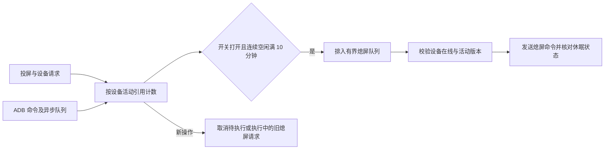

# 空闲自动熄屏

入口：系统设置 → 通用设置 → 空闲自动熄屏。默认关闭，开启后立即生效，保存在后端数据库中；浏览器关闭后仍由后端执行。

按设备独立计算：开启开关、新设备上线、或最后一个操作结束后，连续空闲满 10 分钟，再发送 `KEYCODE_SLEEP`（223）。有投屏、视频流保活、ADB 终端、排队或运行中的命令、设备请求时不执行自动熄屏。后台电量/温度/硬件属性采集、屏幕状态轮询、画面帧上传不刷新空闲计时。

调度每 5 秒扫描一次，一个工作协程、队列最多 32 项；单设备命令与状态验证共 5 秒超时，失败记录日志并在 1 分钟后重试。关闭开关、设备离线或新操作会取消旧请求；退出时取消命令并等待协程收尾。成功熄屏后不重复发送，下一次系统操作重新开始计时。开启时从当前时间起计时，后端重启或设备重新上线也重新计时。

接口：`GET /api/system/idle-screen`，`PUT /api/system/idle-screen`；请求与响应均为 `{"enabled": false}`，保存失败不改变当前生效配置。接口文档见 `web/openapi.json`。

范围：只跟踪经 MyWebScrcpy 发起的设备操作，不能追踪其他程序直接运行的 ADB 命令。手机自身的自动锁屏仍独立生效，本设置不保证屏幕至少亮 10 分钟，也不会为预览连接主动点亮手机。
