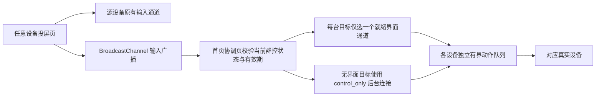

# 首页设备交互与群控问题记录

记录日期：2026-11-06。来源：用户语音反馈。

状态：2026-11-07 已实现并部署至 `https://10.0.0.6:8080`；本地构建、回归测试与三台真机 Web 群控验收通过。代码分支为 `codex/home-group-control-fixes`，提交记录以 Git 为准。专项未验证范围见文末。

## 1. 首页设备图标拖动异常

- [x] 复现并修复首页设备图标/卡片拖不动、拖动异常的问题。
- 语音原文：“手移设备的图标，图不动，图动有问题。”本轮按“首页设备卡片拖动排序异常”落实。
- 排查入口：`frontend/src/components/home/HomePhoneView.vue`、`frontend/src/components/home/HomeIosDockBar.vue`。实际修复位于 `HomePhoneView.vue`：使用 Sortable 指针拖动，消除 Reka 右键触发器内联 `pointer-events:auto` 对拖动镜像落点检测的拦截。四台模拟设备的实际拖动、顺序保存及编号同步已通过。

## 2. 系统导航中的“锁屏”改为电源键

- [x] 首页 iOS 悬浮底栏 → 操作 → 系统导航指令，将“锁屏”按钮改为“电源键”。
- 行为应对应设备系统电源键的按键功能，不能只更改名称或继续执行专用锁屏动作。
- `HomeIosDockBar.vue` 改为“电源键”，通过 `sendDeviceEvent` 发送后端已有的 `power`（键码 26），不调用 `KEYCODE_SLEEP`；真机验证了熄屏→亮屏→熄屏。

## 3. 开启群控后，任意设备操作均应同步

- [x] 开启群控后，打开任意一台设备进行操作，其点击、滑屏及手势应同步到群控范围内的所有目标设备，不固定某一台为主控。
- [x] 按源设备的归一化坐标，将点击位置和滑动轨迹映射到各目标设备，适配不同分辨率。
- 术语按 `docs/glossary.md` 的“群控”条目理解：目标为所有已勾选受控设备；保留用户“任意一台设备”的源设备要求，不擅自增加源设备必须已勾选的限制。
- 排查入口：`frontend/src/composables/useGroupControl.ts` 及投屏小窗/详情页的输入接入；需覆盖打开多台设备、切换操作源以及目标未打开投屏的场景。

## 4. 提升群控并行执行效率

- [x] 核对当前群控派发与设备执行链路，确认是否存在逐台等待、串行阻塞或其他延迟来源。
- [x] 群控应并行派发，提高多设备同步响应速度；慢设备或失败设备不应拖住其他设备。
- 语音中的“窗型还是斑型”“搞成斑型”按“串行还是并行”“改为并行”理解；源码核对后确认原先的 WebSocket 派发本就不等待各目标执行；本轮修复跨窗口协调、重复派发与后台音视频传输开销，不将原先逻辑描述为逐台等待。
- 群控目标上限 1024，后台连接同时初始化最多 4 台；连接及心跳超时 10 秒，连续失败 3 次后停止重连，成功取得真实尺寸或重新开启群控时重置计数，跨窗输入有效期 500 毫秒，单通道积压上限 128 KiB；每设备保序派发，关闭群控、移除目标或退出操作源时释放未抬起的输入。真实延迟未做专项测量。

## 5. 移除群控下方的完成统计与清除记录按钮

- [x] 不再展示“执行完成：成功 / 失败 / 待确认”这一结果区域。
- [x] 移除同一区域的“清除记录”按钮。
- 当前区域已核对：`frontend/src/components/home/HomeIosDockBar.vue`，位于群控开关下方。
- 本条范围是界面展示调整；不据此删除底层记录或错误处理能力。

## 6. 移除批量控制卡片内重复的设备数量标签

- [x] 移除操作浮动卡片顶部的“已选中设备 × 台”标签及数量展示，保留胶囊上的设备数量。
- 原因：同一已选数量已在胶囊上展示，卡片内重复。
- 当前区域已核对：`frontend/src/components/home/HomeIosDockBar.vue`；同排“全选在线 / 取消全选”和“清空”等操作不属于本条移除范围。

## 7. 离线设备不再展示

- [x] 首页不再展示已离线设备，包括设备卡片和设备编号小方块；不保留离线编号标签。
- 本条是展示要求，不代表删除设备记录。首页与编号区域共用在线列表，不提供离线展示入口；全量编号映射仍保持稳定，离线编号空位不渲染。

## 8. 隐藏设备的编号样式与右键恢复

- [x] 隐藏设备仍保留编号入口，并以独立样式区分；复用当前离线编号的灰色、虚线等视觉样式。
- [x] 根据设备可见状态切换右键菜单：可见设备显示“隐藏”，已隐藏设备显示“显示”，点击后恢复该设备展示。
- 已核对当前菜单：`frontend/src/components/home/DeviceContextMenu.vue` 现已根据实际卡片可见状态切换“隐藏/显示”，右键恢复已实测。

## 9. 显示范围改用切换组件

- [x] 显示范围使用切换组件表达状态，不继续采用独立动作按钮的形式。
- 本轮将“只显示已选/显示全部”合并为“只显示已选”开关：开启时实时展示当前已选设备，关闭时解除该筛选。
- 语音中夹杂的“移除”等片段指代不清，未据此增加删除或改名；“显示隐藏设备”继续用于恢复持久隐藏状态。

## 10. “只显示已选”与编号选择实时联动

- [x] 开启“只显示已选”时，取消某设备编号的选择，应立即隐藏对应设备卡片。
- [x] 再次点击该编号，应同时选中并显示对应设备卡片。
- [x] 编号入口持续可见、可点，不能因卡片被筛掉而失去再次选择的入口；离线设备按第 7 条不展示。
- 筛选应随当前选择实时变化，不能只保存开启时的选择快照。与手动隐藏并存时，新选中编号会清除该设备的持久隐藏状态；右键隐藏同步取消选中，右键显示在只显已选模式下同时选中。实际点选、全选、取消全选与右键恢复已验证。
- 排查入口：`frontend/src/composables/useHomePhoneView.ts`、`frontend/src/views/HomeView.vue` 及底栏编号选择事件。

## 11. 设备面板增加全选 / 取消全选

- [x] 在设备编号选择区域增加全选控件：存在未选中设备时，点击选中所有设备；全部已选时，再点击取消全部选择。
- [x] 在“只显示已选”模式下，同步更新卡片展示：全选后显示对应设备，取消全选后隐藏对应设备，编号入口保留。
- 全选范围不能被“只显示已选”过滤后的卡片列表截断，否则无法选回未显示的设备；离线设备不纳入展示和选择。

## 12. 移除设备面板重复统计文案

- [x] 移除“设备筛选与管理”浮动卡片中的“× 台在线”“× 台已选”文案及其统计展示。
- 本条补充第 6 条，作用于设备面板；第 6 条作用于批量操作面板，胶囊上的数字仍保留。

## 13. 展开 / 收起图标移到关闭图标左侧

- [x] 将设备编号区域的放大 / 缩小（展开 / 收起）图标移至浮动卡片标题栏，紧邻关闭图标左侧。
- 保留同一个控件按状态切换展开与收起图标，不重复放置入口。
- `HomeIosDockBar.vue` 的 `devicesExpanded` 入口已移至标题栏关闭按钮左侧，真实点击与位置检查通过。

## 14. 统一弹窗与胶囊卡片的视觉风格

- [x] “添加 Android 设备”弹窗的底色、圆角、边框、透明度与阴影统一为现有胶囊卡片风格。
- [x] 系统设置弹窗采用同一风格，并核对其他弹窗，统一整体视觉。
- 用户反馈：添加设备和系统设置弹窗与设备卡片的底色、风格不一致。现由 `frontend/src/lib/surfaces.ts` 的共享材质类统一浮动卡片与普通、滚动、确认弹窗，遮罩统一为轻遮罩与背景模糊。
- 入口：`frontend/src/components/home/AddDeviceDialog.vue`、`frontend/src/components/system/SystemConfigDialog.vue`；视觉参考为 `frontend/src/components/home/HomeIosDockBar.vue` 的胶囊浮动卡片。
- 用户已确认规则文件为根目录 `AGENTS.md`，已写入一条规则：“所有弹窗统一采用现有胶囊卡片的视觉风格。”

## 15. 首页顶部 AI 集成按钮增加状态标签

- [x] 首页顶部工具栏的“AI 集成”按钮旁增加“暂未实现”标识标签。
- 入口：`frontend/src/components/layout/AppHeader.vue`。
- 本条记录用户要求的界面标识，不据此判定整个 AI 集成模块的实际实现状态；按钮行为未要求调整。

## 群控实现链路

操作源无需勾选；源已在目标集合时不回送。触控和滚动包按真实投屏尺寸映射，HID/ADB 语义手势沿用归一化坐标；缺失尺寸时报告未就绪，不猜测设备分辨率。后台连接不订阅视频、音频或剪贴板。

## 验证记录（2026-11-07）

- `pnpm --dir frontend build`：类型检查及生产构建通过。
- 前端 Node 回归：58 项通过；群控专项通过跨页面通信、非勾选操作源、单目标、重复窗口去重、失败隔离、坐标边界、源关闭释放输入、连接容量及超限拒绝检查。
- `go test ./...`：462 项通过；`go test -race ./internal/ws`：73 项通过。
- 浏览器实际交互：四张模拟卡片拖动后顺序与编号同步保存；离线编号消失；只显已选、反选、再选、全选/取消全选、隐藏编号样式和右键显示通过；展开入口位于关闭左侧。
- 添加设备与系统设置弹窗的底色、圆角、边框、模糊、阴影与浮动卡片一致；明暗主题及 390×844 视口布局已核对，无横向溢出；AI 集成标签及移除的统计区域已核对。
- 真机电源键：一次按键亮屏，再次按键熄屏，最终恢复原先熄屏状态。
- 远端三台独立手机（两台 vivo、一台 Redmi）：未勾选的操作源在独立投屏页操作，已选的两台目标未打开投屏；横向滑屏后三台均翻页；点击各自桌面同位置文件管理图标，三台均进入对应文件管理应用（其中一台进入首次权限页，未授予权限）。按键同步与关闭群控后停止派发也通过，测试后回到桌面。
- 远端会话统计：源设备视频订阅数为 1，两台后台受控设备均为 0；输入包核对映射了 `976×2176` 与 `448×1024` 两种投屏尺寸。
- 单轮浏览器模拟负载：500 个就绪通道、100 个输入事件，共 50,000 次派发，中位 0.3 ms/事件、P95 0.7 ms/事件、最大 3.5 ms/事件。该结果仅为此轮浏览器派发耗时，不是大规模真机执行延迟。
- 验证截图保存在本地忽略目录 `.cache/verification/home-controls/`，不随源代码提交。

## 部署与未验证范围

- 目标：`liuzhuo@10.0.0.6`，服务 `mywebscrcpy.service`，程序 `/opt/mywebscrcpy/mywebscrcpy-linux-amd64`；沿用源码版本标识 `v2026.11.5-2`，未创建 Release 或修改版本号。
- 部署前 SQLite 一致性备份：`/opt/mywebscrcpy/data/mywebscrcpy.db.bak.home-controls-20261107102315`，完整性检查为 `ok`；现有部署脚本另保留程序备份。
- 已核对远端服务为 `active`，页面 JavaScript 资源与构建产物一致；最终程序 SHA-256：`a6489bc2d8afeb2c270e02a33537d7e530886999597aefcc64966730e80470e3`。
- 专项未验证：macOS/Windows 原生独立 WebView、HID/ADB 模式群控的真机操作、多设备断网重连、旋转切换及长时间/大规模真机性能。上述自动化检查和三台 Web 真机验收不替代这些专项。

### 独立审查补充

- 修复旧投屏会话结束后后台控制连接继续保活的问题：心跳核对当前会话身份，旧会话发送断开并关闭连接，触发客户端重连。
- 修复成功重连后仍累积历史失败次数的问题：收到合法尺寸即重置重试预算，连续失败仍有上限。补充重复瞬断恢复和旧会话退出的定向回归。
