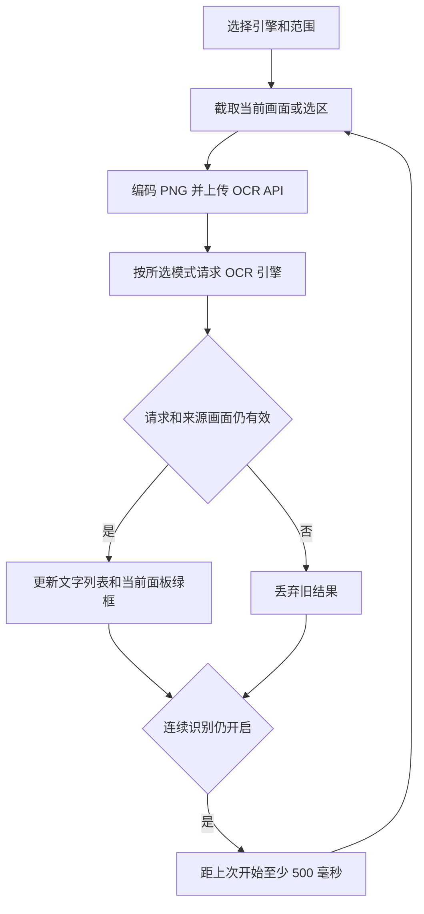

# 投屏检查中的 OCR

在投屏详情打开「检查 → OCR」，选择引擎和识别范围后执行识别。打开检查面板默认保持设备操控；面板顶栏的「检查模式」按钮仅在主动取色、拾取元素或框选时拦截画面输入，完成选择后自动恢复操控，也可再次点击按钮退出。自动模式按 Indra OCR、macOCR、PaddleOCR 顺序尝试。全屏和框选区域的选中项使用主题色高亮；已有 XML 选中节点时仍可识别选中元素。

点击「框选区域」后在画面中拖动一次，完成后恢复设备操控。选区固定在画面的相对位置，连续识别始终截取该区域；普通点击和滑动不会修改选区。需要重新选区时再次点击「框选区域」。列表中的 `x、y、w、h` 为识别时整张画面的像素坐标与尺寸，不使用裁剪图片中的局部像素坐标。点击列表或文字框可双向定位，筛选和「显示文字框」控制本检查面板的叠加层，不影响模板匹配框。

连续识别串行执行，没有等待识别的帧队列。单次捕获与请求共用 30 秒超时；错误后停止连续识别，由用户检查服务或重试。停止、切换引擎和范围、切换标签或关闭面板会取消尚未完成的请求，旧请求完成后不会覆盖当前状态。

画面尺寸变化或断流会清理识别和选区。已有新视频帧且来源画面已超过 600 毫秒时，不再显示旧文字框；静止画面不会通过续期伪造新帧。文字列表保留最近一次有效结果供查看，关闭检查面板时清空。只有主动进入检查模式或拖动框选阶段暂时拦截设备输入；全屏识别、区域识别及连续识别期间均可点击、滑动、滚轮和键盘操控设备。

相关验证：`node frontend/src/inspector/roi_test.cjs` 覆盖选中元素和框选裁剪、坐标映射、停止和取消、连续请求串行、旋转与旧帧丢弃；`pnpm --dir frontend build` 检查类型并构建。浏览器联调使用正式检查面板、已知文字画布和真实 Indra HTTP 服务，不代替真实手机页面验收。
