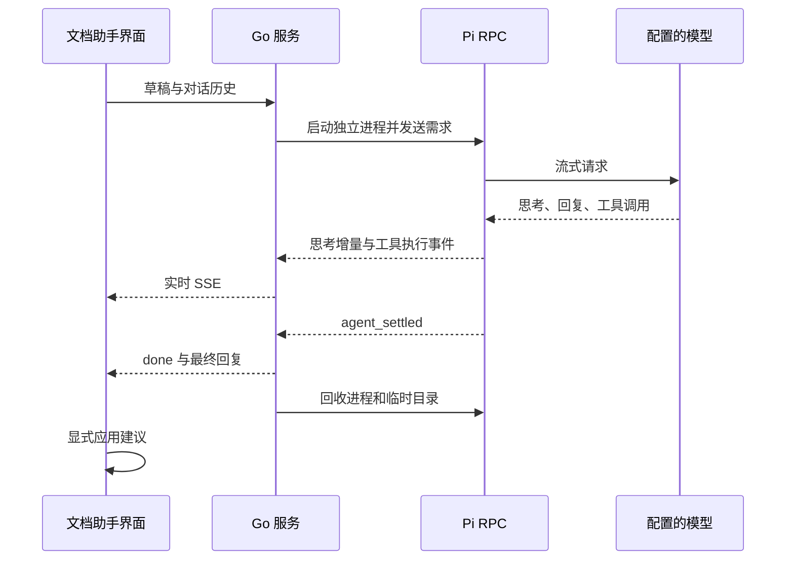

# Pi 文档助手

文档助手通过服务端的 `pi --mode rpc` 运行，浏览器实时展示模型返回的思考内容、回复和实际工具调用。原来的 `/api/ai/chat` JSON 整包回复与失败时自动生成的本地建议已移除。

Pi、fd 和 ripgrep 从主程序与桌面安装包中移出。首页“系统配置 → 依赖”可以按需安装锁定的 Pi 0.86.1、fd 10.3.0、ripgrep 15.2.0 独立环境，无需系统 Node.js；也可以选择系统来源并配置这三个程序各自的执行路径。缺少 Pi 不阻止应用启动，文档助手会明确返回依赖错误。

## 构建与安装

`bash scripts/build.sh` 只构建前端和 Go 程序；桌面 sidecar 使用同样的拆包方式。运行时从锁定的官方 GitHub Release 下载对应平台资源，验证 SHA-256 和解包文件后原子安装到数据目录的 `dependencies/pi-agent/`。下载中可以取消，关闭配置弹窗不取消安装。来源选择独立保存，安装成功不会自动切换。

支持 Windows AMD64、macOS AMD64 / ARM64、Linux AMD64 / ARM64。运行时清单位于 `internal/dependencies/catalog/pi.json`，与 `scripts/pi-runtime.lock.json` 保持一致；构建机无需为主程序下载依赖。`python3 scripts/prepare-pi.py` 仅用于独立包准备及回归验证，默认输出 `.cache/pi-test/payload/`。真实 Pi 测试设置 `MYWEBSCRCPY_PI_TEST_PAYLOAD` 为其父目录 `.cache/pi-test`。

内置依赖可以卸载；正在使用时拒绝删除。卸载不改变所选来源，也不删除系统程序、模型配置或项目技能。无网环境请预先安装依赖或配置系统来源。旧 `.pi/runtime/<hash>/` 保留，未携带可独立核验的安装清单时不扫描或自动登记；可显式将其中的 Pi、fd、rg 路径配置为系统来源。

## 项目技能

## 项目技能目录

项目根目录的 `.pi/skills/` 用于维护助手专用技能，每个技能放在 `技能名/SKILL.md`，文件头必须包含 `name` 和 `description`。格式示例见 [技能目录说明](../.pi/skills/README.md)。

服务使用数据目录中的 `.pi/skills/` 绝对路径，以 `--skill` 显式传入。Pi 的工作目录仍为每次请求的临时上下文目录，也不自动加载全局技能或 `.agents/skills/`。搜索程序复制到本次请求的私有 `.agent/bin/`，Pi 优先使用这些程序，不要求系统的 `PATH` 中有搜索工具。

每次新请求都会重新扫描技能。模型先获得技能名称、描述和位置，完整正文与引用资料按需读取；新增或修改技能会在下一次请求中生效，正在运行的请求不保证重新加载。技能中的脚本不会自动执行，也不会增加 Shell、写入或设备操作工具。

`POST /api/ai/chat` 返回 `text/event-stream`。每条 `data` 是一个 JSON 事件：

| type | 内容 |
| --- | --- |
| `thinking_start` / `thinking_delta` / `thinking_end` | 思考块生命周期，增量使用 `delta` |
| `text_start` / `text_delta` / `text_end` | 回复块生命周期，增量使用 `delta` |
| `tool_start` | `tool_call_id`、`tool_name`、`args` |
| `tool_update` | 同一 `tool_call_id` 的累计 `output`，覆盖已有输出 |
| `tool_end` | 最终 `output`，`is_error: true` 表示工具失败 |
| `done` | 最终 `reply`，仅完整运行结束后发送 |
| `error` | `error` 错误信息，不生成替代建议 |

停止按钮、离开页面或断开请求会取消该请求的 Pi 进程；服务端最多等待 5 分钟。切换任务保留各自的会话，迟到的回复只写入原任务；有新草稿修改时，旧建议无法直接应用。正在阅读历史时不强制滚动，处于底部时跟随实时更新。

协议依据：[Pi RPC 文档](https://github.com/earendil-works/pi/blob/main/packages/coding-agent/docs/rpc.md)。

独立程序来源：[Pi 0.86.1 官方发布](https://github.com/earendil-works/pi/releases/tag/v0.86.1)。原生测试使用 [GitHub 官方 runner 列表](https://docs.github.com/en/actions/reference/runners/github-hosted-runners) 中对应架构的 Windows、macOS 和 Linux 运行环境。

验证命令：先执行 `python3 scripts/prepare-pi.py`，再执行 `go test ./...`、`go vet ./...`、`pnpm --dir frontend build`。`internal/aiprovider` 测试使用真实内置 Pi 和本地受控模型，并将子进程的 `PATH` 指向空目录，验证流式输出、真实读取/搜索工具、技能加载与进程回收，不消耗外部模型额度；未准备内置包时会明确跳过真实 Pi 测试。发布流程在五个平台执行原生测试，并在通过后发布产物。

## 本次验证（2026-10-12）

- 前端生产构建、Go 全量测试、`go vet ./...` 与受影响包的 race 检查通过。
- 使用本机 Pi 0.86.1 和本地受控模型，验证思考实时到达、真实 `read` 工具读取当前草稿、结果回传模型、最终建议以及断流后的进程回收。
- 使用实际 Vue 助手逻辑、SSE 客户端和隔离 Go API，验证运行中的思考状态、跨任务回复归属、建议不自动应用、草稿变更保护、主动停止以及模型错误时不生成替代建议。
- 浏览器视觉验收未完成：浏览器连接返回 `Unable to load browser request-header policy`，原生窗口访问返回 `cgWindowNotFound`。没有生成界面截图，也没有重启现有项目服务。

- 项目技能验证：真实 Pi 已扫描临时测试技能，将名称、描述和路径加入模型上下文，并通过真实 `read` 工具读取 `SKILL.md` 和参考文件。修改技能后启动下一次请求，已确认新的描述被加载。

- 内置依赖验证：本机 macOS ARM64 在子进程 `PATH` 指向空目录时，真实内置 Pi 完成流式对话，真实 `read`、`grep`、`find` 工具均返回结果，技能与参考资料按需加载。
- 便携程序验证：用完整构建脚本产生约 47.2 MiB 的 macOS ARM64 程序，从两个不同的工作目录启动，首次自动释放依赖和技能，再次启动复用运行环境、保留技能修改，真实 HTTP SSE 对话通过。未重启现有服务。
- 五个目标的依赖均按官方 SHA-256 校验，Windows AMD64、macOS AMD64 / ARM64、Linux AMD64 / ARM64 均完成编译。Windows、Linux 和 macOS Intel 的原生运行测试已加入发布流程，本次未运行这些 CI，也没有启动本机 Docker 服务。
