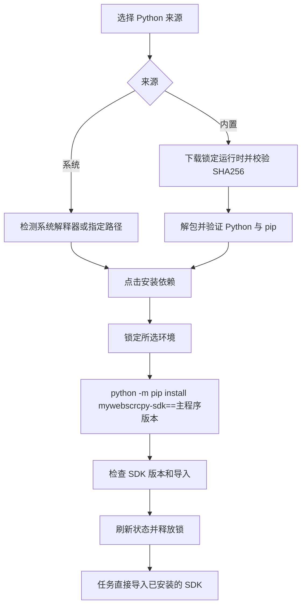

# Python 环境与模块依赖

系统配置的「依赖」页统一管理 Python。系统来源检测 PATH 或用户指定的解释器；内置来源按需下载锁定版本的 python-build-standalone，保存在应用数据目录，不借用系统解释器。来源缺失或无效时直接报错。

系统来源只显示执行路径、版本及检测结果。内置来源显示安装状态、下载、取消和卸载。Python 卡片额外显示 `mywebscrcpy-sdk` 的安装版本和「安装依赖」，对当前选择的解释器生效，不隐式保存或切换来源。



主程序只保留 SDK 包版本元数据，不嵌入或释放 SDK Python 源码，不将任务目录加入 `PYTHONPATH`。安装通过所选解释器调用 pip，安装包名由后端固定，版本与根目录 `VERSION` 一致。应用不绕过系统 Python 的环境保护；缺少 pip 或不允许安装时显示 pip 错误，可改用内置解释器或指定虚拟环境。

安装为后台任务，可取消，最多运行十分钟。Python 运行中或用于代码生成时，不允许安装模块、卸载运行时或切换来源；安装中也不启动使用该环境的新任务。更新程序时沿用依赖管理的维护锁。SDK 安装后以实际版本和导入结果确定就绪，不仅根据 pip 退出码判断。

内置运行时采用 [Astral python-build-standalone](https://github.com/astral-sh/python-build-standalone) 的 `install_only_stripped` 归档，锁定 URL、SHA256 和字节数。归档中的内部文件链接复制为普通文件；越界、循环或缺少目标的链接拒绝解包。可再生成的 `.pyc` 不计入运行时完整性清单，允许 pip 安装后正常生成缓存和新增第三方模块。

旧 schema-1 依赖配置在没有 Python 来源字段时保留既有系统 Python 路径。已有依赖路径接口明确同步 Python 的系统来源，不猜测其他字段或自动退回其他解释器。

运行 Go 测试前，在测试所用 Python 环境安装 SDK：

```bash
python -m pip install ./packages/python-sdk
go test ./...
```

真实内置运行时及 PyPI 安装验证使用 `MYWEBSCRCPY_PYTHON_ARCHIVE` 指向对应平台的锁定归档。常规单元测试使用受控解释器，验证固定安装命令、重复安装拒绝、运行期间的修改保护、配置持久化和归档路径边界。
