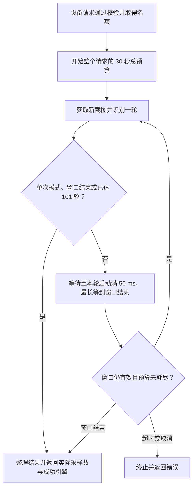

# 系统配置

首页“系统配置”保留主题、ADB、Python 与模板匹配。Pi、模型提供商、模型地址、API Key、fd/rg 配置和内置脚本调度已移除。

ADB、Python 可选择应用管理的内置副本，或 PATH / 绝对路径指定的系统程序；错误路径直接报错。ADB 安装仍需接受 Android SDK 许可，来源变更需等待设备连接与操作空闲。Python 的“安装依赖”使用所选解释器安装同版本 SDK 和识图依赖。

当前 `dependencies/config.json` 的 schema 为 2，仅包含 `adb`、`python` 的 `source` 和 `path`。v1.25 遇到 schema 1 时直接重置选择，不迁移 Pi 或归档旧配置；新配置重启后保留。未知版本报错，不覆盖文件。全局 Pi、个人技能和用户业务脚本不参与清理。

模板匹配、Indra OCR 和 PaddleOCR 本地服务在点击启动时检查依赖；缺少包或版本不满足当前应用要求时，先安装或升级，再复查版本、导入和服务就绪状态。依赖已满足时直接启动，不重复安装。模板匹配使用与应用一致的 SDK 版本，PaddleOCR 使用随应用提供的 requirements.txt 约束。

三项服务分别使用 `dependencies/services/` 下的独立虚拟环境，基于当前选定的 Python 创建，避免修改该解释器的全局模块。源码运行可安装本地 SDK；安装包运行从 PyPI 安装应用要求的 SDK 版本，尚未发布的版本会明确报错。Indra OCR 和 PaddleOCR 服务脚本与依赖清单随 Go 程序内嵌，启动不依赖工作目录中存在源码。

成功开启后保存该服务的开启状态，手动停止则保存关闭状态。下次应用启动约 5 秒后分别异步恢复开启的服务，失败保留错误并等待用户重试，不阻塞主界面、不反复重启。应用正常退出停止进程时保留用户设置；手动操作会取消尚未执行的自动恢复，旧启动请求的完成结果不能覆盖较新的关闭设置。

系统设置外框高度固定为 `min(720px, 90dvh)`；功能页内容在内部滚动，小屏页签按两行排列，切换页签不会改变外框尺寸。

## OCR 引擎与采样

自动模式依次使用 **Indra OCR → macOCR → PaddleOCR**。仅在服务请求或响应契约出错时降级，成功但没有文字时直接返回空结果；显式指定某个引擎不切换到其他引擎。既有手动选择保持有效。

`engine="parallel"` 是独立的并行模式，每轮同时调用 Indra OCR、macOCR、PaddleOCR 三个引擎并融合成功结果。每个并行引擎独立使用 5 秒 deadline，受整个请求剩余预算约束。慢引擎超时记入 `fallback_reason`，其他引擎成功仍可正常返回，不必等待耗尽整体 30 秒预算；部分引擎的其他失败也通过该字段说明。全部引擎失败（包括全部引擎各自超时）返回 HTTP 502，整体预算或请求上下文超时则返回 HTTP 504。响应的 `engine` 固定为 `parallel`，`engines_used` 只列实际成功的引擎，不包含失败引擎或模式名。请求省略 `engine` 时使用服务配置，`POST /api/ocr/config` 的 `engine` 也可设为 `parallel`。

### OCR API 输入与响应

`POST /api/vision/ocr` 和 `POST /api/vision/ocr-text-art` 共用以下输入规则，完整字段见 `web/openapi.json`。

| 调用方式 | 图片来源与要求 |
|---|---|
| `application/json` | 必须提供含非空白字符的 `serial`，服务端获取设备新截图；不传 `file`。`bbox`、`keywords` 为数组 |
| `multipart/form-data` 上传 `file` | 使用调用方提供的非空图片，只识别一次；可附带 `serial` 发布识别框。`bbox` 为 JSON 数组文本，`keywords` 为逗号分隔文本 |
| `multipart/form-data` 不传 `file` | 必须提供含非空白字符的 `serial`，服务端获取设备新截图；其他表单字段同上 |
| text-art 的 query | 保留无请求体的 `POST /api/vision/ocr-text-art?serial=…&engine=…&stabilization_ms=…&columns=…&rows=…`；必须提供 `serial`，仅在不使用 JSON/multipart 请求体时读取 query |

设备模式的 `bbox` 用于裁剪截图，再将结果坐标映射回完整画面；上传模式不裁剪图片，只将已有图片中的坐标映射回完整画面。`keywords` 筛选文字框，`text` 保留完整识别文本。`mark=true` 时在指定设备投屏发布最终结果。

两个接口的 JSON 响应都必含 `samples`（整数）和 `engines_used`（字符串数组）。`samples` 统计实际完成的截图采样轮数，不统计每轮引擎调用数；单次设备截图与上传文件均为 1，即使使用 `parallel` 也不变。连续采样时 `engines_used` 跨轮去重；非并行模式的 `engine` 为最后一轮成功的引擎。`fallback_reason` 没有失败时省略，与后端结构体的 `omitempty` 一致。

text-art 额外支持 `columns`（省略或不大于 0 时为 90）、`rows`（省略或不大于 0 时由渲染器选择，当前为 90）。默认返回含 `text_art` 和识别信息的 JSON；`Accept` 包含 `text/plain` 时只返回纯文本画。

### 连续采样窗口与资源限制

`stabilization_ms` 是 `0..5000` 的整数毫秒，默认 0。省略或 0 保持单次识别；正数必须提供有效 `serial` 且禁止上传 `file`。负数、超范围、非整数以及 JSON `null` 返回 HTTP 400，不能通过传正数将上传图片变为重复识别。

设备连续采样由服务端串行执行「新截图 → 识别」，相邻轮次的启动间隔至少 50 ms，最多 101 轮。每轮可选择 `auto`、单引擎或 `parallel`；并行仅发生在同一轮的三个引擎之间。采样窗口结束后不启动新轮，已启动轮可在请求预算内完成，最后融合各轮结果；截图失败、识别失败或采样期间截图尺寸变化（如旋转导致宽高交换）会终止请求并返回错误。

设备截图请求（包括单次）与上传文件的 `parallel` 请求共用最多 2 个高开销识别请求名额，满额立即返回 HTTP 429，不排队。此类请求从开始执行起共用 30 秒总预算，覆盖截图、全部采样轮次、引擎调用、等待以及窗口结束时已启动的轮次，不为每轮重置；请求上下文可提前结束。超时返回 HTTP 504，取消返回 HTTP 408。普通上传文件的单引擎或 `auto` 请求保留单次识别路径。

HTTP 502 表示 OCR 或截图执行失败，包含并行模式全部引擎失败；并行模式部分失败可通过成功响应中的 `fallback_reason` 检查。底层 Indra 服务的忙碌状态与 OCR API 的请求名额是不同限制。

系统配置的 OCR 服务页可启动或停止本地 Indra OCR，首次启动在独立环境中安装锁定的 `indra-ocr==0.3.2` 及 HTTP 服务依赖，再下载官方模型。默认上传地址为 `http://127.0.0.1:8032/upload`，可通过 `INDRAOCR_URL` 配置；`/health` 只在模型加载成功后返回就绪。启动成功后记住开启状态，下次应用启动延迟恢复，停止后保持关闭。

后端 `POST /api/vision/ocr` 和 Python SDK `device.ocr()` 均支持 `engine="indraocr"`。SDK 直接连接 OCR 服务，可通过 `indraocr_url=` 或 `INDRAOCR_URL` 配置地址；远程运行脚本时须填写脚本可访问的服务地址。

Indra 始终返回输入图片的像素坐标，关闭自动旋转，不通过坐标数值猜测单位。服务一次处理一张图，无排队积压；忙时返回 503，单帧超时返回 504，原推理结束前不接受下一帧，退出由应用回收进程。
