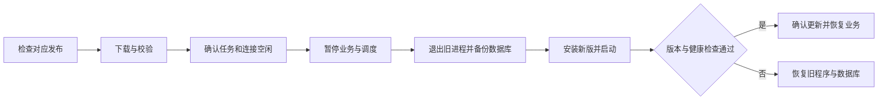

# 更新与发布

## 运行方式

更新方式由后端声明，前端只展示对应操作；后端拒绝不支持的升级请求。

| 场景 | 更新方式 |
| --- | --- |
| macOS App、Windows 安装版 | 原生宿主安装完整签名更新包，退出后重新启动整个应用 |
| Linux AppImage | 安装完整签名 AppImage |
| 桌面便携目录、包内程序手动运行服务、Linux deb/rpm | 下载完整安装包或使用包管理器更新 |
| 独立 Go 服务程序 | 从固定 GitHub 仓库下载当前平台程序，校验后受控重启 |
| systemd | 使用服务部署流程升级；应用内不自行重启或替换文件 |
| Docker/Podman | 拉取新版镜像并重建容器；应用内保留版本检查，禁止二进制升级 |

官方 Docker 镜像设置 `MYWEBSCRCPY_RUNTIME=docker`，同时识别 `/.dockerenv`、`/run/.containerenv`。自定义镜像应保留该变量。systemd 使用 `INVOCATION_ID`，也可以明确设置 `MYWEBSCRCPY_RUNTIME=systemd`。桌面宿主通过既有 `--desktop-ready` 标识服务。

## 更新保护

独立服务更新必须由服务端选择仓库资源，忽略客户端传入的下载地址；资源名严格匹配平台，要求 GitHub 返回 SHA-256 digest。安装前验证文件大小、SHA-256 和程序 `--version`。临时文件位于安装目录所在文件系统。没有可验证资源、目录不可写或已有更新时，拒绝升级。

投屏/终端等长连接、录制、回放、托管脚本任务未结束时拒绝安装，不主动中断用户任务。进入维护后阻止新业务请求和定时任务。新版连续三次健康检查通过后才确认成功；验证期间业务保持关闭。独立服务启动失败时恢复旧程序和数据库文件，包括 WAL/SHM；结果持久化，前端断线后通过状态轮询获取结果。

macOS 完整 App 安装前备份整个 `.app` 和运行数据库，由复制到应用包外的 Go 监护进程验证新版启动；失败时停止新版自有进程，恢复完整旧 App 与数据库。无法确认新版进程退出、无法写回原 App 目录或已存在失败包时停止自动回滚并保留备份，日志明确说明原因。备份位于应用数据目录的 `update-backups/`，失败包位于原 App 旁的 `.failed-update`；不自动删除历史备份。

Windows/Linux 的安装与签名校验由 Tauri 更新器处理，保留升级前数据库备份；安装失败后恢复启动。它们的新版启动失败自动回滚尚未接入原生安装器，不应作为已经验证的功能宣称。

更新备份覆盖当前数据库及依赖路径配置；发布涉及其他数据迁移时必须扩展备份范围并验证回滚。不要在未确认新版本可读写数据之前删除旧版备份。

## 版本和 Actions

根目录 `VERSION` 是正式版本源。修改后执行 `node scripts/sync-version.mjs`，同步前端、桌面配置、Cargo 包及锁文件和 Python SDK；`--check` 只校验。发布 tag 必须与 `VERSION` 相同。Python SDK 的 PyPI 版本去掉 `v` 前缀，主分支版本更新后由 `Publish Python SDK` 工作流自动发布；仓库需配置 `PYPI_API_TOKEN` Actions Secret，已发布的完整版本会跳过。

从 v1.20.1 起，`.github/workflows/release.yml` 发布 5 个 CLI、Windows GUI exe/安装包和 macOS Intel/Apple Silicon 两种 GUI DMG，共 9 个程序。`desktop-latest.json` 只包含 Windows 安装包的签名更新信息；macOS 使用 DMG 手动安装和更新，Linux 使用 CLI。缺少约定资产或版本不一致时发布失败。Docker 继续使用 Linux AMD64 CLI。

Windows 桌面更新使用 Tauri 官方更新器，校验 minisign 签名，安装包使用 NSIS。macOS 的 Tauri 自动更新需要另行发布完整 `.app.tar.gz`；当前仅发布用于手动安装的 DMG，其中包含 App 和配套服务程序。桌面便携目录不作为安装版更新包发布。

Actions 配置：

- Secret `TAURI_SIGNING_PRIVATE_KEY`：更新签名私钥。
- 可选 Secret `TAURI_SIGNING_PRIVATE_KEY_PASSWORD`：加密私钥密码。
- Variable `MYWEBSCRCPY_UPDATER_PUBLIC_KEY`：与 `desktop/updater.pub` 相同的更新公钥。
- Apple 系统签名/公证：Secrets `APPLE_CERTIFICATE`、`APPLE_CERTIFICATE_PASSWORD`、`APPLE_ID`、`APPLE_PASSWORD`；Variables `APPLE_SIGNING_IDENTITY`、`APPLE_TEAM_ID`。

更新签名与 Apple 系统签名是两套独立凭据。更新私钥已保存到本机受保护目录并配置到仓库 Secret；仓库只保存公钥。Apple 凭据尚未配置，当前 macOS 包只有本机 ad-hoc 签名，不能宣称通过正式签名和公证。私钥不得提交到 Git，也不能随意重新生成，否则已安装版本无法验证后续更新。

初次安装需要一个包含新更新器和公钥的完整安装包；此前没有完整 App 更新能力的旧 App 无法凭空获得新流程，需要手动安装一次。

## 验证边界

本机应运行 Go 测试/race/vet、前端构建、Rust check/clippy、Actions 语法检查、桌面服务集成检查、发布清单契约检查和原生 IPC 检查。原生验证构建使用独立应用标识 `com.mywebscrcpy.desktop.verification`，不会复用正式应用数据目录；交付前重新构建普通版本。

完整 Release 上的真实版本升级、Windows/Linux 安装器、systemd 部署和 Docker 容器重建还需要各环境验收；单元测试和本机 macOS 打包不能替代这些验证。

参考：[Tauri 官方更新器](https://v2.tauri.app/plugin/updater/)、[GitHub macOS runner 列表](https://github.com/actions/runner-images)。
