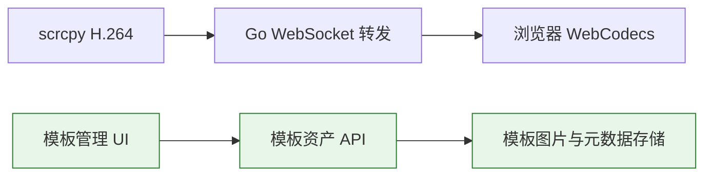

# v1.11.0-feature 设计说明：模板资产管理与投屏解耦

## 背景

模板匹配曾同时存在于 Go 与内嵌 Python 运行时。Python Worker 接收共享 scrcpy H.264 帧并通过 PyAV/OpenCV 解码、匹配；该额外负载与投屏坏帧出现时间重合。投屏路径一旦因浏览器解码、绘制或服务端调度而积压，H.264 预测帧丢失可能造成花屏或短暂坏帧。

## 目标

- 保留模板图片的新增、查看、编辑、删除、追加参考图、下载、导入和导出。
- 彻底移除内嵌 Python/PyAV/OpenCV 匹配运行时及其镜像依赖。
- Go 服务不再订阅、解码、匹配或基于模板执行设备点击。
- 将播放器入口与文档调整为“模板管理”，不暴露失效的匹配开关、命中状态或点击操作。

## 非目标

- 不删除已保存的模板图片或元数据。
- 不修改独立 Vision WebSocket 及外部 Python Vision 示例；它们不是内嵌模板管理运行时。
- 不在本版本中调整共享 H.264 队列的丢帧恢复策略。
- 不自动修改正式 `VERSION`、创建 Git tag、部署或发布。

## 关键决策

1. 采用“仅资产管理”而不是回退旧纯 Go 匹配。旧方案仍需实时 H.264 解码，并且对部分 CABAC 设备不兼容，不能作为稳定性修复的默认路径。
2. 移除匹配相关 REST/WebSocket 接口：`/api/templates/status`、`/matches`、`/detect`、`/click`、`/feed`。保留 CRUD、图片和导入导出接口。
3. 保留现有模板存储格式中的匹配参数字段，以避免破坏已有模板数据；管理 UI 不再展示或修改这些无执行意义的参数。
4. Docker 镜像移除仅由内嵌模板 Worker 使用的 Python、PyAV、OpenCV 依赖。

## 目标链路

模板资产管理不再连接到视频帧链路，避免模板操作引入实时解码和匹配负载。

## 风险

- 已有调用方访问已移除的匹配接口会收到非成功响应，需要迁移或停止调用。
- 移除实时匹配后，绿框命中和按模板自动点击不可用。
- 本地自动化检查无法替代真实设备上的坏帧对照验证。

## 迁移计划

1. 保留原模板数据目录及 CRUD/导入导出接口。
2. 移除 Python 与 Go 的匹配执行链路、相关 UI 和 OpenAPI 描述。
3. 构建并替换服务后，在同一设备和网络条件下观察投屏连续性。
4. 若仍有坏帧，再单独处理共享 H.264 队列的预测帧丢弃恢复机制。

## 回滚计划

回滚本版本提交即可恢复先前的匹配运行时和接口；模板数据未迁移或删除，因此不需要数据恢复操作。

## 待确认问题

- 真实设备上移除匹配执行链路后，坏帧是否消失或显著减少。
- 是否需要在后续版本对共享视频队列增加关键帧重同步机制。
