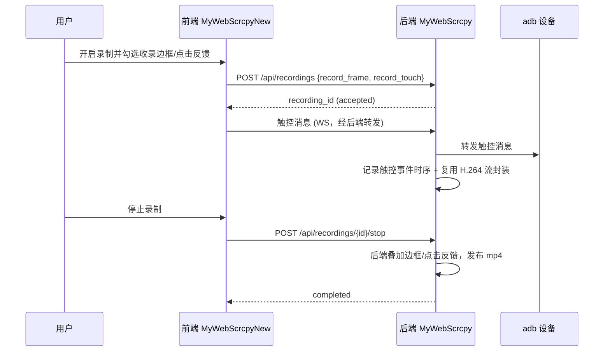

# v1.12.0-feature 设计说明：显示尺寸入设置、手机边框与录制边框/点击反馈

## 背景

投屏播放器现状：

- 显示尺寸目前是「更多」菜单里的独立条目 + 独立 Dialog（前端 `PlayerView.vue` 的 `sizeOpen`），与设置面板分离。
- 画面只有裸 canvas，无手机外形边框。
- 录制为后端复用 H.264 共享流直接封装 mp4（`internal/ws/recording.go` → `newMP4RecordingMuxer`），不含前端 overlay 边框与点击反馈。

本轮需求横跨两个仓库：前端 `MyWebScrcpyNew`（Vue 3）与后端 `MyWebScrcpy`（Go）。

## 目标与非目标

**目标：**

- 将显示尺寸调整并入设置面板，去掉独立按钮/对话框。
- 投屏画面支持常见手机边框，采用 CSS/SVG 绘制，自适应分辨率与横竖屏。
- 录制时可选是否收录边框、是否收录点击反馈。

**非目标：**

- 不引入第三方外壳素材图片及逐机型元数据（首版走绘制方案）。
- 不在本版本内完成录制边框/点击反馈的前端合成方案（沿用后端录制链路）。
- 不自动修改正式 `VERSION`、创建 Git tag、部署或发布。

## 关键决策

### 1. 显示尺寸并入设置面板

前端闭环改动。将 `Slider` + 「适应窗口」从独立 Dialog 迁入 `PlayerSettingsPanel.vue`，删除 `sizeOpen` 状态和「更多」菜单中的「显示尺寸」条目；复用 `usePlayer` 现有 `displayScale/displayLabel/setDisplayScale/fitWindow`。

### 2. 手机边框采用 CSS/SVG 绘制

不依赖外部素材，内置若干常见机型边框，按屏幕比例动态绘制（圆角/刘海/镜头孔/下巴），任意分辨率与横竖屏自适应。需扩展 `fitCanvas` 适配：先扣除边框占位，再把 canvas 对齐到「屏幕区」。

### 3. 录制边框/点击反馈：后端合成

- 现状：后端 `recording.go` 用纯 Go mp4 muxer 封装，无 ffmpeg，无法直接叠加 overlay。
- 点击反馈：触控消息（ACTION_DOWN/MOVE/UP）经 WS 先到后端，服务端可见坐标，需在录制期间记录触控事件时序日志，再生成动态 overlay 叠加（或录制期解码→绘制→重编码）。
- 边框：后端需持有一份与前端一致的分机边框几何参数，录制时以相同方式叠加，保证两端观感一致。
- 前端增补：`POST /api/recordings` 增加录制选项参数（如 `record_frame`、`record_touch`），录制面板与设置项同步。

## 交互时序（录制后端合成，规划）

## 风险与权衡

- [后端合成需引入 ffmpeg 或用后处理叠加] → 单独评估实现路径，避免影响现有纯 Go 录制链路的稳定性与性能。
- [录制期实时解码重编码 CPU 开销大] → 优先录制后后处理叠加，配合触控事件日志；若能接受则实时方案不上。
- [边框前后端定义不一致] → 约定共享的机型几何参数规范，两边引用同一份定义。
- [横屏/异常分辨率下边框对齐错位] → fitCanvas 统一走「屏幕区」对齐，异常比例降级为无边框。

## 迁移计划

1. 前端先完成显示尺寸入设置、手机边框绘制（闭环、不依赖后端）。
2. 前端补录录制选项 UI 与请求参数。
3. 后端单独立项：触控事件日志 + 边框/点击反馈合成。
4. 联调前后端边框定义与录制参数。

## 回滚计划

- 前端改动按版本提交回滚即可，无数据迁移。
- 后端录制合成以新增参数与后处理路径呈现；回退时保留旧纯 Go 录制链路即可。

## 待确认问题

- 后端合成采用「录制期实时叠加」还是「录制后后处理叠加」。
- 首版内置哪些机型边框（如 iPhone 全面屏、Android 全面屏、带下巴机型）。
- `record_frame`/`record_touch` 参数命名与默认值是否需要与后端对齐。