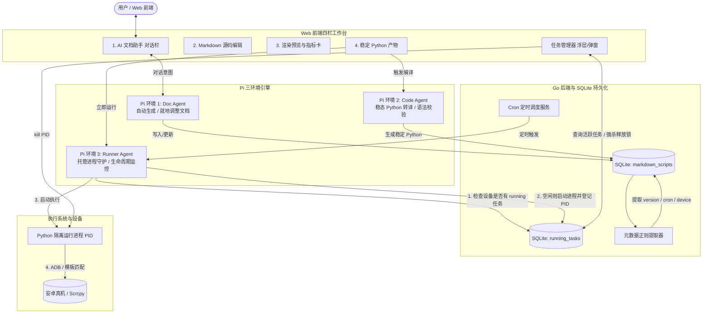
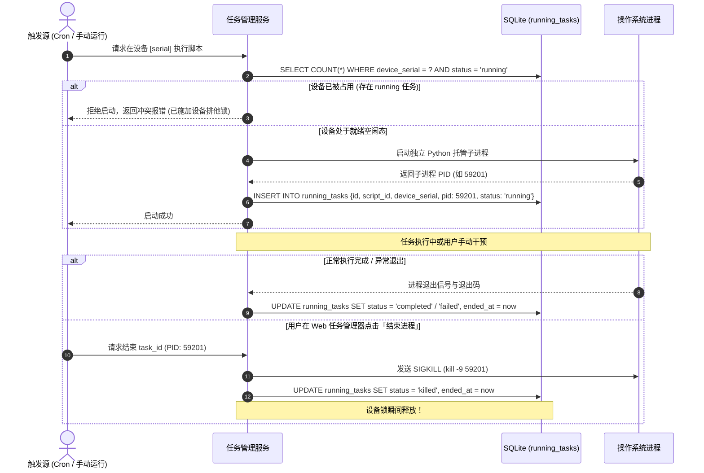

# v1.16.0-feature 设计文档：Markdown 脚本体系与任务管理器

## 1. 总体架构图



---

## 2. 数据模型设计 (SQLite)

### 2.1 脚本持久化表 (`markdown_scripts`)
```sql
CREATE TABLE IF NOT EXISTS markdown_scripts (
    id                  INTEGER PRIMARY KEY AUTOINCREMENT,
    name                TEXT NOT NULL,
    target_device       TEXT NOT NULL DEFAULT 'auto',   -- 目标设备 (auto 或特定 serial)
    content             TEXT NOT NULL DEFAULT '',       -- Markdown 完整源文件
    
    -- 正则提取字段缓存
    extracted_version   TEXT NOT NULL DEFAULT '',       -- 提取到的版本号或时间戳
    schedule_cron       TEXT NOT NULL DEFAULT '',       -- Cron 周期表达式
    is_enabled          INTEGER NOT NULL DEFAULT 1,     -- 调度启用开关
    timeout_sec         INTEGER NOT NULL DEFAULT 120,   -- 单次运行超时保护 (秒)
    
    -- 编译与缓存复用控制
    compiled_version    TEXT NOT NULL DEFAULT '',       -- 上次编译时对应的版本号
    compiled_python     TEXT NOT NULL DEFAULT '',       -- 生成的稳定 Python 脚本正文
    compiled_at         INTEGER NOT NULL DEFAULT 0,     -- 上次编译时间戳 (Unix ms)
    
    created_at          INTEGER NOT NULL,               -- 创建时间戳 (Unix ms)
    updated_at          INTEGER NOT NULL                -- 最后更新时间戳 (Unix ms)
);

CREATE INDEX IF NOT EXISTS idx_md_scripts_schedule ON markdown_scripts(is_enabled, schedule_cron);
```

### 2.2 任务管理器运行实例表 (`running_tasks`)
```sql
CREATE TABLE IF NOT EXISTS running_tasks (
    id              TEXT PRIMARY KEY,              -- 任务唯一标识 (如 task_run_1791680)
    script_id       INTEGER NOT NULL,              -- 关联的 markdown_scripts.id
    script_name     TEXT NOT NULL,                 -- 冗余脚本名称
    device_serial   TEXT NOT NULL,                 -- 目标设备序列号
    pid             INTEGER NOT NULL,              -- 操作系统进程 PID
    status          TEXT NOT NULL DEFAULT 'running',-- 'running', 'stopping', 'completed', 'failed', 'killed'
    exit_code       INTEGER DEFAULT 0,             -- 进程退出码
    error_msg       TEXT NOT NULL DEFAULT '',      -- 错误信息
    started_at      INTEGER NOT NULL,              -- 启动时间戳 (Unix ms)
    ended_at        INTEGER DEFAULT 0              -- 结束时间戳 (Unix ms)
);

-- 设备锁核心索引：极速查询某台设备当前是否有 running 状态的任务
CREATE INDEX IF NOT EXISTS idx_running_tasks_lock ON running_tasks(device_serial, status);
```

---

## 3. Markdown 正则规范与提取逻辑

Markdown 必须以标准 YAML Front-Matter 开头，正文为标准 Markdown：

```markdown
---
name: 微信自动签到任务
version: 1.2.0
schedule: "*/30 * * * *"
target_device: auto
timeout_sec: 180
enabled: true
---

# 业务流程
- 唤醒手机屏幕
- 启动应用包名 `com.tencent.mm`
- 点击消息导航：
  
```

### 提取正则表

| 配置项 | 正则模式 | 提取行为与兜底 |
| :--- | :--- | :--- |
| **版本号** | `(?mi)^version\s*:\s*["']?([a-zA-Z0-9._-]+)["']?` | 优先提取；提取不到时使用 `ts_YYYYMMDDHHmmss` 修改时间戳兜底。 |
| **定时周期** | `(?mi)^schedule\s*:\s*["']?([^"'\r\n]+)["']?` | 提取 5 位标准 Cron；未匹配则默认为空（仅手动运行）。 |
| **目标设备** | `(?mi)^target_device\s*:\s*["']?([^"'\r\n]+)["']?` | 默认为 `auto`。 |
| **超时时间** | `(?mi)^timeout_sec\s*:\s*(\d+)` | 默认 `120` 秒。 |
| **调度开关** | `(?mi)^enabled\s*:\s*(true\|false)` | 默认 `true`。 |
| **模板引用** | `!\[(.*?)\]\((template:\/\/([^?\s)]+)(?:\?threshold=([0-9.]+))?\))` | 提取：图片说明、模板唯一 ID、置信度阈值（默认 0.85）。 |

---

## 4. 任务管理器与进程锁时序



---

## 5. Pi 三环境详细规范

1. **Pi 环境 1：Doc Agent（文档助手）**
   - **职责**：自然语言对话输入，自动编写规范的 YAML 头部与 Markdown 步骤；根据用户修改要求就地重写文档；
   - **技能**：`template_search`（查询可用模板）、`cron_validator`（校验 Cron 语法）。
2. **Pi 环境 2：Code Agent（编译转译器）**
   - **职责**：将终稿 Markdown 转译为稳态 Python 脚本；严格将步骤转为 ADB 指令，将模板转为 `Matcher.wait_and_click`；
   - **技能**：`py_ast_check`（Python 语法静态检查）、`template_meta`（读取模板尺寸）。
3. **Pi 环境 3：Runner Agent（托管执行监督）**
   - **职责**：进程托管与心跳维持；将运行日志通过 WebSocket 实时推流到前端；超时自动回收；
   - **技能**：`process_kill`（按 PID 强杀进程）、`device_wake`（唤醒锁守护）。
