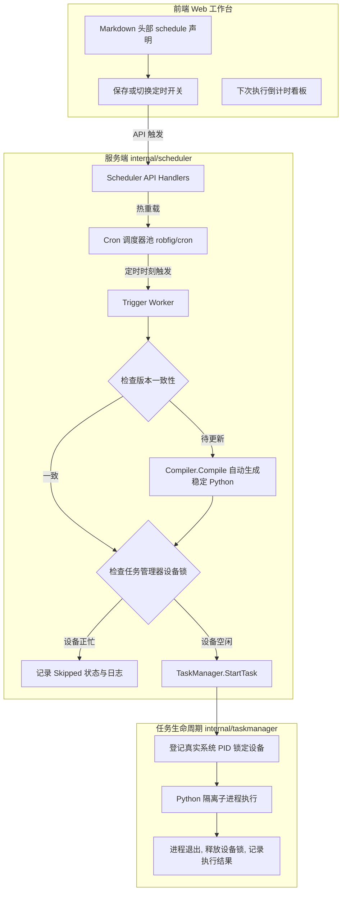
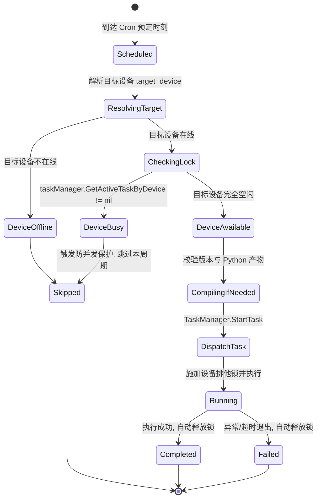

# v1.17.0-feature 技术设计：内嵌 Cron 调度器与排期执行系统

更新日期：2026-10-11。

---

## 1. 系统架构图



---

## 2. 调度执行状态机与防重叠设计

每次调度器到点被触发时，严格遵循以下确定性状态机：



---

## 3. 核心数据结构

### 3.1 调度项元数据 (ScheduleEntry)

```go
type ScheduleEntry struct {
    ScriptID     int64     `json:"script_id"`
    ScriptName   string    `json:"script_name"`
    CronExpr     string    `json:"cron_expr"`
    TargetDevice string    `json:"target_device"`
    IsEnabled    bool      `json:"is_enabled"`
    NextRunAt    int64     `json:"next_run_at"`
    LastRunAt    int64     `json:"last_run_at"`
    LastStatus   string    `json:"last_status"` // "success", "failed", "skipped"
}
```

### 3.2 数据库支持 (markdown_scripts 扩展字段)

```sql
ALTER TABLE markdown_scripts ADD COLUMN last_run_at INTEGER NOT NULL DEFAULT 0;
ALTER TABLE markdown_scripts ADD COLUMN last_run_status TEXT NOT NULL DEFAULT '';
```

---

## 4. API 规范

### 4.1 获取当前所有调度计划
- **方法与路径**：`GET /api/scheduler/entries`
- **返回**：
  ```json
  {
    "entries": [
      {
        "script_id": 1,
        "script_name": "真机签到",
        "cron_expr": "*/30 * * * *",
        "target_device": "10.0.0.30:5555",
        "is_enabled": true,
        "next_run_at": 1791718800000,
        "last_run_at": 1791717000000,
        "last_status": "success"
      }
    ]
  }
  ```

### 4.2 一键启停单个脚本的定时调度
- **方法与路径**：`POST /api/md-scripts/{id}/toggle-schedule`
- **请求体**：
  ```json
  {
    "enabled": false
  }
  ```
- **返回**：
  ```json
  {
    "ok": true,
    "script_id": 1,
    "is_enabled": 0
  }
  ```
