# v1.18.0-feature 设计：脚本管理布局与多设备配置

日期：2026-10-11。状态：正式实现与隔离环境验收完成，真实手机动作未验收。

## 背景与目标

v1.16 引入 Markdown 脚本工作台，v1.17 增加定时调度。现有页面把文档助手、源码、预览和 Python 产物分栏展示，任务选择与新建位于顶部。目标设备由 Markdown 中的单值 `target_device` 提取，模板库只加载公共模板。

本版聚焦工作台布局、任务信息展示、目标设备多选和模板范围联动。用户明确要求设备配置独立于 Markdown，底部标签切换优先于口述中先提到的顶部标签。

## 页面布局

桌面布局建议如下，左侧任务栏的位置属于设计选择，后续通过原型验证：

```text
┌──────────────┬────────────────────────────┬─────────────────┐
│ 任务  新建    │ 当前任务标题与操作           │ 文档助手         │
│              │                            │                 │
│ 标题         │ 单一内容区                 │ 对话             │
│ 目标设备列表  │ Markdown 源码 / 渲染预览     │                 │
│ 配置与状态    │ / Python 产物              │                 │
│              │                            │                 │
│ 其他任务      ├────────────────────────────┤ 输入             │
│              │ 源码    预览    Python      │                 │
└──────────────┴────────────────────────────┴─────────────────┘
```

- 任务栏：承载新建入口和任务列表，替代顶部的任务下拉选择。每条任务直接显示标题和所选设备；多设备列表可滚动查看，不能只显示数量而看不到设备。
- 配置摘要：展示现有的文档版本、定时规则、超时时间、启用状态；下一次执行、最近执行结果、编译版本与状态、各设备运行状态由对应数据展示，不将未取得的状态猜成成功。
- 统一内容区：默认进入源码；底部固定「源码 / 预览 / Python」标签，同一时刻只展示一种内容。切换不清空编辑内容、不重复编译、不主动运行任务。
- 文档助手：固定在内容区右侧，对话与输入保持可用。切换标签不清空会话；切换任务时避免上一任务的迟到回复覆盖当前任务。
- 保存、模板库、编译、运行等现有动作放在当前任务操作区；运行任务管理器保留独立入口，其已有逐台终止能力继续可达。
- 小屏布局通过原型验证任务栏收纳和助手展开方式，仍保留底部内容标签，不强行压缩成三个窄栏。
- 同一信息有一个主要展示位置，移走原重复指标卡；不新增版本徽章、实现说明、调试文案或不必要提示。

## 新建与配置

新建入口先收集任务标题和目标设备。目标设备从现有设备列表选择，支持勾选多台，显示设备名称、序列号和连接状态。保存前至少选中一台明确设备，不以 `auto` 或首台设备替代未填写配置。

新建后可在任务配置中修改设备列表。保存失败保留输入；切换任务或新建遇到未保存内容时，按任务保留内存草稿，避免误覆盖；本版不新增自动丢弃操作。

设备列表是任务配置的唯一来源。新建示例、文档助手提示词和生成内容均不再写入目标设备字段。Markdown 的人工修改及助手回复不改变已选设备。其他已有 Markdown 配置项暂保留原职责，本次仅将目标设备移出文档；定时、超时和启用信息在任务栏展示，不另建第二套配置来源。

## 数据与接口方案

以下为已实现契约：

| 层级 | 本版调整 |
| --- | --- |
| 新建、更新与脚本详情 | 明确使用 `target_devices: string[]`，元素为设备 `serial`，不能为空或重复 |
| SQLite | 使用非空 JSON 数组存储 `target_devices`；迁移待配置记录为 `[]`，列表接口返回全部设备。每次触发另有明确批次及设备运行记录关联，避免按时间戳猜测批次 |
| Markdown 解析 | 已移除设备字段解析；旧列仅作迁移档案，旧文档由用户明确点击移除 |
| 编译与执行 | 产物通过明确的运行参数接收设备序列号，不把某台设备固定为多设备共用产物的默认值 |
| 调度与运行响应 | 返回明确的目标设备列表及逐设备状态；手动运行不能只返回单个 `task` |

前端按约定字段读取，不使用 `target_devices || target_device` 等兼容猜测，不通过别名、模板名或相似字段推断序列号。缺失数据应修正数据源或明确迁移。设备列表更新触发排期热重载，页面与执行使用同一份已保存配置。

## 模板范围与引用

复用现有 `GET /api/templates?serial={serial}`。现有设备查询返回该设备与公共模板；多选时对所选设备逐个查询，按模板 `id` 合并，公共模板仅显示一次。模板归属使用已有 `serial` 字段，公共范围沿用现有 `global` 定义，不查询未选择设备的资产。

模板库显示模板名称、图片和归属，支持在公共与已选设备范围内筛选。同名不同 ID 模板不能合并或自动替换，插入 Markdown 继续引用准确的 `template://<id>`。

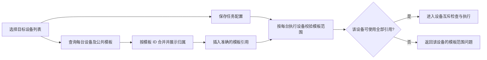

界面可展示所选设备模板的合集，但运行校验必须针对单台设备。修改设备选择后重新加载范围，忽略旧请求的迟到响应；已有引用不自动删除或映射为同名模板。加载失败保留当前文档并显示必要错误，不将请求失败当成空库。

## 多设备执行

一次手动或定时触发按已保存设备列表创建独立运行实例。离线、未知或占用设备记为跳过，模板不适用或启动失败记为失败，其他设备继续检查和启动。每台实例沿用互斥锁与超时保护；逐设备结果和原因写入运行历史。最近结果按明确批次汇总，启动、完成、部分异常、失败、跳过和终止分别展示。

编译产物要求调用方传入设备序列号。任务管理器启动 Python 时传入单台设备参数，测试通过进程写出的参数文件核对两台设备各自的参数；这证明进程参数和管理能力，不证明真实手机动作。

## 非目标

本版不扩展脚本语言、不新增调度引擎、不恢复已移除的内嵌模板匹配、不改造独立匹配工程，也不调整网络或生产服务。创建版本记录不包含正式发版和部署。

## 风险与迁移计划

1. 旧单设备 `target_device`、Markdown 同名字段和 `auto` 均存在。用户已确认迁移策略。迁移后不增加运行期双字段兜底。
2. 迁移建议：明确且与文档不冲突的序列号转为单元素列表；`auto`、空值、重复文档字段或字段冲突列为待配置。迁移不要求设备当前在线，启动时对未知或离线设备分别跳过。这些记录暂停自动触发；选择设备并保存后仍需手动启用。
3. 实际升级前应备份 SQLite 与脚本文档。本轮只在临时数据库验证事务迁移与重开幂等，未升级用户数据库。迁移不改写旧 Markdown；保存时由用户明确点击或勾选移除旧设备配置。
4. 设备专属模板在多台设备间不保证通用，不允许自动用同名模板替换；阻止不适用的单台设备，其他设备继续执行。
5. 改选设备时正在运行的实例应保留启动时配置快照，新配置作用于下一次执行，避免页面改选影响既有进程。
6. 任务多选只扩大目标范围，不能扩大模板权限或绕过现有设备锁；关键操作与失败记录脚本 ID、设备序列号和结果。

## 回滚计划

页面布局可通过回退本版前端代码恢复。数据库完成多设备迁移后不能简单回滚为单值：先停用受影响调度并备份新增数据，再恢复迁移前数据库与对应代码；不得自动截取设备列表第一项。实际回滚依次为：停止服务及受影响调度，备份当前完整 SQLite；恢复迁移前数据库与配套后端、前端代码；核对旧设备、文档和启用状态后再启动。新增多设备数据另行保留，不能自动降为第一台设备。本轮未对用户数据库演练恢复。

## 已确认决策与当前边界

- 明确单设备迁移；auto、空值、重复文档字段与冲突配置待配置且停用。
- 模板不适用、设备离线或占用仅阻止对应设备，不猜测替换模板。
- 桌面三栏与小屏收纳均已在原型和正式页面验证。
- 数据库设备数组与执行批次独立，当前任务设备变更不改变已启动实例。
- 手机动作、识图和匹配仍沿用已有编译器占位行为。独立模板匹配工程、真实 ADB 操作、生产数据升级与正式发布不在本次验收中。

## 交互原型与验证证据

- 方案：`prototypes/cases/markdown-script-v2/`。该目录原有元信息，缺少页面，本轮补齐 `Prototype.vue`、`data.ts` 和 `useWorkbench.ts`，保留 v1。
- 预览：[公网原型](https://imposed-stop-entrance-cuisine.trycloudflare.com/#markdown-script-v2)；本地为 `http://127.0.0.1:5174/#markdown-script-v2`。
- 运行：`pnpm --dir frontend proto:preview`。最初开发预览通过公网加载大量模块时请求取消，已改用通过构建检查的产物，保留同一隧道网址；不需要 HMR WebSocket。
- 检查：`pnpm --dir frontend proto:check` 和 `proto:build` 通过，产物仅写入 `prototypes/dist/`，未写入正式 `web/dist/`。
- 浏览器：公网 HTML、JavaScript、CSS 和动态页面模块均为 200；最终网络采集中没有失败请求，没有业务 API、远端图片或访问者本机地址请求；最终控制台无错误或警告。
- 交互：新建标题与非空设备校验、设备多选、任务与模板搜索空结果、模板归属筛选、公共模板去重、未选设备模板隔离、改选设备范围更新、助手建议应用、跨任务草稿保留、底部三标签及键盘切换均已操作验证。
- 原型模拟执行：演示两台设备独立运行状态、单台终止及模板不适用。该阶段只有方案演示；正式进程与 API 验证见下文。
- 视口：桌面 1440×900、1280×720；小屏 390×844。1280×720 底部标签下沿为 677，小屏为 788，均在可视范围；页面无横向溢出。浅色与深色主题已验证。
- 边界：设备、模板、会话和运行数据均在内存模拟，刷新重置。助手固定演示等待/重试建议，Python 为演示产物，不包含实际动作。预览仅覆盖示例中的标题、段落、步骤及模板引用，完整 Markdown 渲染、数据库迁移和真实多设备执行未验证。
- 组件：使用现有 Button、Input、Checkbox、Tabs、Dialog、Select、Badge 和主题；组件库无独立多行输入组件，源码区沿用正式页面已有的原生文本编辑方式，未安装新依赖。
- 运行记录：`prototypes/artifacts/remote-preview/20261011-212623/` 内保存日志、`session.json`、`browser-network.json`、`verification.md` 与 `stop.sh`。预览 PID 为 15716，隧道 PID 为 14211，均由本轮创建；交付前已延迟复查进程身份、本地页面和公网响应。运行 `bash prototypes/artifacts/remote-preview/20261011-212623/stop.sh` 可停止本轮两个进程组；脚本核对进程身份后才停止。
- 原型阶段正式改动：仅给 `frontend/vite.prototype.config.ts` 的开发与构建预览增加本次具体域名白名单；没有修改正式页面、路由、业务接口、数据库或主题。

桌面预览，1440×900：

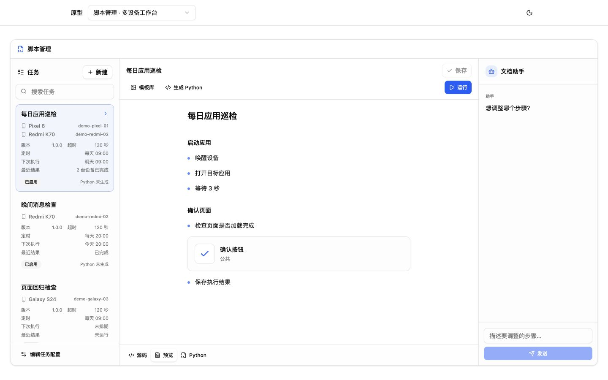

新建时多选设备，1440×900：

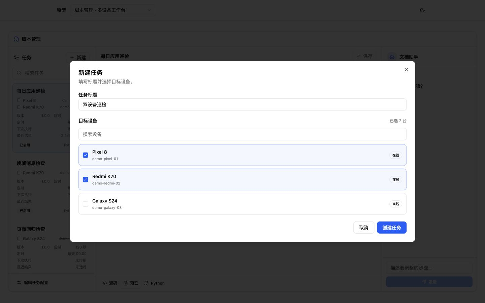

所选设备与公共模板，1440×900：

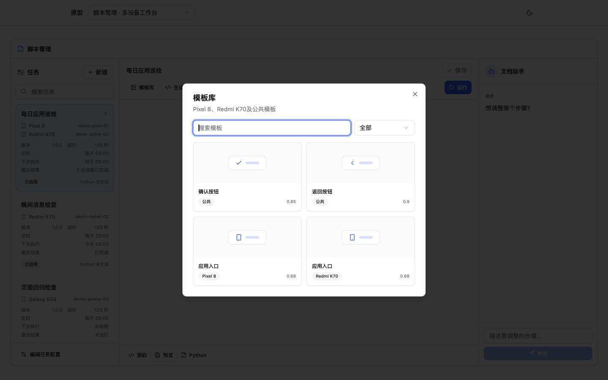

小屏预览与设备多选，390×844：

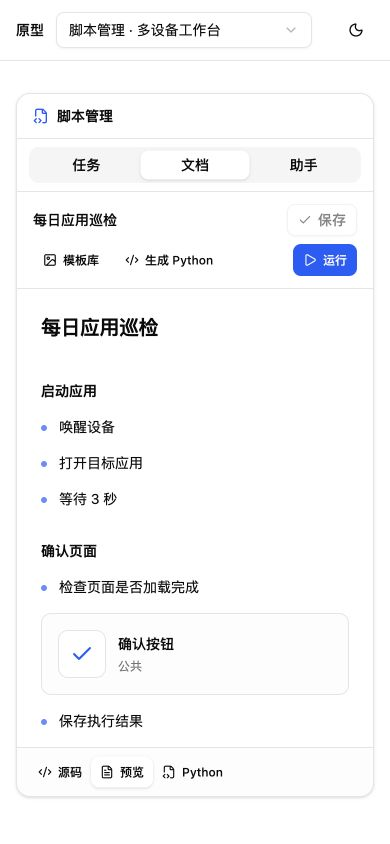

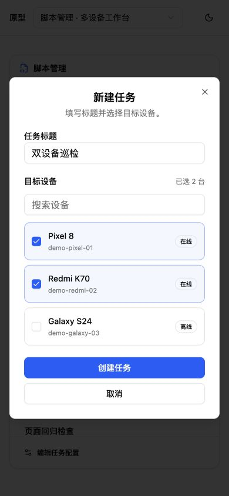

深色主题，1440×900：

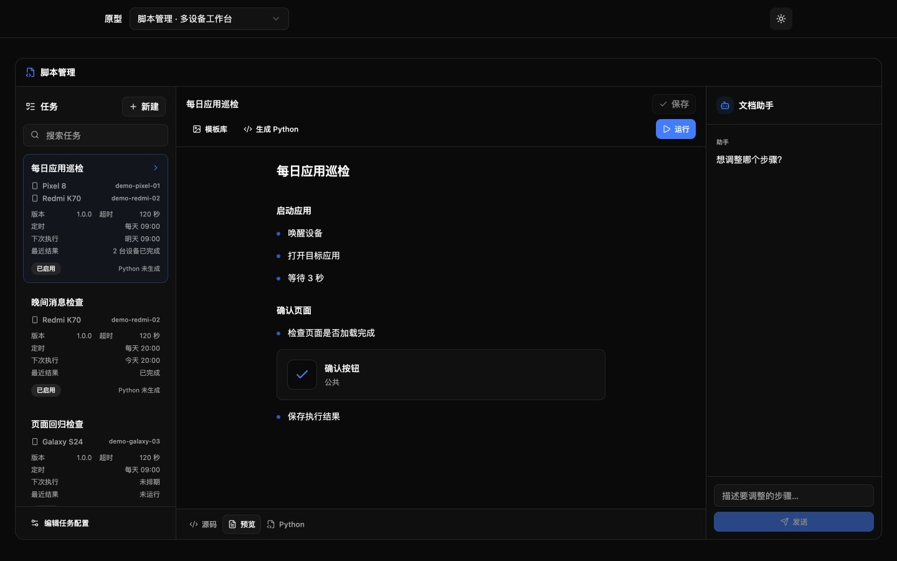


## 正式实现与验证证据

验证使用正式前端构建和真实脚本、模板、调度、任务 API。设备清单为测试数据，模型为受控延迟或失败响应，SQLite 与模板目录独立，Python 为本机真实进程。没有启动主项目服务、触碰用户数据库、连接真实手机或外部模型。

| 项目 | 已取得结果 |
| --- | --- |
| 布局与小屏 | 桌面 1440×900 / 1280×720 三栏，底部三标签；390×844 小屏可切换任务、文档、助手，无横向溢出，含运行状态时标签底部约 738 |
| 新建和设备配置 | 标题与非空设备校验；两设备保存、刷新、重新编辑仍勾选；模拟保存失败后输入不丢失 |
| 草稿与助手 | 切换任务保留草稿；另一任务无迟到建议；文档修改后旧建议按钮禁用；重新生成后显式应用，不改变设备 |
| 模板与预览 | Pixel 与 Redmi 专属模板各一份、公共模板两份，总计四份；仅选 Pixel 为三份；公共筛选两份；搜索空态正确；表格与图片正常，script 和 onerror 被清理 |
| 设备执行 | 两份真实 Python 进程分别接收设备参数；单台终止不影响另一台；离线、未知、占用和专属模板不适用均有逐设备结果；超时终止子进程组 |
| 调度与连续触发 | 定时入口读取同一已保存设备列表；热重载设备后下一次触发使用新设备，原实例不变；相同任务时间戳不混淆批次 |
| 迁移 | 明确、auto、空值、冲突、文档缺失字段和重复字段用例；待配置不能启用；旧文档原样保留，旧 Python 清除；重开幂等 |
| 编译 | 文档或标题变化清除旧产物；编译不改变文档修改时间；Python 无默认设备，引号、反斜杠和花括号能执行 |
| 检查 | frontend build、go test ./...、go vet ./...、db/mdscript/scheduler/taskmanager 的 race 检查通过 |

桌面正式页面（测试设备数据）：

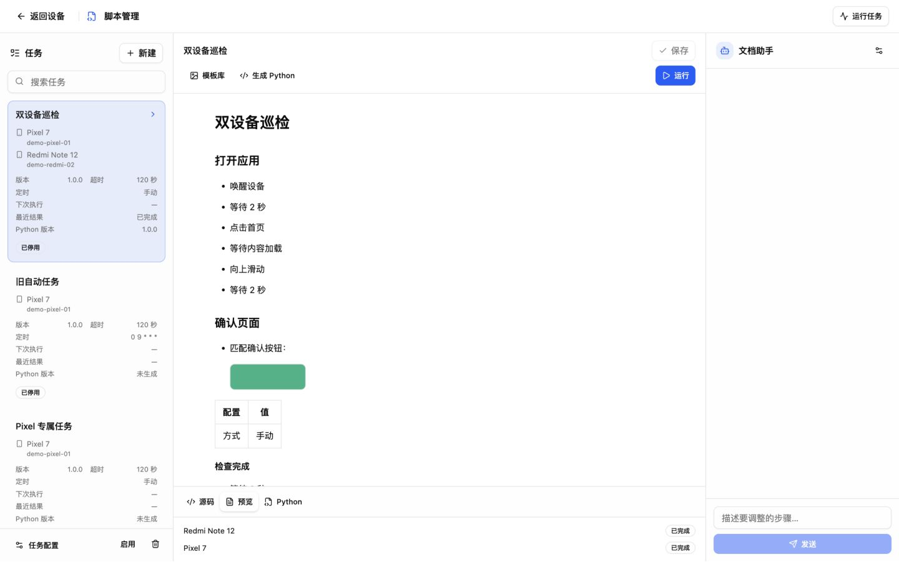

任务设备配置：

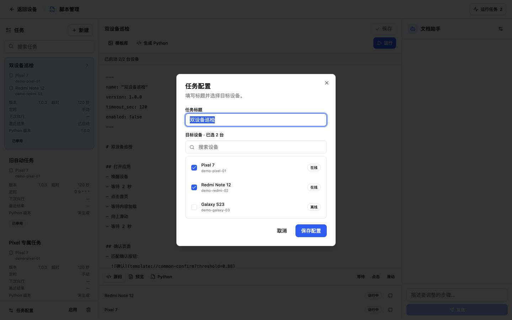

模板合集：

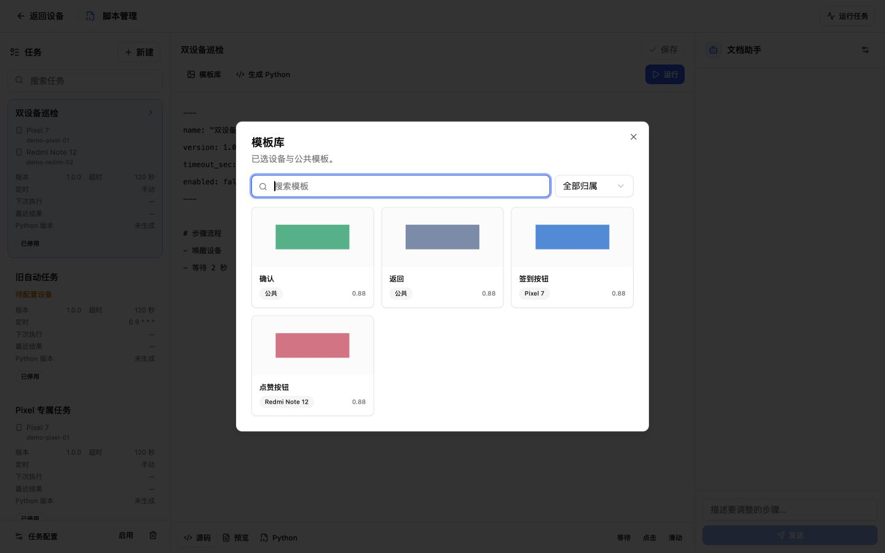

小屏正式页面与新建：

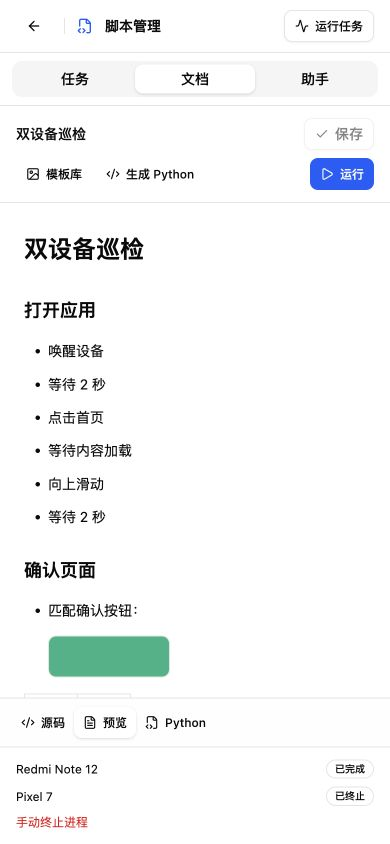

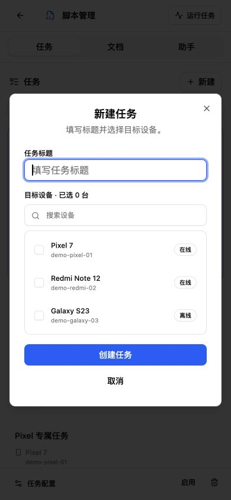

独立终止证据：

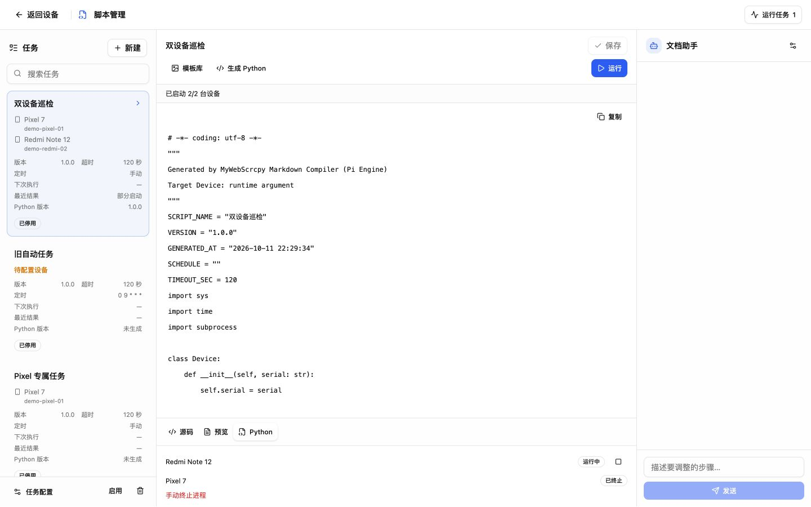

隔离验证的运行日志、临时数据库和参数检查放在已忽略的 `prototypes/artifacts/v1.18-live-check/`。验证服务完成后停止；正式服务、正式 VERSION、部署与标签均未改变。
