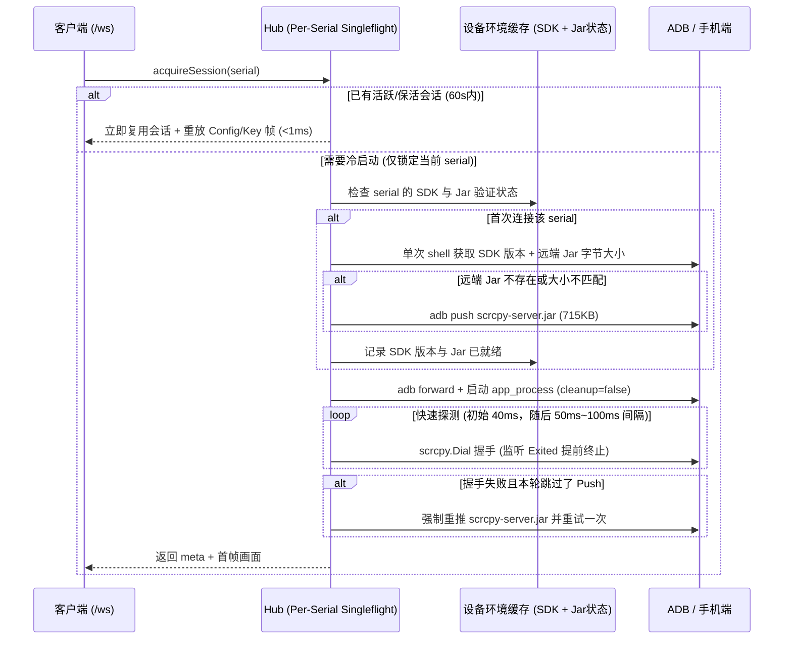

# v1.19.0-feature 设计：投屏启动加速与会话并发优化

日期：2026-10-11。状态：正式实现与真机性能验证完成。

## 背景

在单机投屏（`/ws?serial=`）、多机大屏及 Vision 订阅场景中，当目标设备尚无活跃会话（或退出投屏满 10 秒后会话被回收）时，`Hub.acquireSession` 会调用 `Hub.startSession` 执行冷启动。实测冷启动耗时普遍在 `2.1s ~ 2.7s`（无线 ADB 网络波动时更长），主要瓶颈集中在：

1. **硬编码启动死等**：`server.Start()` 后固定 `time.Sleep(1500 * time.Millisecond)`，未能在 `scrcpy-server` 监听就绪的第一时间建连；若首次 `Dial` 未就绪，每次重试又固定等待 `500ms`。
2. **重复推送 Jar、冗余校验与 `CleanUp` 自删机制**：
   - 每次冷启动均无条件通过 `adb push` 传输 715KB（732,226 字节）的 `scrcpy-server.jar`，并在推送成功后额外执行一次 `adb shell ls -la` 子进程校验。
   - 更关键的是，`scrcpy-server 4.0` 默认开启 `cleanup=true`，启动时会在手机端额外派生 `com.genymobile.scrcpy.CleanUp` 进程把 `/data/local/tmp/scrcpy-server.jar` 删除，导致每次会话结束后手机端 Jar 包必定丢失。
3. **重复查询设备属性**：每次冷启动均执行 `adb shell getprop ro.build.version.sdk`，未按设备缓存。
4. **全局互斥锁跨设备阻塞**：`acquireSession` 全程持有 `Hub.sessionMu` 全局锁执行 `startSession`，某台设备冷启动或超时会导致其余所有设备的投屏建连排队。
5. **空闲回收过快**：最后一个订阅者断开仅 10 秒即终止手机端 `scrcpy-server`，用户在页面间短暂切换也会频繁触发冷启动。

## 目标

1. 传入 `cleanup=false` 保留手机端 `scrcpy-server.jar`，结合单次 `adb shell` 探测与内存缓存，消除服务运行期间及跨服务重启时的冗余 `adb push` 与 `adb shell` 往返，同时具备手机端 Jar 缺失自动重推的自愈能力。
2. 移除 `1500ms` 硬编码等待，改为高频快速探测握手，将冷启动建连延迟压缩至设备实际就绪耗时。
3. 将会话建连锁粒度从全局 `Hub` 细化到单设备 `serial`（Per-Serial Singleflight），不同设备并发启动互不阻塞。
4. 将空闲会话保活时间从 10 秒延长至 60 秒，提升页面切换时的热复用命中率。
5. 通过真机实测与自动化基准测试输出优化前后的量化对比数据。

## 非目标

1. 不改变 WebSocket 媒体帧与控制帧二进制协议。
2. 不修改前端播放器解码逻辑或界面文案。
3. 不删除已导出的 `scrcpy.Server.Push` 等既有方法签名。

## 关键决策

1. **禁用 `CleanUp` 自删 + 单次探测 + 内存缓存 + 失败自愈重推**：
   - 在 `Server.Start()` 参数中增加 `cleanup=false`，阻止 `scrcpy-server` 启动 `CleanUp` 子进程删除 `/data/local/tmp/scrcpy-server.jar`。
   - 在 `Hub` 中按 `serial` 缓存 `deviceEnv`（包含 `sdk int` 与 `jarReady bool`）。
   - 首次连接某台设备时，合并执行一次 `adb -s <serial> shell "getprop ro.build.version.sdk; stat -c %s /data/local/tmp/scrcpy-server.jar 2>/dev/null || true"`，一次往返同时拿到 SDK 版本与手机端现有 Jar 大小；若大小与当前内嵌 Jar（`os.Stat(h.jarPath).Size()`）一致，则免去 715KB 的 `adb push`。
   - 后续连接该设备直接命中内存缓存，跳过 `getprop`、`stat` 和 `push`。
   - 若跳过 `push` 的会话在 `startSession` 阶段握手失败（例如手机重启清空了 `/data/local/tmp` 导致 `app_process` 退出码 `134`），自动清除该设备的 `jarReady` 标记，强制执行一次 `server.Push(h.jarPath)` 并重试建连。
2. **移除冗余 `ls -la` 校验与统一进程退出等待**：
   - `Server.Push` 在 `adb push` 返回成功后不再额外启动 `adb shell ls -la` 子进程。
   - `Server` 使用 `exited chan struct{}` 广播后台 `cmd.Wait()` 结果，消除多处调用 `cmd.Wait()` 的竞态，并支持 `startSession` 在 `app_process` 异常秒退时立即中断轮询。
3. **自适应快速探测握手**：
   - `server.Start()` 后初始等待由 `1500ms` 降至 `40ms`；前 30 次探测间隔 `50ms`，后续探测间隔 `100ms`，总超时窗口保持 8 秒。
4. **Per-Serial Singleflight 并发控制**：
   - 在 `Hub` 中引入 `inflight map[string]*inflightSession`。同一 `serial` 并发请求共享同一个正在启动的 `inflightSession` 并准确累加 `waiters` 引用计数；不同 `serial` 在释放 `h.sessionMu` 后各自并行执行 `startSession`。
5. **空闲保活时间调优**：
   - 空闲会话回收时间默认设为 `60 * time.Second`（结构体字段 `idleTTL` 可在测试中覆写）。

## 性能测试与真机对比证据

测试环境：无线 ADB 设备 `10.0.0.244:5555`（vivo V2072A，Android 13 / SDK 33，分辨率 `448x1024`，H.264 + AAC），测试入口为 `internal/ws/session_perf_test.go` 中的 `TestRealDeviceSessionStartupPerf`（统计从调用 `acquireSession` 到订阅通道完整收到 `FrameConfig` + `FrameKey` 首帧画面的端到端耗时）。

### 1. 单步 ADB 操作耗时拆解

| 阶段 | 优化前 | 优化后（首次免推） | 优化后（同进程二次冷启动） | 说明 |
| --- | --- | --- | --- | --- |
| 查询 SDK (`getprop`) | `175.9 ms` | 合并至单次探测 (`~50 ms`) | **`0 ms`**（内存缓存） | 消除重复 `getprop` 调用 |
| 推送 Jar (`adb push` 715KB) | `212.8 ms` | **`0 ms`**（大小匹配免推） | **`0 ms`**（内存缓存） | `cleanup=false` 保留手机端 Jar |
| 校验 Jar (`adb shell ls -la`) | `47.1 ms` | **`0 ms`**（已移除） | **`0 ms`**（已移除） | 移除多余子进程校验 |
| 建立转发 (`adb forward`) | `20.1 ms` | `20.1 ms` | `20.1 ms` | 保持不变 |
| 启动等待与 `Dial` 握手 | 固定 `1500 ms` + `500 ms` 步进 | `40 ms` + `50 ms` 快速探测 | `40 ms` + `50 ms` 快速探测 | 设备一就绪立即完成握手 |

### 2. 端到端首帧耗时对比（真机实测）

| 场景 | 优化前耗时 | 优化后耗时 | 缩短时间 | 提速比例 / 倍数 |
| --- | --- | --- | --- | --- |
| **首次冷启动（手机端已有匹配 Jar）** | `2,664 ms` | **`888 ms`** | `-1,776 ms` | **耗时降低 66.7%（快 3.00 倍）** |
| **首次冷启动（手机端无 Jar，需首次推送）** | `2,664 ms` | **`1,232 ms`** | `-1,432 ms` | **耗时降低 53.8%（快 2.16 倍）** |
| **同进程重复冷启动（命中内存缓存，最快）** | `2,081 ms` | **`534 ms`** | `-1,547 ms` | **耗时降低 74.3%（快 3.90 倍）** |
| **同进程重复冷启动（命中内存缓存，平均）** | `2,194 ms` | **`644 ms`** | `-1,550 ms` | **耗时降低 70.6%（快 3.41 倍）** |
| **空闲保活期内切回重连（10s → 60s）** | `>10s` 触发 `2.2s` 冷启动 | **`< 1 ms` (`100 µs`)** | `-2,193 ms` | **直接重放内存关键帧秒开** |
| **多设备并发启动（另一台慢设备卡住 300ms+）** | 被全局锁阻塞 `>300 ms` | **`< 1 ms`** | 不受慢设备影响 | **按 `serial` 独立单飞并行** |

## 风险与应对

1. **手机重启或临时目录清理导致 Jar 丢失**：通过“跳过 Push 时若建连失败自动强制重推一次”的自愈机制兜底（已在真机模拟删除 Jar 触发 `exit status 134` 验证自愈重推通过）。
2. **旧版 Android toybox/toolbox 的 `stat` 兼容性**：若 `stat -c %s` 输出无法解析为匹配的文件大小，自动退回执行 `server.Push`，不猜字段、不中断正常启动。
3. **并发取消与唤醒竞态**：`inflightSession` 完成后统一向所有等待者广播结果并为每个成功获取的调用方准确递增 `refs`。

## 迁移计划

纯后端内部机制优化，无数据库或配置文件变更，直接升级二进制即可生效。

## 回滚计划

回退 `internal/scrcpy/server.go`、`internal/ws/hub.go` 与 `internal/ws/registry.go` 改动即可恢复原有串行启动逻辑。

## 待确认问题

无。
