# v1.19.4-feature：脚本与任务执行记录

日期：2026-10-12。状态：已按确认方案实施；验证与实际边界见 verification.md。用户指定版本号 1.19.4，新增能力使用 feature 记录类型。创建记录不更新正式 VERSION，不创建发布标签。

## 背景与现状

用户希望运行脚本后可以查看日志、开启录制时查看视频，并查看按 Markdown 头部要求生成的 AI 任务报告。用户已确认任务开始自动录制、结束自动停止。

本设计基于当前工作区源码。工作区另有未提交的 AI/Pi、播放器和发布流程修改，保持原样，不作为本版交付。正式 VERSION 为 v1.19.2。

| 能力 | 已核实的现状 | 本版需要补齐 |
| --- | --- | --- |
| 批次与设备运行 | `script_dispatches`、`script_dispatch_tasks` 已有明确关联；运行列表按脚本返回最近 100 条设备实例 | 批次分页、详情、来源和启动时快照；公开 dispatch_id |
| 日志 | `taskmanager.StartTask` 没有设置 Stdout/Stderr；只有后端生命周期 log.Printf | 采集、持久化、增量查询、查看和下载；不能从服务日志反推脚本输出 |
| 录制 | `ws` 管理逐设备 H.264/MP4 录制；同设备最多一份活动录制，默认 7 天、10 GiB，全局可调 | 复用录制服务，为任务增加受控入口、所有权、准确关联与查看 |
| 头部 | 现有 parser 使用全文正则提取旧标量，没有嵌套 YAML 配置 | 新增仅头部的 recording/report 结构化解析与校验，保留旧路径 |
| AI | 有系统模型配置；工作区中的文档助手已向 Pi 流式会话调整 | 独立总结调用，复用模型配置，不绑定编辑会话和工具执行 |
| UI | 工作台已有任务列表、源码/预览/Python、助手和运行状态；当前播放器弹窗亦有工作区改动 | 增加执行记录入口，按批次及设备查看三种产物，保持编辑区职责 |

主要源码：`internal/mdscript/{parser,executor,handlers}.go`、`internal/taskmanager/{manager,handlers}.go`、`internal/db/script_runs.go`、`internal/ws/recording.go`、`internal/aiprovider/`、`frontend/src/components/scripts/`、`frontend/src/api/{mdScripts,recordings}.ts`。

## 目标与非目标

1. 用户从某个脚本进入执行记录，选择一次触发和一台设备，看到准确的运行结果、日志、录制与报告。
2. 日志实时可追读，运行结束及服务重启后可查看；无法保存或已过期时明确展示状态。
3. 自动录制按脚本显式开启，每台设备独立录制，任务结束后停止，只控制自己创建的录制。
4. 报告按头部开关和总结要求生成，持久保存，并提供可回查的日志证据。

首版不做视频 AI 分析、不从日志猜测截图、不开发新调度引擎、不改造脚本语言、不提供自动修复或自动重跑脚本。AI 报告只总结可用证据，不将退出码 0 自动认定为业务成功。历史缺失产物不补造。本轮不部署、连接真实设备或调用真实模型。

## 界面与交互

保留工作台的任务选择、文档三标签、助手和运行控制，增加“执行记录”动作；当前逐设备结果提供“查看执行”快捷入口。执行记录通过弹窗打开，工作台在背景保留文档、助手和布局；关闭弹窗回到原草稿、标签、助手会话和滚动位置，不保存或丢弃用户内容。文档标题旁提供头部配置说明，列出当前支持的参数、默认行为与可复制示例。

桌面左侧展示该脚本的执行批次（时间、手动/定时、汇总状态），详情顶部选择本批次设备，下面切换“日志 / 录制 / 报告”。多设备属于同一次触发，不把全部设备混成同一输出。历史显示启动时名称和设备快照；不使用当前脚本设备配置替代旧设备。

- 日志：搜索、stdout/stderr/system 来源筛选、跟随最新、下载。stderr 表示输出来源，不能无依据把所有 stderr 标为业务错误。每行有稳定 seq 和接收时间；暂停跟随后阅读位置不跳动。前端只保留有界窗口，向前加载历史，不一次渲染全部输出。搜索与来源筛选在服务端完成，游标不随筛选改为数组下标。
- 录制：就地播放器、时长、声音状态、下载。默认不自动播放；查看历史录制不连接实时设备，不启动 replay 会话或抢占手机会话。关闭、准备中、录制中、收尾中、失败、已过期各自展示。未开启录制时保留标签和简洁空态。
- 报告：默认展示持久 Markdown，标记 AI 总结、生成时间；提供下载与日志引用定位。区分关闭、排队、生成中、成功、失败。失败可重新生成；成功重新生成另存修订，不能先清除旧报告。运行中不提前生成终稿。
- 批次汇总可沿用 completed/partial/failed/killed/skipped，不能重复推导另一套结果。正在分发的批次与已完成分发须区分，避免第一台极快退出就生成全批次终态。
- 小屏先显示记录列表，选择后进入详情；返回按钮回到同一筛选位置。详情标签一行可达；日志长行换行或局部滚动，不让整页横向溢出。
- 加载、无记录、无匹配结果与请求失败分开处理；切换脚本/批次/设备时取消旧请求，迟到响应不得覆盖新选择。

原型展示执行记录内容及文档头部样例，不重建全部正式工作台。文档助手保留行为需正式实施后回归。

## Markdown 头部配置

建议契约如下；字段名仍处于设计确认阶段。目标设备继续由任务配置单独保存，不写回头部。

```yaml
---
version: 1.0.0
schedule: "0 9 * * *"
timeout_sec: 120
enabled: true
recording:
  enabled: true
  record_audio: false
report:
  enabled: true
  prompt: |
    总结每台设备的签到结果、失败原因和重试情况。
    结论引用日志行号；无法确认时说明证据不足。
---
```

| 新字段 | 类型与规则 | 未配置时 |
| --- | --- | --- |
| recording.enabled | 严格布尔，仅 true/false；开启自动录制 | false |
| recording.record_audio | 严格布尔，开启设备声音；不控制音频播放 | false |
| report.enabled | 严格布尔，结束后自动生成单台报告 | false |
| report.prompt | 字符串，支持 YAML 多行；建议上限 4000 字符 | 系统默认要求：结果、关键过程、异常、证据、建议 |

日志始终采集，无需增加头部开关。配置按保存文档解析，并在触发时形成不可变快照；运行中修改文档只作用于下次执行。报告模型和凭据来自系统配置，头部不保存 API key、base_url 或模型清单。

新增扩展读取器仅从文件开始的 `---` 头部读取这两个固定顶层块；正文和代码块里的示例不生效。不支持别名字段、跨层级查找、字符串布尔或错误字段兜底。新块出现时对类型、重复键、未知嵌套键和缺失闭合标记给出字段位置错误，保存/编译/执行同一份校验，定时触发也不能绕过。

旧标量 `version/schedule/timeout_sec/enabled` 提取保持现有逻辑，不在本版自动替换；无新块的旧文档维持原行为。新块解析建议使用成熟 YAML 库，不扩展正则模拟嵌套、多行语法。候选为官方维护的 [go.yaml.in/yaml/v4](https://github.com/yaml/go-yaml)，实施时锁定版本并配置严格布尔、重复键与大小/深度限制；新块限制别名/合并键，避免跨块推断。旧解析器替换或统一迁移如需进行，先征求用户确认。

## 执行与产物生命周期

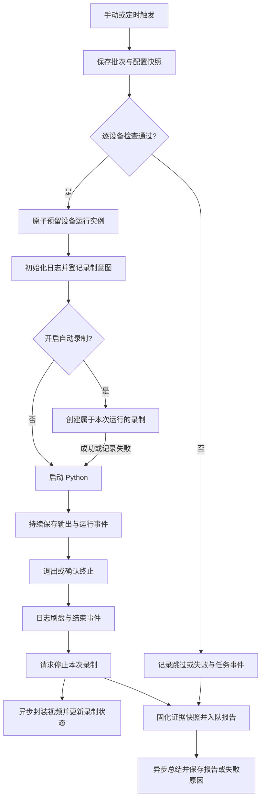

图中失败的录制默认不阻断 Python；未开录制和已跳过的实例同样能产生日志事件和报告。报告执行不持有设备锁，录制收尾不阻塞其他设备。

报告不等待视频封装完成。日志刷盘结束并发出所属录制的停止请求后，形成文本证据快照即可入队；此时录制仍收尾，报告只记录“收尾中”，不声称视频已成功。录制后来成功或失败由详情页独立更新，不静默改写已生成的报告。启动阶段的录制超时须使该启动请求失效；迟到创建若已发生，只按 owner_task_id 清理自己创建的录制，不让它变成下一次执行的录制。

### 批次和身份

复用现有 dispatch_id 与 task_id，分发前保存文档 hash、版本、编译产物 hash、标题、目标 serial 列表、触发来源和扩展配置。进程启动失败、预检跳过和编译失败也有记录。批次增加 `dispatching/finished` 分发标识；编译失败时批次保存 error_msg 与终态，详情可显示无设备实例的失败原因。

现有执行顺序是先启动 Python 后登记数据库、再 AttachDispatchTask。本版前置录制需要先以事务预留实例和设备锁、关联批次，再开始录制和启动进程，以免极快进程退出或并发触发产生无归属产物。这是必要的新自动录制编排建议；**涉及调整旧 StartTask/KillTask 的顺序须在实施前确认**，保留现有方法入口和设备互斥语义，不擅删旧方法或接口。进程未启动的预留失败必须收尾并释放。

### 日志

在启动前绑定 stdout/stderr 的并发安全 writer；托管 Python 保留 UTF-8 设置并增加无缓冲输出。不依赖默认 Scanner 的单行上限，按有界片段处理长行和无换行输出；序号代表采集顺序，不声称能证明两个输出流原始因果顺序。

每行保存 `task_id, seq, at_ms, stream, message, continued`，stream 只取 stdout/stderr/system。系统事件记录预检、启动、终止、超时和产物异常。时间为服务端接收时间。磁盘采用逐实例 JSONL 和简单稀疏索引，SQLite 保存元数据，不把高频大文本全部写入业务表；服务器内部拼接路径，浏览器不传任意路径。

建议初值：单实例 20 MiB、总日志 1 GiB、保存 7 天，单条片段最大 16 KiB，AI 最多读取 64 KiB。达到单实例上限则保留已写内容并标记截断，继续排空进程输出以避免阻塞。初始化日志存储失败时该设备启动失败；运行中写盘失败则记录独立 degraded 状态并告警，不假称完整保存，不自动杀业务进程。日志过期仍保留运行事实和产物状态。

增量读取返回 items、next_cursor、has_more、complete、truncated、availability；建议每页最大 500 条，运行中每秒轮询一次，可复用现有页面轮询风格，不必引入第二套 WS。初次打开加载尾部，向前分页；after/before 游标方向互斥。退出后停止轮询。下载按持久文件流式返回。

### 自动录制

复用已有录制服务，通过内部接口暴露 start/stop/get，而非后端循环调用自身 HTTP。新增 owner_task_id 持久保存于录制元数据，任务侧保存 recording_id，创建返回前必须固化归属，避免“创建成功但未保存关联”后误录或孤儿录制。

录制意图在设备检查通过后、Python 启动前执行。准备时间建议不超过 5 秒，任务 timeout 从 Python 启动计算。受现有 1 分钟至 8 小时录制上限约束：max_duration 取 timeout+收尾余量 30 秒并限制在该范围；长任务最多录 8 小时并显式标记覆盖不足。正常结束、失败、超时、手动终止和启动失败都停止所属录制。录制停止后异步封装，状态为 stopping 时禁止播放。

同设备已有任意活动录制（包括上次任务尚在收尾）则本次 recording=failed，原因明确，任务继续运行，不采用“最新录制”或自动停止冲突录制。音频不可用时不默默降级为无声音，显示录制失败。用户从录制页提前停止时保留实际结束时间，覆盖范围不足不自动续录。

停止必须校验 recording_id + serial + owner_task_id，即使设备锁已释放也不能停止下一次任务的录制。服务重启后按持久归属回收自动录制与残留实例；不依赖 PID 重用继续控制旧进程，不把 .partial 文件标为完整视频。原有手动录制和实时 replay 行为保持。

播放复用 MP4 文件服务，使用浏览器原生 video controls，按明确 recording_id 同源读取，支持 seek 需要的 Range 响应；下载与播放可共用服务层但分别设置 Content-Disposition。视频 UI 不导入初始化实时会话的播放器。依据：[MDN video](https://developer.mozilla.org/en-US/docs/Web/HTML/Reference/Elements/video)、[HTTP Range](https://developer.mozilla.org/en-US/docs/Web/HTTP/Guides/Range_requests)。

### AI 报告

首版每个设备实例一份报告，不额外生成批次总报告，避免重复调用与重复内容。头部 enabled=true 的结束实例（包括 failed/killed/skipped）都会入队。摘要包含启动时脚本快照、设备 serial、事实状态/退出码/时间、有限日志及录制状态；只发送元数据，不发送视频、截图、无关工作目录或文档助手会话。

沿用系统模型配置，新增无工具的总结服务与后台持久队列。当前 Pi 文档助手允许读取隔离工作区，本报告不依赖其会话，也不调用它的编辑流程；建议用现有 OpenAI-compatible 模型传输契约实现独立单次总结，前提是复用鉴权、超时和错误分类代码，不复制整个客户端。系统模型不可用时报告失败并说明原因，不猜默认供应商或自动改用其他模型。

队列建议并发 2、单次超时 60 秒，每 task_id/revision 原子入队一次。无自动无限重试；用户点重新生成后新增 revision、记录本次 provider/model（无凭据），仍使用冻结的任务证据。重启时 running 生成任务记为失败“生成中断”，允许显式重试；pending 队列恢复执行。设备锁早于模型调用释放。成功报告在重新生成失败时仍可阅读。

模型输出约定 `markdown` 与 `citations: [{seq}]`；服务端校验 seq 属于本实例现存日志，非法引用不得生成可点击定位，保留证据不足标记。UI 将引用列表变成按钮，跳到该运行的准确日志行。报告内容按现有 marked + DOMPurify 安全渲染，并限制链接协议、远程图片和未授权资源加载。日志内容是证据，不允许其中的文字指令触发工具或扩大读取范围。

长日志采用确定性选取（启动/结束事件、stderr、头尾区段），报告保存 selection、original_bytes、included_bytes、truncated 和 input_hash。截断、录制失败、旧记录无快照均需告知证据范围。报告默认中文，prompt 控制关注点；不提供自动执行建议。

## 数据与接口草案

这是拟实施契约，现有接口尚未返回新字段。

| 对象 | 新增或扩展的明确数据 |
| --- | --- |
| script_dispatches | 触发来源、分发终态、结束时间、错误信息、不可变脚本/编译/设备/扩展配置快照；保留既有 id |
| task_artifacts（按 task_id） | log 可用性/采集状态/截断/字节数/到期时间、recording_id 与 unavailable/disabled/not_started/preparing/recording/stopping/completed/failed/expired 状态、错误与覆盖区间 |
| task_reports | task_id + revision、waiting/pending/running/completed/failed/disabled/unavailable、markdown、citations、输入 hash 与证据范围、生成模型/时间/错误；唯一索引避免重复入队 |
| 日志磁盘 | task_id 对应的有界 JSONL/索引；不会通过 serial 或目录扫描猜测归属 |

旧记录使用明确的“未采集”标识（日志 unavailable、配置快照 legacy_unavailable），禁止回填虚构的录制或报告。disabled 与 unavailable 不混为同一事实。

| 接口建议 | 返回与约束 |
| --- | --- |
| GET /api/md-scripts/{id}/dispatches?cursor=&limit= | 分页批次摘要与 next_cursor；limit 默认 20，上限 100 |
| GET /api/md-scripts/{id}/dispatches/{dispatch_id} | 快照、汇总状态、逐设备运行与明确 task_id；验证脚本/批次关联 |
| GET /api/tasks/{task_id} | 运行事实与产物状态；新增入口，保留 active/kill |
| GET /api/tasks/{task_id}/logs?after=&before=&limit=&stream=&q= | 有方向的序号游标、完整性标记与日志项；不回传任意文件路径 |
| GET /api/tasks/{task_id}/logs/download | 流式下载本实例日志；无产物返回明确原因 |
| GET /api/tasks/{task_id}/recording | 由已存关联解析准确录制；不选择 latestCompleted |
| GET /api/tasks/{task_id}/recording/media | 同源 MP4，支持 Range；不完整 409、文件已清理 410 |
| GET /api/tasks/{task_id}/report | 当前报告与生成状态，历史修订可用 revision 参数 |
| POST /api/tasks/{task_id}/report/retry | 终态且头部开启才允许；原子创建一次修订，生成中返回现有请求，禁止双击重复费用 |
| GET /api/tasks/{task_id}/report/download | 下载指定修订 Markdown，仅成功报告可用 |

运行响应建议增加 dispatch_id，同时保留现有 results 数组与 task 结构；旧 /runs 接口保留，新页面明确使用新契约。字段缺失由数据源或映射修正，不使用 `id || run_id` 等兜底。所有产物接口沿用项目现有访问控制、验证实体关联，不扩大任意文件读取能力。

建议模块按职责拆为日志存储、录制协调、报告服务/队列、批次查询与前端详情组件，接入现有 Executor/Manager，不堆入 manager.go 或 ScriptEditor。新增文件与方法保持项目规模约束。

接口精确字段、状态矩阵、队列和验收条件见 [contract.md](contract.md)。正式接口已更新到 web/openapi.json。

## 风险、迁移与回滚

1. **进程结束顺序**：现有 KillTask 立即释放锁；需要保证实际进程退出、日志刷盘和所属录制停止不被快速重跑打断。前置预留方案涉及旧顺序，实施前确认，先做并发、超时、极快退出及单台终止用例。
2. **容量与隐私**：日志默认保存，可能含脚本输出的私有业务资料。凭据/请求头不由系统写入；只在头部显式启用报告时向系统配置的模型发送有限文本。保存周期、容量和截断标志落地验收，不任意延长现有视频保留期。
3. **编译缺口**：当前编译器仍有动作占位行为，退出码和示例日志不能证明真实手机业务已完成；本版报告须维持事实边界，不能扩大为脚本动作实现。
4. **升级**：先备份 SQLite、脚本文档、录制目录；仅增量表/列，旧内容不改写，新增开关默认关闭。保留历史 batch/task 关联，历史缺失快照显示未采集。只在隔离数据库演练，不自动修改用户数据库。
5. **崩溃**：新表保存产物意图与 owner，重开按明确 ID 恢复；已结束报告队列可恢复。不能按时间、文件名相似性或设备“最后一段视频”补关联。
6. **删除策略**：本版不新增自动删除运行记录或删除报告动作。录制仍按原保留规则清理；日志新增明确到期清理，状态保留。现有脚本删除相关历史处理先核对并征求确认，不自动更改级联策略。
7. **回滚**：先关闭新自动录制与报告触发，等待或明确终止本版后台任务，备份当前数据；回退配套前后端代码。若旧版不能读取增量 schema，则使用备份恢复；新增产物另行保留，不能将回滚当作删除日志/视频/报告的理由。旧手动录制接口和旧文档均保留。

## 已确认的实施范围

用户明确授权「开始正式实现，按当前设计推进」。采用日志持续采集、录制和报告默认关闭、录制失败继续执行、按设备生成独立报告的方案；日志保存 7 天，每任务 20 MiB、合计 1 GiB。

保留旧解析器、公开调用方法、手动录制及已有删除策略；任务启动增加设备预留，终止等待实际进程结束与产物收尾。本轮包含功能实现和提交推送，不包含发布标签或部署。

## 原型与验证

方案 v1：`prototypes/cases/task-runs-v1/`，本地模拟数据，复用 Button/Input/Select/Checkbox/Tabs/Badge、MarkdownContent 和项目主题。不导入正式路由、Store、API、设备播放器或模型服务。

检查 `pnpm --dir frontend proto:check` 与 `pnpm --dir frontend proto:build` 已通过，产物仅写入 `prototypes/dist/`，未修改正式业务代码。录制区域为交互布局示意，没有视频文件；报告是本地示例，不代表真实播放或模型结果。真实产物、实时日志跟随、服务重启恢复、权限和文件 Range 均待正式实现验收。

### 已执行的原型验证

- 本次公网：[执行记录原型](https://hypothetical-electrical-craft-ruled.trycloudflare.com/#task-runs-v1)；本地：`http://127.0.0.1:5175/#task-runs-v1`。电脑、预览和隧道需保持运行；临时链接停止隧道后失效。
- 原有 5174 预览属于前次任务，仍保留；其旧公网隧道报 `Tunnel not found`，没有停止或接管。为本次创建 5175 构建预览与新隧道，通过运行资料目录中的独立 `.mts` 配置仅放行本次域名；正式配置未编辑。
- 视口：1440×900 桌面、390×844 小屏，浅色与深色。小屏 document.scrollWidth=390，无整页横向溢出；记录列表与详情返回已操作。
- 交互：批次选择、Pixel/Redmi 切换、来源筛选（stdout 为 5 行）、搜索无结果、报告日志行按钮、失败报告重新生成、未开启报告/录制、离线跳过报告、键盘 ArrowRight 切换标签，以及日志下载均已操作。日志下载核对 7 行示例输出。
- 最终构建通过后重新加载公网页面：HTML、CSS、主 JS 和动态原型模块均 200；网络记录无 loadingFailed、业务 API、WS、远程图片或访问者 localhost 请求；控制台无 error/warn。
- 最终复查发生于启动工具退出数分钟后：预览父进程 PID 14679/PGID 14679、监听进程 14683、隧道 PID/PGID 14084 均存活；5175 本地与公网响应为 200。
- 日志、进程身份、专用配置、网络记录与验证说明：`prototypes/artifacts/remote-preview/20261012-1194/`。停止本次两个进程组：`bash prototypes/artifacts/remote-preview/20261012-1194/stop.sh`，脚本先核对 PID/PGID、启动时间和命令，不停止前次 5174 服务。
- 未验证：真实视频解码/播放/拖动/下载、实时输出跟随、持久化与重启恢复、真实设备执行、真实 AI 输出、安全和迁移回归。原型中的“重新生成”只是本地状态切换，视频区域为 UI 示意，不是产物验收。

桌面日志，1440×900：

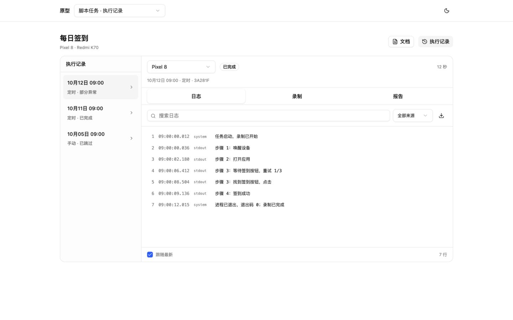

任务报告与日志引用，1440×900：

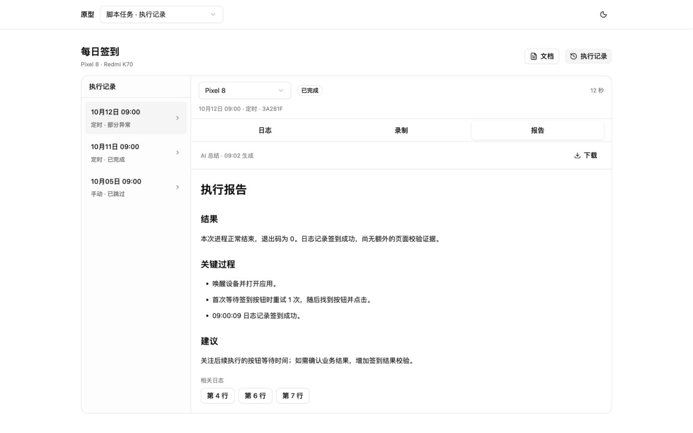

录制布局（本地示例画面，不是真实视频），1440×900：

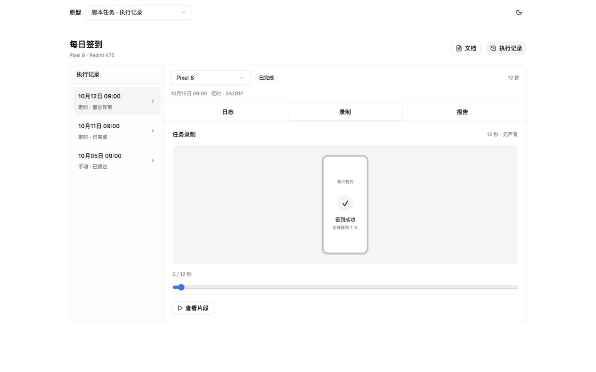

Markdown 头部配置，1440×900：

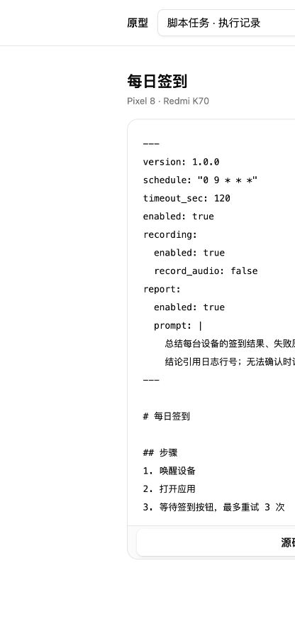

小屏列表与日志详情，390×844：


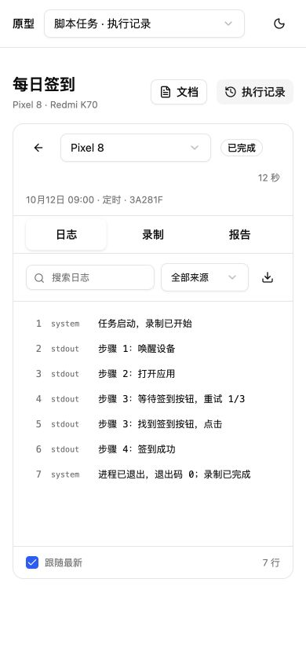

深色报告，1440×900：

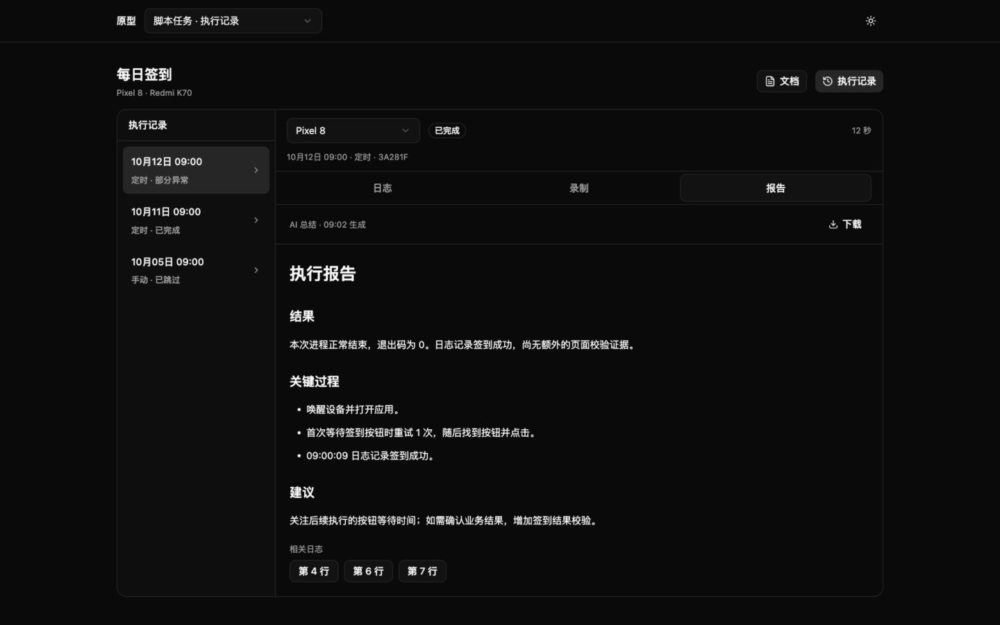

### v2：运行中、历史缺失与过期

保留 v1 与原图，新增 `prototypes/cases/task-runs-v2/`。推荐评审 v2：[公网原型](https://hypothetical-electrical-craft-ruled.trycloudflare.com/#task-runs-v2)，本地为 `http://127.0.0.1:5175/#task-runs-v2`，复用上述预览、隧道与停止脚本。

- 新增运行中示例：录制标签显示“录制中”，报告显示“任务结束后生成报告”，不开放重新生成。
- 历史缺失：分别显示“本次未采集日志 / 本次没有关联录制 / 本次未生成报告”；不把未知旧配置当成关闭。
- 资料过期：日志/录制显示过期，报告保留并显示原始日志已过期，引用跳转按钮为 0。
- 小屏保留稳定行号、接收时间、来源与原文；390×844 视口无整页横向溢出。v1 小屏隐藏时间的设计不作为推荐方案。
- 原型仍为本地静态示例；运行中日志没有真实新增流，跟随开关不证明实时采集。新增状态也不证明持久化、自动录制或模型已实现。
- 独立类型检查和构建通过；浏览器实拍覆盖上述三类状态及小屏时间。最终公网资源与控制台结果保存在同一运行资料目录的 `browser-network-v2.json`、`verification-v2.md`。

运行中等待报告，1440×900：

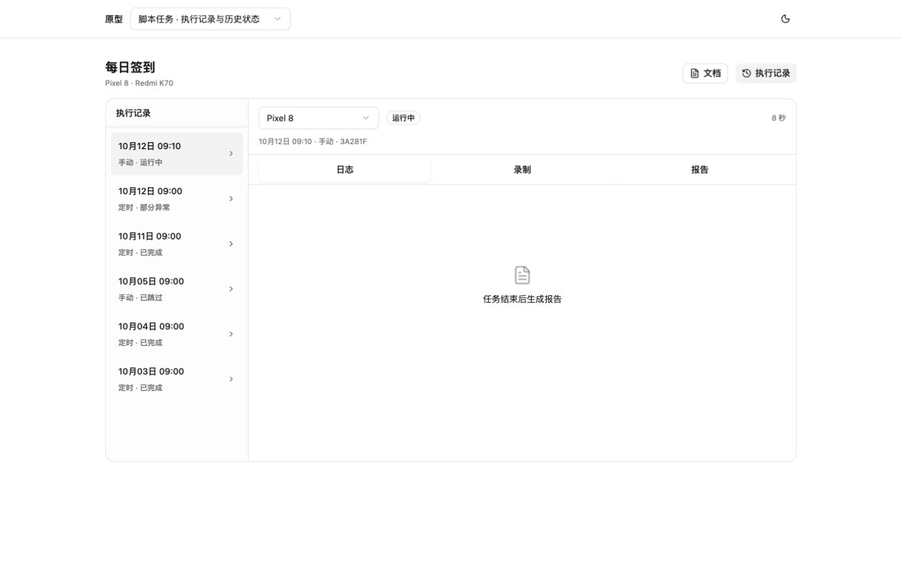

旧记录未采集日志，1440×900：

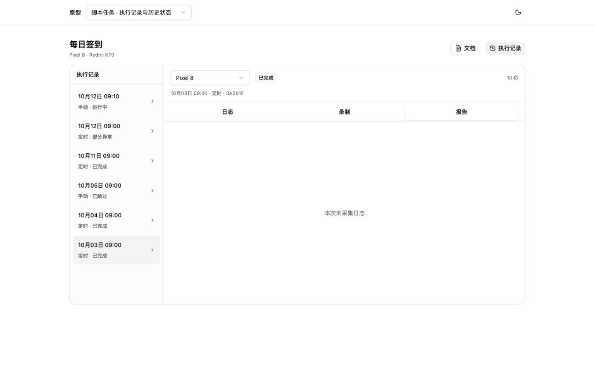

报告保留、日志引用过期，1440×900：

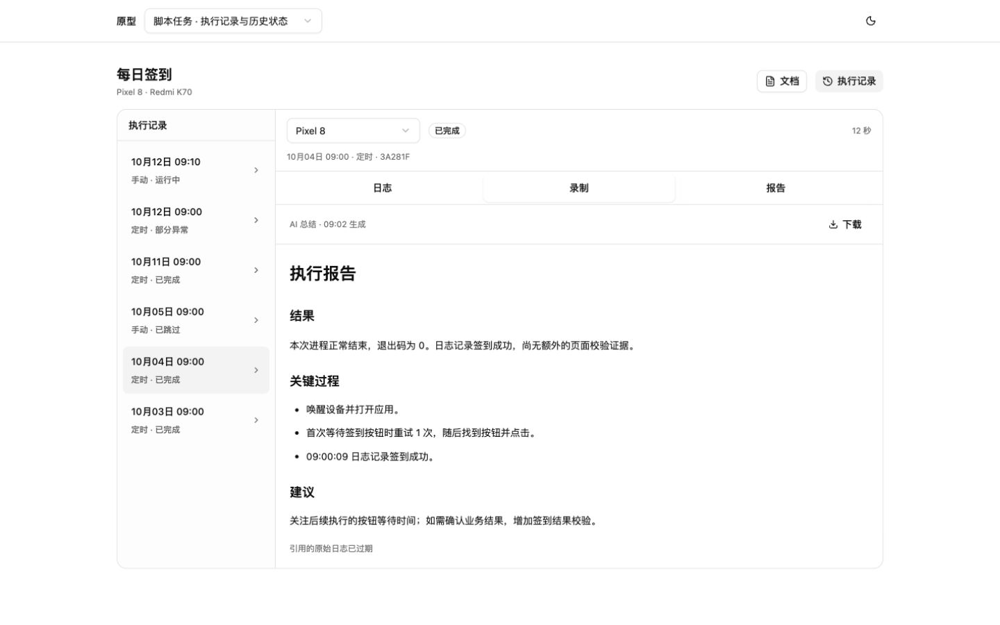

小屏日志保留时间，390×844：

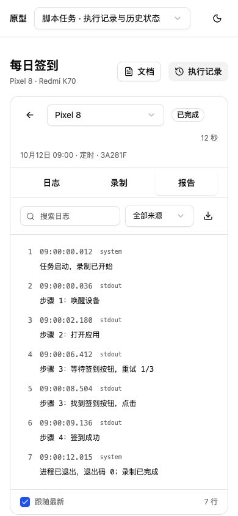
