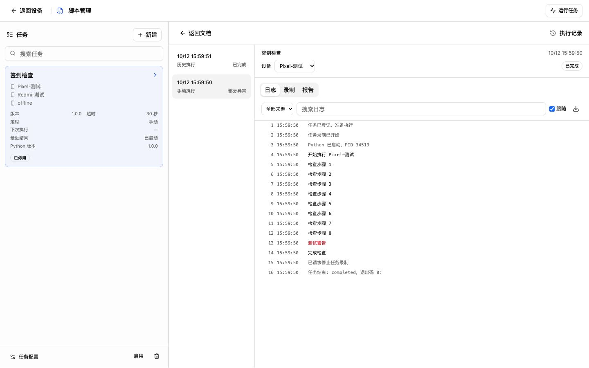
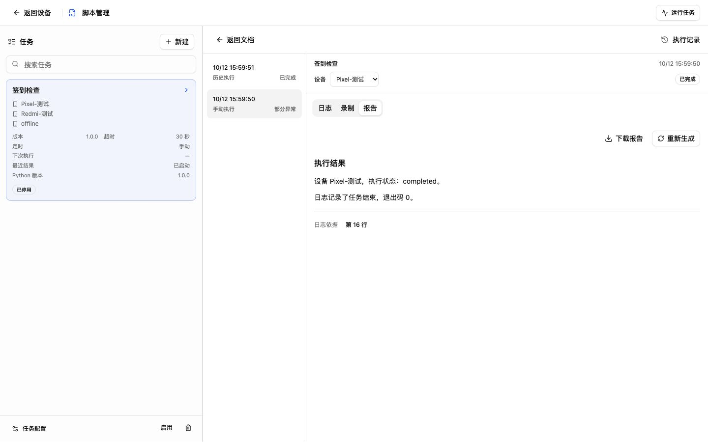
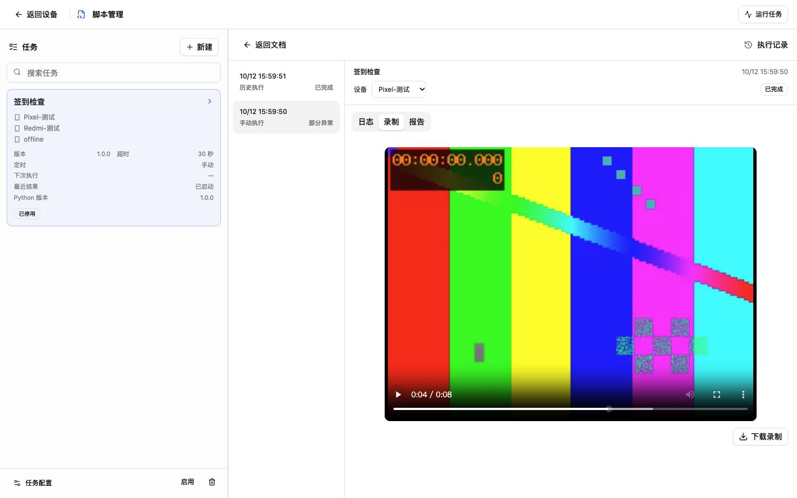
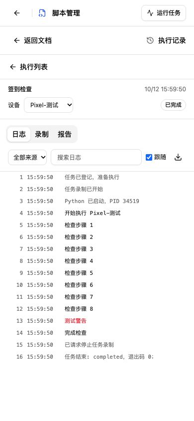
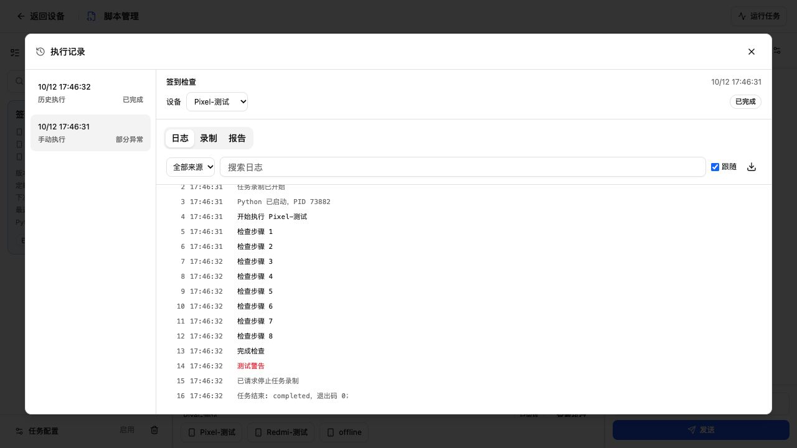
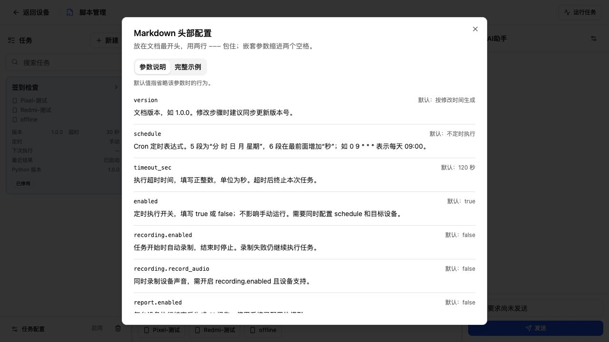
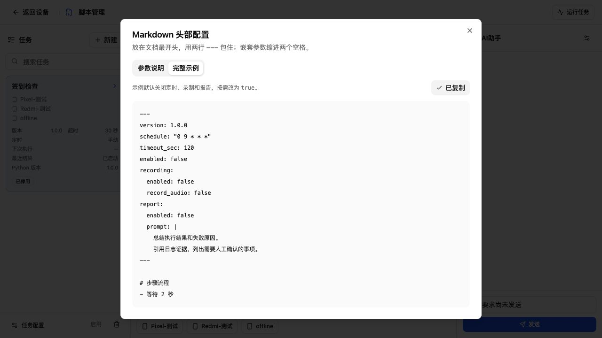
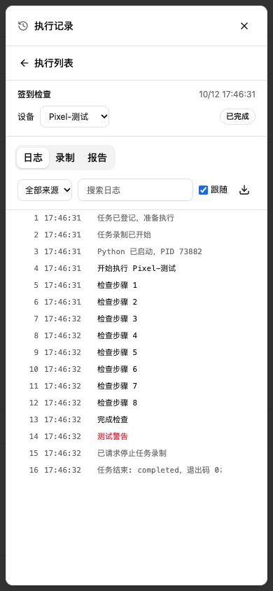
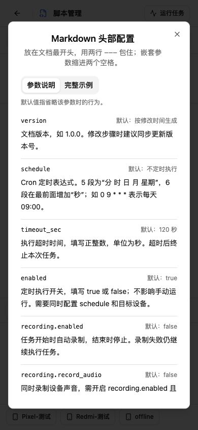

# v1.19.4 实施验证

日期：2026-10-12。所有设备和模型测试均使用隔离环境；没有操作用户数据库或真实手机。

## 自动化检查

- `go test ./...`、`go vet ./...` 和 Go 构建通过。
- `go test -race ./internal/db ./internal/mdscript ./internal/taskartifact ./internal/taskmanager ./internal/ws ./internal/aiprovider ./internal/scheduler` 通过。
- `pnpm --dir frontend build` 通过类型检查和正式前端构建。
- 从当前 HEAD 导出独立目录，仅叠加本次改动；main.go、ScriptEditor.vue、OpenAPI 中的原有 Pi/播放器改动未纳入。独立目录的前端类型检查/构建、Go 全量测试/vet/构建和 Windows amd64 交叉编译通过。
- 独立验证目录记录在 `/tmp/mywebscrcpy-1194-validation-path`；包含本次代码的服务构建为 `/tmp/mywebscrcpy-1194-validation-server`，交叉编译文件为同路径 `.exe`。前端复用已安装依赖，直接调用 vue-tsc/vite，未更改原工作区依赖。

用例覆盖严格头部类型与别名/重复键、正文示例不触发、旧文档、中文和跨管道读取 UTF-8、无换行与长行、实时读取、双向/筛选游标、过大游标、容量截断、写盘/索引故障与配额回收、初始日志失败阻止 Python、真实 Python 超时/终止、准备阶段取消不阻塞其他设备、显式批次/快照、准确进程路径恢复、录制 owner/serial 拒绝错配、Range 206/过期 410、报告队列去重/伪造引用/失败修订保留、有限证据预算及模型 HTTP 请求不含工具。

交叉编译只能证明 Windows 编译通过，不能代替原生 Windows 运行测试。

## 初版正式 UI 浏览器验证（调整弹窗前）

以正式构建页面连接隔离 SQLite、真实 Python 任务管理器、受控 HTTP 模型和 fake recorder。录制文件为 ffmpeg 生成的 8 秒 MP4，非手机画面。接口返回显式批次和任务 ID，未使用原型静态数据。

- 桌面 1440×900、小屏 390×844。小屏 scrollWidth=390，没有横向溢出。
- 选择批次和 Pixel/Redmi 设备，日志分别包含所选设备 serial；来源筛选、搜索无结果及报告第 16 行跳转已操作。
- 在文档中输入未保存草稿，打开执行记录后返回，文本仍完整保留。
- 受控报告中加入 HTML、远程图片和脚本，渲染后 article 中 img/script/a 数量为 0。
- 「重新生成」走真实队列与 HTTP 模型，结束后恢复可重试，上一成功报告在生成期间仍可见。
- 原生 video readyState=4、duration=8；UI 播放后 paused=false，拖动后 currentTime=4.873，确认解码和拖动。
- 文件接口核对：日志 200（2202 bytes JSONL）、报告 200（209 bytes Markdown）、录制 200（224363 bytes MP4）；Range bytes=0-63 返回 206，Content-Range 为 bytes 0-63/224363，正文 64 bytes。
- 浏览器下载按钮已操作，IAB 未返回文件下载事件；因此只确认文件接口正文与播放，未将浏览器实际落盘列为已通过。
- 测试完成恢复浏览器视口并关闭测试页；仅停止本轮 5186 隔离 fixture 和临时隧道，旧原型预览保持原样。

实拍截图：

## 验证边界与 Git

真实设备声音/断连等录制行为、实际模型供应商、原生 Windows、用户数据备份升级和回退尚未验证。录制准备使用现有 scrcpy 服务；动作编译器原有占位行为保留，报告不能以进程退出码推断手机业务完成。

新增 YAML 解析依赖为官方 `go.yaml.in/yaml/v4 v4.0.0-rc.6`，当前为 RC 版本；旧 ParseMarkdown 未替换。原始日志容量不包含状态与稀疏索引开销，报告与执行元数据未新增自动删除策略。运行中状态定期发布，崩溃恢复保留最后已提交的日志范围，末尾未提交片段可能丢失。

fetch 后 origin/main 新增 9d0cf5f，本地保留原有 9ef37f0 和 ec45eba，历史已分叉。按版本技能 Git 安全门禁停止提交推送；未自动 merge/rebase，原有 Pi/播放器/发布等改动未覆盖，暂存区保持空。本轮不创建发布标签、不更新 VERSION。

## 后续界面调整：弹窗与头部配置说明

按用户反馈，执行记录改为统一的 Dialog 弹窗；文档和助手保持在背景，关闭后返回原控件。新增文档标题旁的「头部配置说明」按钮，包含参数说明与完整可复制示例。

本轮 `pnpm --dir frontend build` 通过。仅包含本版改动的独立验证目录也再次通过 vue-tsc/vite 构建，未纳入原有播放器与 Pi 改动。后端源码未在本轮调整。

在重新创建的隔离数据库与正式前端页面中验证：

- 桌面默认视口 1280×720：记录弹窗宽 1200、高 612，背景文档与助手仍保留。
- Esc 和关闭按钮均可关闭，焦点分别回到「执行记录」或逐设备「查看执行」入口；Tab 焦点保持在弹窗中。
- 关闭后文档测试草稿与助手中尚未发送的要求仍完整保留。
- 逐设备 Pixel 快捷入口直接定位该批次和任务；小屏保留执行列表返回与日志/录制/报告标签。
- 390×844：记录弹窗为 374×828，头部说明为 358×759.6，均位于视口内；页面 scrollWidth=390，两种弹窗无横向溢出。
- 说明中的八项参数和默认行为已对照当前 ParseMarkdown、ParseOptions、任务保存及调度注册实现核对；不将文档 name 或已移到任务配置的设备字段列为有效运行参数。
- 完整示例复制成功，复制出的 222 字符文档提交隔离服务保存接口返回 200；解析版本 1.0.0、超时 120、Cron 0 9 * * *、定时关闭，未启动任务。
- 测试恢复视口、关闭测试页，并停止仅本轮 5186 fixture 与临时隧道。现有原型页面及其服务保持原样。

Git 历史分叉仍在，暂存区为空；本轮没有提交、推送或发布。
