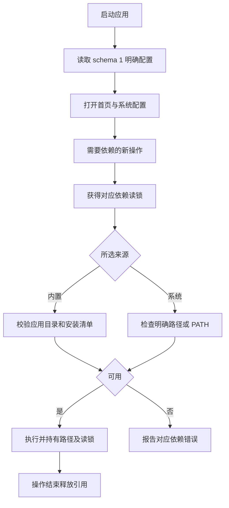
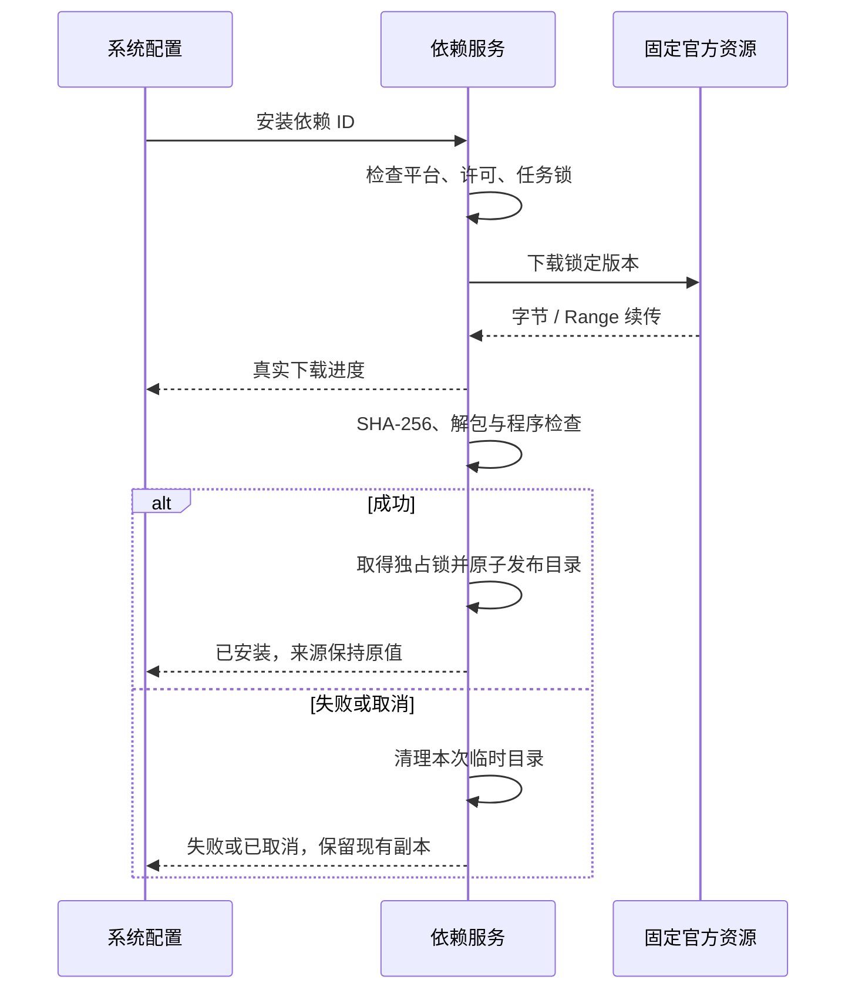
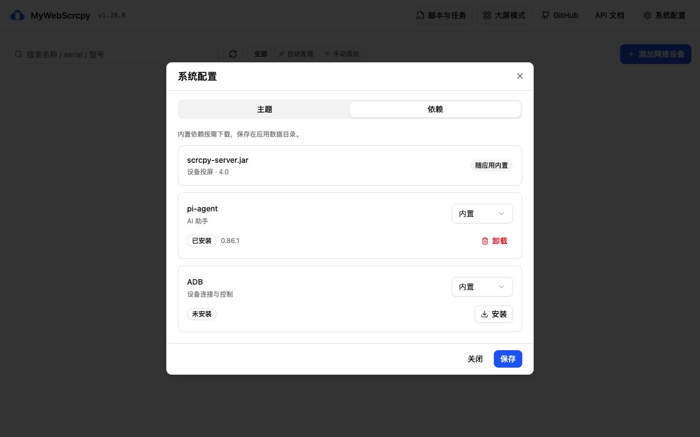
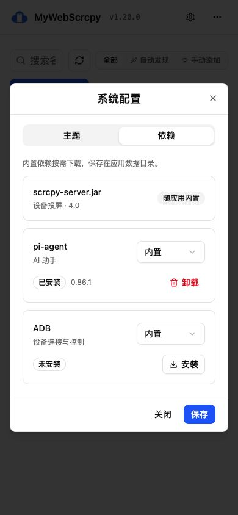

# v1.19.5-feature：系统配置与依赖拆包

状态：正式实现已完成本机验证，此目录沿用用户指定的 v1.19.x 记录；正式版本更新为 v1.20.1，发布包另行验收。

## 范围

首页顶端提供系统配置入口，弹窗采用“主题”和“依赖”两个页签。依赖安装、卸载、来源选择和路径检测合并在同一卡片。scrcpy-server.jar 保持内嵌；Pi 运行环境从主程序/桌面 sidecar 中移出，按需下载。ADB 原本未内嵌，新增应用管理安装方式。

| 依赖 | 安装包中 | 管理方式 | 来源 |
| --- | --- | --- | --- |
| scrcpy-server.jar | 保留 4.0 | 随主程序升级，只读显示 | 固定内置 |
| pi-agent | 移出 Pi/fd/rg 压缩包 | 数据目录按需安装 Pi 0.86.1、fd 10.3.0、ripgrep 15.2.0 | 内置 / 系统 |
| ADB | 不内嵌 | 官方 Platform-Tools 36.0.2 完整发行文件 | 内置 / 系统 |
| 项目 Pi 技能 | 保留小体积业务资源 | 不覆盖已有用户技能 | 沿用现有功能 |
| Python | 沿用现有功能 | 原依赖页面继续管理 | 保留明确配置 |

“内置”表示应用管理的依赖来源，除 Jar 外均按需下载到应用数据目录。界面只说明一次。安装成功不切换来源；缺少 Pi/ADB 不阻止首页和设置打开，使用相应功能时返回依赖错误。

## 界面

主题提供系统、明亮、黑暗，使用既有 VueUse，保存在当前浏览器。首次渲染前应用主题，系统模式监听配色偏好变化。

依赖卡片展示名称、用途、来源和安装状态。下载显示真实字节与已知总量；未知总量使用不定进度。提供取消、失败重试；关闭弹窗不取消后台任务。Jar 没有来源、安装或卸载操作。

系统来源自动查找后端 PATH 中的 `pi` / `adb`，效果相当于 `which pi`；系统 Pi 只展示 pi 执行路径。用户反馈后移除了“搜索工具”明细和 fd/rg 输入框。后台按 Pi 的工具目录与 PATH 自动检测搜索工具，缺失时说明原因，不要求用户逐项配置。找到程序后检查版本、`pi --help` 参数及实际无网络 RPC `get_state` 响应，避免仅凭名称判断可用。

明确路径优先于 PATH，错误路径不回退到内置副本。ADB 保留既有 `MYWEBSCRCPY_ADB` > 明确路径 > `ANDROID_HOME/platform-tools` > PATH 顺序。系统来源不自动修改系统环境。

保存前验证完整配置，再原子写入；失败保留运行配置与草稿。关闭重开恢复已保存配置。主题是客户端设置，依赖是后端主机设置。

## 解析与运行

所有 ADB 调用点使用统一命令包装器，实际执行前解析当前来源；PTY 同样持有引用。Pi 服务取得运行路径与读锁。系统 fd/rg 可以位于独立目录，不猜测 Pi 同目录，也不偷偷借用应用管理包。

写配置、发布、卸载持有对应依赖独占锁。ADB 来源改变时冻结新主机操作并检查投屏/后台会话、录制、回放、设备任务；忙时拒绝，不强杀任务或共享 ADB daemon。Pi/ADB 锁彼此独立，文件锁保护同数据目录的多进程。应用更新和依赖修改互斥。

## 安装与卸载

依赖根目录固定为 `<data-dir>/dependencies/`，不写 macOS App bundle 或依赖可执行目录可写。配置为 `dependencies/config.json`（schema 1）；安装目录固定为 `pi-agent/`、`adb/`，清单记录平台、版本、每文件 SHA-256 与权限。

资源只接受小型嵌入清单中的固定官方 HTTPS 地址。限制重定向域名、字节数、展开大小与文件数量；检查续传响应和最终哈希；拒绝路径穿越、链接、特殊文件与重复目标。日志记录依赖与阶段/错误，不输出令牌或模型密钥。

卸载确认后只处理固定应用目录、对应删除暂存区和遗留安装临时目录。校验目录归属并拒绝符号链接，使用中不能删除；先改名再实际删除。删除失败保留残留状态，可重试。不把系统来源的执行路径当作递归删除目标。来源配置、系统程序、技能、脚本、模型设置与任务数据保留；内置来源卸载后需重装。

| 平台 | Pi 内置安装 | ADB 内置安装 |
| --- | --- | --- |
| macOS AMD64 / ARM64 | 支持 | 官方 Darwin 包 |
| Windows AMD64 | 支持 | 官方 Windows 包 |
| Linux AMD64 | 支持 | 官方 Linux 包 |
| Linux ARM64 | 支持 | 无已锁定官方包，使用系统来源 |

ADB 使用固定 36.0.2 资源，不使用变化的 latest 地址搭配旧哈希。安装前展示实际 Android SDK 协议，必须勾选接受；不替用户接受协议。

## 接口与权限

| 接口 | 行为 |
| --- | --- |
| GET /api/dependencies | 旧状态与新 managed/config |
| POST /api/dependencies/detect | 检查明确依赖 ID、来源和路径 |
| POST /api/dependencies/install | 创建任务，客户端不能指定 URL |
| GET /api/dependencies/install/{id} | 查看阶段、进度和错误 |
| DELETE /api/dependencies/install/{id} | 取消安装 |
| DELETE /api/dependencies/installed/{id} | 删除应用管理副本 |
| PUT /api/dependencies/config | 验证并原子保存完整配置 |

按用户反馈移除新增的主机令牌、解锁、回环地址/Host、Origin 与 Sec-Fetch-Site 限制。服务模式直接配置，来源、路径和操作按钮不按权限禁用。桌面既有内部控制继续由应用自动完成。

## 保留与打包

- 既有 `/dependencies`、桌面菜单与 Python 设置保留，旧页面增加新弹窗入口；旧 `dependencies.json` 按确认的 adb/python 字段读取。
- 旧 `.pi/runtime/` 不自动猜测迁移或删除，可选择明确路径使用。项目技能仍释放到数据根 `.pi/skills`，保留已有内容。
- 主程序、桌面 sidecar 和发布构建不再准备或嵌入 Pi。`prepare-pi.py` 保留为独立测试资源工具，产物在 `.cache/pi-test/payload/`，不会进入 go:embed。
- 更新继续保留依赖目录，事务备份/恢复加入 `dependencies/config.json`。Dockerfile 沿用系统 ADB 与主程序，未在本机完成 Docker 运行验收。
- 同参数 macOS ARM64 实测主程序减重约 67%；完整桌面安装包压缩比例需正式打包测量，不能直接套用主程序比例。

## 验证与原型

真实验证和未验收项见 [verification.md](verification.md)，使用方式见 [系统配置](../../system-config.md)。正式本地预览为 `http://127.0.0.1:61013/`，使用独立临时数据目录；不操作真实设备。

正式页面：

小屏：

历史独立模拟原型保留 `system-config-v1`（三页签）及 `system-config-v2`（合并页签、卸载）；公网地址只演示模拟状态，不暴露正式主机配置 API。

## 资料

- [Android Platform-Tools](https://developer.android.com/tools/releases/platform-tools)
- [Android SDK 许可](https://developer.android.com/studio/terms)
- [Pi 官方仓库](https://github.com/earendil-works/pi)
