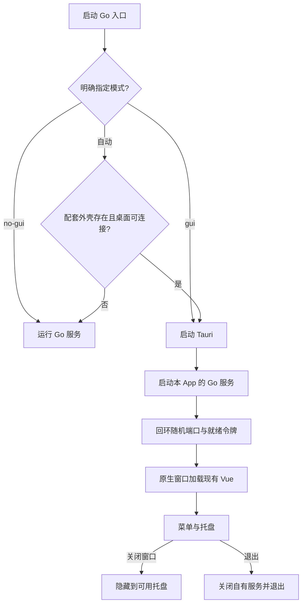
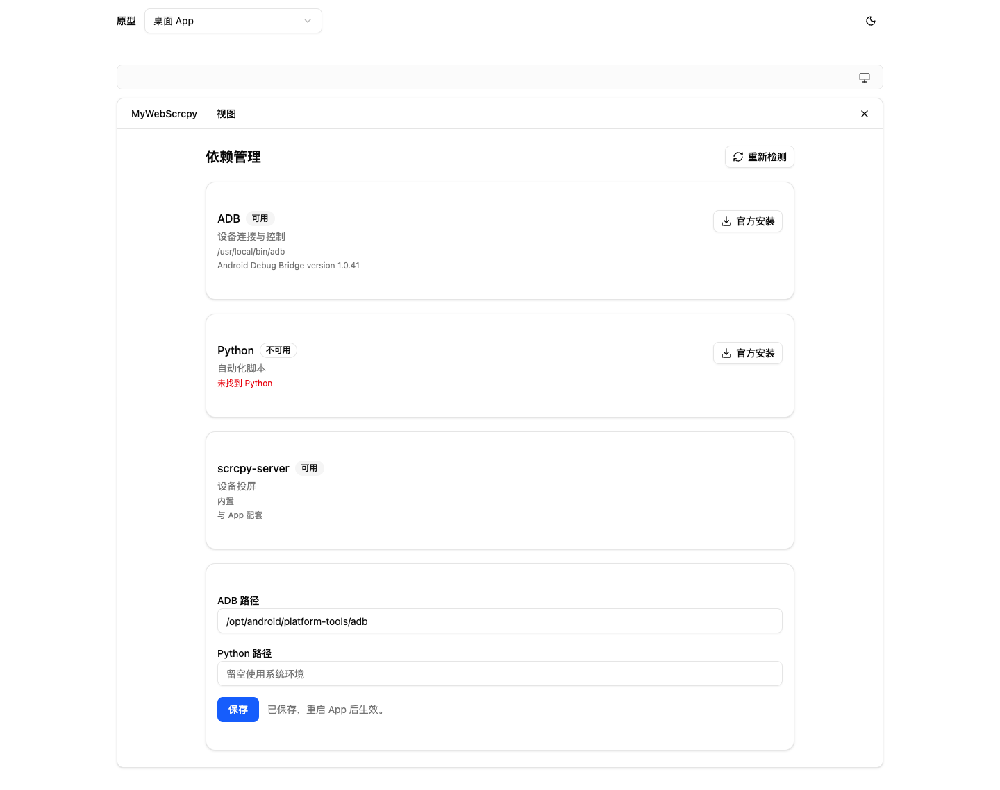
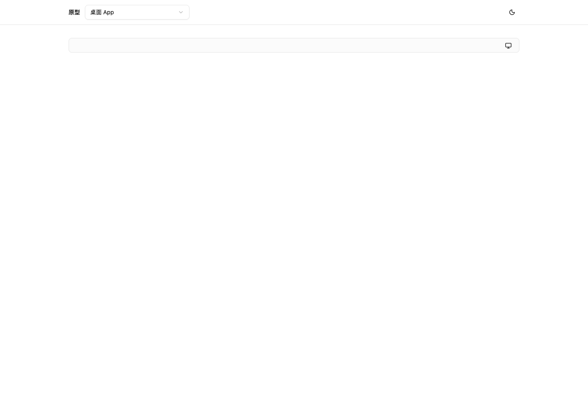
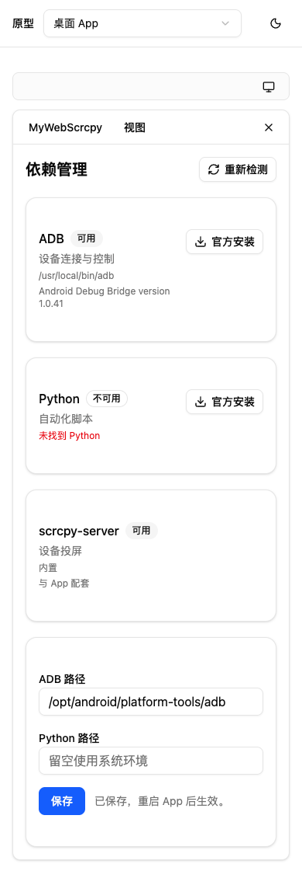

# v1.20.0-feature 设计：轻量桌面 App

## 背景与目标

在现有 Go 服务和 Vue 界面上增加 Tauri 桌面外壳。桌面分发默认 GUI，支持 --no-gui、--gui、原生菜单和系统托盘；Linux 自动检测可连接的图形会话。ADB、Python 等外部依赖独立安装，显示真实检测结果、官方安装入口及可执行文件路径配置。

## 非目标

不改写投屏协议或业务后端，不删除原有服务端构建，不自动安装未经确认的 Pi Agent，不移动现有用户数据，不在本轮自动发布标签或部署远端。

## 关键决策

- Go 入口决定模式；纯服务产物默认沿用服务行为，桌面包存在配套外壳时默认 GUI。
- Tauri 管理窗口、菜单、托盘及单实例；Go 作为受管理子进程承载 HTTP/WebSocket 和嵌入的 Vue。
- 桌面服务监听回环地址和系统分配的空闲端口，用一次性令牌及就绪文件管理生命周期，不复用未知端口上的服务。
- 桌面数据写入用户应用目录，原服务工作目录与数据路径保留。
- 关闭窗口在可用托盘下隐藏（Linux 通过 gdbus 读取标准托盘宿主注册状态，缺工具或未注册时不隐藏），托盘“打开主窗口”恢复，“退出”终止本 App 拥有的服务。托盘建立失败时关闭窗口退出，避免不可恢复的隐藏。
- 菜单提供设备列表、大屏监控、脚本与任务、依赖管理、浏览器打开及退出；保留系统编辑快捷键。
- 依赖模块按已确认配置检测 ADB、Python；scrcpy JAR 内置且固定版本，Pi 外部程序待确认。

## 风险与验证

WebCodecs、AAC/H264、画中画和硬件加速因系统 WebView 不同需三平台真机验证。Linux 托盘依赖桌面支持。签名、公证与 Windows/Linux 原生安装验证分别记录，不以 macOS 编译成功代替。新外壳更新不能使用原单文件自更新替换整个 App。

## 迁移与回滚

既有服务构建继续可用，桌面包独立生成。桌面新数据目录不自动迁移或覆盖现有 data/；回滚到旧服务程序即可，保留桌面数据。scrcpy 内置策略本版保留。

## 交互原型 v1

源码：`prototypes/cases/desktop-app-v1/`，入口：http://127.0.0.1:5174/#desktop-app-v1。复用项目 Vue、shadcn-vue 与主题，通过菜单导航、依赖路径保存、窗口隐藏、托盘恢复和 390px 小屏检查；无页面脚本错误。这里只是浏览器交互原型，不代表系统原生托盘验证。

本机没有已安装的 cloudflared，公网预览受阻，保留本地服务与实拍。未把临时链接或页面 200 当作公网交付成功。

## 待确认

用户所指外部 Pi Agent 的具体程序和版本尚未确认，本版不添加猜测的安装源。

## 原生验证与实际产物

macOS arm64 的普通 App 位于 `desktop/target/release/bundle/macos/MyWebScrcpy.app`，便携包位于 `desktop/target/portable/darwin-arm64/`。产物已忽略，不作为运行数据快照。

原生验证报告：[WebView](verification/native-webview.json)、[窗口生命周期](verification/native-lifecycle.json)。验证构建通过菜单处理器打开依赖管理，读取 WKWebView 自身的 DOM，并确认关闭隐藏与恢复。普通交付构建不包含验证 hook。

当前桌面捕获没有得到有效的原生像素截图；物理菜单/托盘点击缺系统辅助功能权限，保持待验收。原型截图仅用于方案，不替代原生视觉验收。
