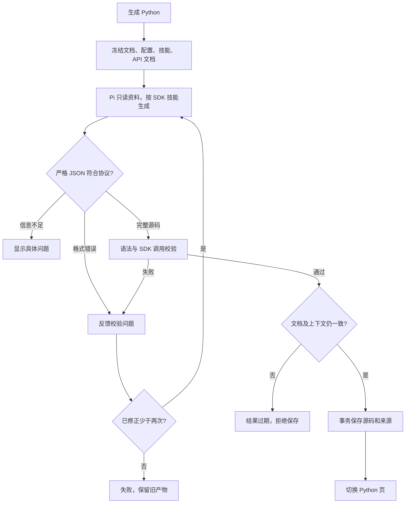

# v1.21.0-feature：Pi 技能生成 Python

已实现第一阶段：Pi 生成独立 Python，使用统一、可安装的 `mywebscrcpy` SDK 基础能力。视频解码与模板匹配留在 [v1.22 设计](../v1.22.0-feature/design.md)。软件与受控接口验证不替代真机验收。

## 目标与范围

此前 Markdown 编译由本地 Go 模板拼接，设备方法为占位实现。本版经用户确认，替换旧生成器、取消执行前自动编译。手动与 Cron 仅执行已生成且有效的 Python；历史占位源码需要重新生成。

第一阶段支持明确参数的 ADB、按键、像素或比例点击、滑动、ASCII 文本、等待、条件与有限循环。基础动作通过 SDK 的 `device.adb` 调用真实 ADB HTTP API；比例坐标通过 `device.page_info` 的真实尺寸换算。模板匹配、Vision 专用动作、OCR 与中文输入尚未提供，Pi 必须返回缺少能力或信息的问题。

用户曾提出 requests 直调，随后要求对齐 v1.22 可安装 SDK，并确认本次只做 SDK 基础能力。不保留另一套 `mywebscrcpy_runtime`，不同时维护两套连接封装。SDK 当前版本为 0.1.0，包名 `mywebscrcpy-sdk`，导入名 `mywebscrcpy`。

## 技能与 SDK

```text
.pi/skills/markdown-to-python/
├── SKILL.md
├── references/sdk-api.md
└── assets/example.py
packages/python-sdk/
├── pyproject.toml
├── src/mywebscrcpy/
├── examples/device_query.py
└── tests/test_basic.py
```

技能规定转换顺序、来源、支持范围、结构、异常与严格 JSON。SDK 使用 HTTPX，定义 Client、Device、CommandResult、PageInfo 和明确异常；基础导入不加载 OpenCV/PyAV。专用按键/点击等 Vision SDK 方法由 v1.22 后续补充，当前不假装实现。

生成的代码使用 `from mywebscrcpy import Client`、唯一 main()、argparse 配置和标准启动入口。通过 with Client / client.device 管理资源。serial 是位置参数，--base-url 和 --token 可从 MYWEBSCRCPY_API_URL / MYWEBSCRCPY_API_TOKEN 获取默认值。无连接配置时明确报错，不硬编码设备、地址或凭据。

安装包后，脚本可复制到外部目录运行：

```bash
python -m pip install ./packages/python-sdk
python script.py DEVICE_SERIAL --base-url http://HOST:PORT
```

远程操作仍要求 MyWebScrcpy 服务与设备可达。应用任务释放同一份嵌入 SDK 源码，配置的 Python 环境仍需安装 HTTPX，不在后台静默执行 pip。SDK、示例和安装说明见 [SDK README](../../../packages/python-sdk/README.md)。

## 真实接口与连接

| SDK | 已确认 API 与语义 |
| --- | --- |
| device.adb(args, timeout=秒) | POST /api/adb/commands；params.serial 为当前设备；json.args 为数组，timeout_ms 为毫秒。HTTP 成功后仍必须 status=completed 且 exit_code=0；截断、错误、超时均失败 |
| device.page_info(timeout=秒) | GET /api/ui/page-info；严格读取 display.width/height 正整数，不猜别名或其他层级 |

ADB 参数不含 adb 可执行文件及 -s/--serial/-H/-P/-L 等目标或宿主切换选项。不自动重试动作。网络超时可能表示设备结果未知，不能推断动作没有执行。

应用内提供任务专用的本机动态 HTTP 监听，转发上述两条已注册 API；每个任务独立令牌并验证 serial，只允许当前存活任务访问。连接不依赖网页端口或桌面 TLS。外部脚本可使用服务公开地址，鉴权头由调用方显式提供。同步 ADB 请求随请求取消，异步 API 原有独立生命周期保留。

## 生成与保存



生成与文档聊天使用独立入口、提示词和状态，复用 Pi RPC 生命周期与 SSE 活动；只允许 read/grep/find/ls。每次生成冻结 current.md、task.json、templates.json、capabilities.json、真实 api/openapi.json、技能与引用。模板资料仅记录文档引用，能力明确为不支持匹配。

最终只接收 status/python/issues JSON。ready 必须有完整源码、空 issues；needs_input 必须源码为空、问题非空，每个问题含 step（字符串或 null）和 message。拒绝重复键、缺字段、未知字段、额外内容及过大响应。

校验通过 Python AST 和编译检查语法、导入、唯一入口、SDK 方法与参数、有限循环和资源上下文；不执行生成代码，也不宣称提供沙箱或证明动作语义。单次最多两次修正，共享五分钟总期限。取消、信息不足、Pi 错误不自动回退。

生成并发按脚本隔离，拒绝同任务重复生成，不持有执行器全局锁。保存时重新比较上下文，并在事务内比较源快照版本，防止旧结果覆盖新编辑。

新增 script_generations 来源表，记录 source_hash、code_hash、provider、model、contract_version、generated_at。有效性指纹包含文档、任务元数据与目标、技能、API 文档、校验器和实际 SDK 源码。模型信息用于追溯，切换模型本身不让已生成源码失效。

失败保留最后成功产物。编辑文档不删除源码，但旧产物过期，禁止执行；文档、技能、接口、SDK 或代码变化均需重新生成。多设备仍共享代码、各自启动进程；现有互斥、超时、终止、日志、录像和报告沿用任务管理器。

## 界面与迁移

保留生成按钮与 Python 页，复用活动组件显示思考和真实工具调用，支持停止。生成状态与文档聊天分别管理；未保存草稿、缺失/过期代码或当前任务生成中时禁止运行。成功与失败信息只在生成活动处显示，避免重复通知。

数据库增量迁移，不清空文档、设备、排期、源码或历史。历史源码无来源记录，显示需要重新生成。技能随应用释放，用户既有技能不覆盖；若技能约定版本不匹配明确报错，由用户检查技能或更新程序。

回退前备份数据库与技能，保留来源和历史数据。旧占位生成器不能作为真实自动化降级路径。模板匹配旧工程不改动，不恢复已删除的匹配 HTTP 路由。

## 验证边界

真实 Pi 与受控模型验证技能、SDK 引用和实际 API 文档读取；生成 Python 在真实进程调用受控设备接口。覆盖失败、协议缺字段、截断、目标绑定、单位转换、取消、有限修正、并发编辑、旧产物与过期检查。

浏览器分别验证正式工作台与模拟原型；截图和记录见 [prototypes](prototypes/README.md)。Go 全量测试、race、vet、前端正式/原型构建和 SDK wheel/sdist 安装按实际结果记录。真实手机动作、Windows/Linux 原生链路以及发布 CI 未执行；正式版本仍为 v1.20.1，不发布标签、Release 或 PyPI。
