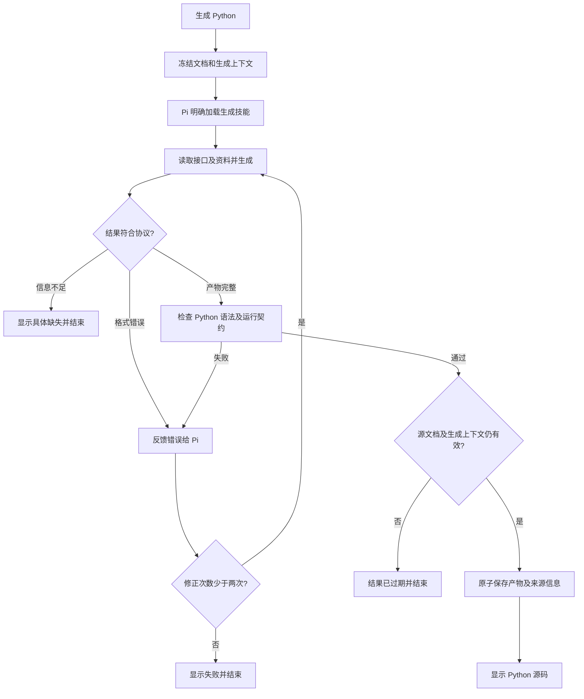

# v1.21.0-feature 设计：Pi 技能生成 Python

状态：设计已记录，待实施。文中的技能、运行库及新增协议均为拟定接口，不能作为当前已交付能力调用。

## 背景

当前文档助手接入 Pi，但 Markdown 到 Python 的编译仍由本地 Go 模板完成。普通步骤不会转换成真实设备动作，生成器内的设备和匹配方法为占位实现。本版让 Pi 根据项目技能生成流程代码，并用真实运行接口执行。

## 目标

- 以项目专用 Pi 技能维护 Markdown 转换规则、生成结构和异常行为。
- 第一阶段支持已明确参数的按键、点击、滑动、文本输入、等待及基于已支持返回结果的条件和有限循环。
- 后端提供冻结上下文、校验及产物保存；现有任务管理器承担多设备进程、超时、终止、日志、录像和报告。
- 复用现有模型配置、内置 Pi 运行环境与流式活动展示。
- 能追溯产物所依据的文档、技能、运行接口和模型，不用版本字符串独自判断有效性。

## 非目标

- 生成时操作真实设备、通过试运行验证点击结果，或赋予 Pi Shell、写文件权限。
- 新增独立脚本工作台，重做排期、录像、报告或桌面依赖管理。
- 恢复主服务已移除的内嵌模板匹配引擎，或假设模板资产 API 能执行匹配。
- 自动发布标签、部署远端、安装未经配置的 Python 依赖。

## 关键决策

### 技能与真实运行接口分工

拟建目录：

```text
.pi/skills/markdown-to-python/
├── SKILL.md
├── references/
│   └── runtime-api.md
└── assets/
    └── example.py
```

`SKILL.md` 说明如何理解步骤、保留流程语义、处理信息不足和返回结果。接口文档提供方法签名、参数单位、返回值、异常及支持范围。示例必须使用已经验证的运行库，不复制旧生成器中的占位方法。

生成入口明确加载该技能及转换规则，不依赖模型自行发现。技能缺失或与运行接口版本不匹配时报告错误。修改技能后下一次生成读取新内容；技能规则不替代后端检查，也不是进程或文件访问沙箱。

规则至少包含：

- 按文档顺序、条件及循环生成代码，不把自然语言动作降为日志。
- 坐标、模板 ID、包名等依据本次上下文；不能猜测未提供的目标或替代字段。
- 缺少定位条件、必需参数或已支持能力时返回问题，不能输出虚构可执行脚本。
- 等待和重试有明确上限；动作失败记录步骤并抛出异常，不能返回假成功。
- 设备序列号由运行参数读取，同一份产物适用于配置中的多个设备。
- 定时、多设备派发、录像和报告由宿主控制，脚本不重复实现。

### Python 运行库

拟提供 `mywebscrcpy_runtime`，只封装生成脚本需要的真实操作。优先使用 Python 标准库或项目已确定依赖，复用现有 ADB 命令和设备动作通道；后端/协议中的目标约束、执行结果和失败状态必须保留。

拟定代码形态如下，实际方法在运行库契约完成后冻结：

```python
from mywebscrcpy_runtime import Device, run_script

def main(device: Device):
    device.key("HOME")
    device.sleep(1)
    device.tap(x=0.5, y=0.8)

if __name__ == "__main__":
    run_script(main)
```

`run_script` 统一入口、UTF-8 日志、异常退出及连接配置。运行库及其依赖必须进入服务和桌面分发，执行器明确提供模块路径、实际服务地址及所需鉴权信息。地址不能固定为 `127.0.0.1:8080`；连接信息和凭据不由 Pi 生成，不写入源码或日志。

第一阶段不提供未经实现的 `wait_and_click`。已有独立 Python 模板匹配工程仅作为候选复用资源；需确认调用方式、依赖分发、目标设备范围、帧时效和真实动作结果后才发布该能力。

### 独立生成请求与冻结上下文

生成入口与文档助手聊天分开，复用 Pi RPC 生命周期及事件解析，分别设置任务提示词。生成阶段保留只读工具，由后端保存返回代码。

| 输入 | 来源与用途 |
| --- | --- |
| `current.md` | 本次已保存文档快照，提供业务流程 |
| `task.json` | 后端按明确结构输出的名称、元数据和目标配置 |
| `templates.json` | 当前引用模板在目标设备及公共范围中的真实资料 |
| `capabilities.json` | 已实现运行方法、接口版本、可用依赖及限制 |
| 生成技能及引用文件 | 转换规则、接口说明和已验证示例 |

生成上下文不混入右侧聊天历史。资料缺失或目标设备间模板不适用时指出问题。必需定位参数不能由不同范围的相似模板或其他字段兜底。

### 生成、校验和保存



拟定最终输出为严格 JSON，不从自然语言中搜索代码块。固定字段为 `status`、`python`、`issues`，每条问题使用 `step` 和 `message`；缺失、未知字段及不一致状态拒绝接收，不猜测其他字段。

```json
{"status":"ready","python":"完整 Python 源码","issues":[]}
```

`status` 为 `ready` 时源码非空、问题为空；`needs_input` 时源码为空、问题非空。`step` 使用文档中的步骤标识，无步骤标识时允许 `null`。系统故障与取消由后端事件报告，不伪装为生成完成。

后端检查结构、长度、Python 语法、入口、允许导入及调用、真实模板引用和能力范围。校验本身不执行生成脚本，语法通过不等于设备行为验收。最多两次自动修正，共享单次生成的总超时；取消、超时、信息不足不继续修正，也不自动回退旧生成器。

保存必须在同一数据库事务内比较本次源快照再写入，避免生成期间编辑或其他生成请求覆盖新结果。失败保留最后成功产物及其来源；源已改变时旧产物仍标为过期，不允许因此运行。

### 产物与执行

记录文档及名称等相关配置哈希、技能及引用文件哈希、运行接口版本、模板依赖指纹、模型来源、生成时间和代码哈希。有效性依据影响代码的输入及运行契约；模型信息用于追溯，切换模型不自动证明既有源码失效。

建议手动和定时执行只使用有效产物，缺失或过期时提示先生成，避免定时触发临时调用模型。现有执行前自动编译会改变，需要实施前确认。多设备仍共享一份代码、分别启动进程，设备互斥、终止和超时沿用现有任务系统。

Pi 耗时操作不能持有执行器的全局锁。生成并发按脚本归属管理，拒绝重复请求或使用明确的请求序号，跨脚本请求不阻塞全部设备任务。

### 界面与原型

保留「生成 Python」及 Python 标签页，复用现有助手活动组件展示本次生成进度和工具调用；生成和聊天状态分别管理，支持停止。仅校验和保存完成后展示成功并切换源码，问题对应具体步骤。

正式实施前创建或复用项目交互原型，覆盖生成中、成功、缺少信息、失败、停止及文档变化导致结果过期。浏览器实拍保存到本版 `prototypes/`，区分原型证据与真实生成验收。本次仅创建版本记录，不生成空截图或声称原型已验收。

## 风险与验证

| 风险 | 处理与验收 |
| --- | --- |
| 模型编造操作能力或参数 | 固定运行契约；缺少定位和未知接口用例必须阻止保存 |
| 生成时编辑导致旧结果覆盖 | 冻结输入和事务比较；并发修改用例验证不覆盖 |
| 自定义技能与程序升级接口不一致 | 校验技能/接口兼容版本，不静默使用错误说明 |
| 动态端口和 Python 模块缺失 | 服务及桌面打包验证，空外部模块路径环境下检查运行库可用 |
| 只通过语法而实际动作失败 | 受控后端验证参数和失败传播，真机验收单独记录 |
| Pi 取消、超时或修正循环泄漏 | 总超时、次数上限、进程回收及产物不被覆盖的用例 |
| 多设备模板范围不同 | 生成前按每个目标核对依赖，执行前继续检查在线和资源状态 |

## 迁移计划

1. 明确旧生成器及执行前自动编译的切换决策，再处理旧代码。
2. 增量增加生成产物来源字段或关联表，不清空用户文档、设备、排期或历史记录。
3. 历史源码没有 Pi 来源信息，不能伪造已通过本版校验；如何标为待重新生成在切换决策中确定。
4. 新增技能使用现有嵌入和释放机制。已有技能文件保留用户修改；后续升级不得仅依赖「文件不存在才复制」，需检查与运行接口是否匹配并给出明确处理办法。
5. 先完成基础动作的真实生成与执行验收，再评估模板匹配，按实际证据更新任务状态。

## 回滚计划

源码和版本记录随 Git 保存，回退程序前备份数据库及技能。新 schema 保持增量，确认旧程序能读取后再回退；保留文档、生成来源、历史日志及用户技能，不通过删除数据实现回滚。旧版本占位脚本不能作为真实自动化降级方案，回滚不等于自动恢复定时执行。

## 待确认问题

1. 接入 Pi 后，旧本地生成器采用删除替换还是明确保留的独立入口？建议替换，禁止失败时静默回退。
2. 是否采纳「执行只用已生成产物」，取消手动和定时执行前的自动编译？建议采纳，并让历史任务先重新生成。
3. 是否按第一阶段基础动作、第二阶段模板匹配推进？已有独立匹配工程未被确认作为本版正式依赖。

上述候选决策尚未实施，不因记录在文档中而自动处理旧逻辑。
