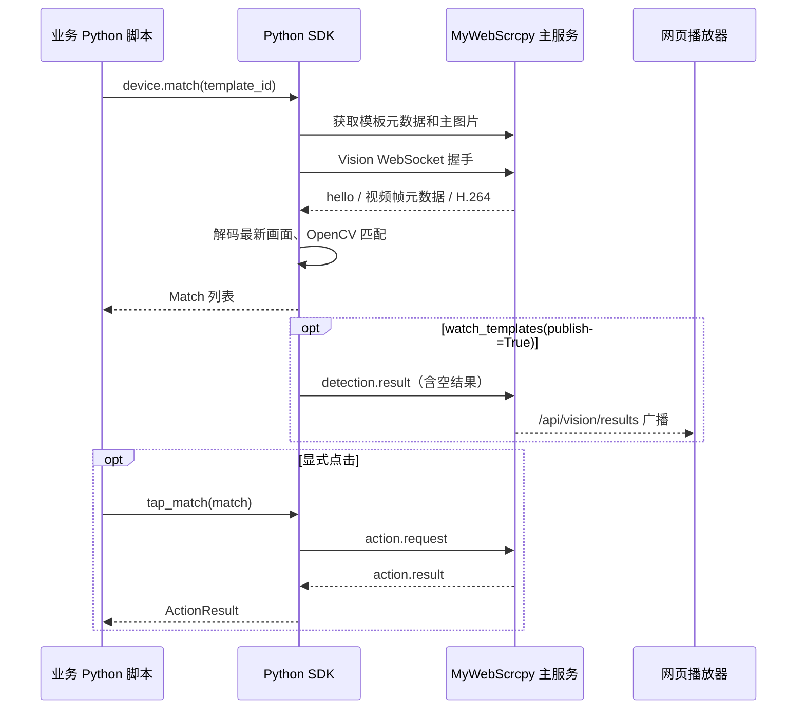

# v1.22.0-feature：Python SDK 与进程内模板匹配设计

当前完整方案仍待实施；v1.21 已承接统一 SDK 的基础 HTTP 能力，具体边界见文末。

## 背景与目标

当前 Go 主服务管理模板资产、提供 `/api/vision/stream` 和 `/api/vision/results`，本身不执行模板匹配。`scripts/template_matcher/` 通过 HTTP 加载模板、PyAV 解码 H.264、OpenCV 匹配，再回传 `detection.result`。使用者目前必须运行独立脚本或自己拼接协议。

本版设计一个项目内可安装的 Python SDK，业务脚本通过 import 调用即可管理模板、获取设备画面、匹配与操作设备。匹配计算在调用方 Python 进程运行，不自动拉起外部匹配进程。远程设备模式仍要求 MyWebScrcpy 主服务可达及设备可连接；仅对传入内存图像执行本地 match_image 不依赖主服务。

首版目标：Python 3.10+、同步 API、pip 本地安装与 wheel 分发、类型化结果、清晰异常与资源生命周期。实现完成后才确定依赖版本范围和正式发布版本。

## 范围与非目标

本版封装模板 CRUD、主图片、参考图上传、ZIP 导入导出、设备列表、Vision 会话、取帧、单次匹配、等待匹配、持续匹配和 tap/swipe/key/text 动作。设备会话连接直接使用现有 Vision 握手，不假设存在新的 HTTP connect 接口。

不做所有后台 API 的一揽子封装、不新增 UI、不改 Markdown 编译器、不增加调度器、不自动启动主服务、不恢复旧 matches/status/detect/click 路由。现有截图 HTTP API 是截图资产上传和管理，不能当作实时截屏接口；SDK 的 frame() 来自视频解码。

不发布到 PyPI、不自动部署，也不删除或替换现有独立模板匹配实现。首版暂不支持全异步 API、YOLO/OCR、多参考图自动聚合匹配与未确认鉴权协议。

## 包结构与依赖

拟定目录：

```text
packages/python-sdk/
  pyproject.toml
  README.md
  src/mywebscrcpy/
    __init__.py
    client.py          # HTTP 连接、设备入口、配置与关闭
    templates.py       # 模板资产与在线缓存
    device.py          # 面向业务的会话 API
    vision.py          # 握手、单一收包线程、消息分发
    decoder.py         # H.264 配置、帧解码与最新画面
    matcher.py         # 匹配与去重
    models.py          # Template、Frame、Match、ActionResult
    errors.py
  tests/
  examples/
```

模块按职责拆分，文件不超过 1000 行、方法不超过 400 行。协议控制线程与匹配计算分离，避免将 HTTP 下载或匹配阻塞放入收包线程。

基础安装包含 HTTPX、websocket-client；导入包和管理模板时不得加载 OpenCV/PyAV。`[vision]` 包含 PyAV、opencv-python-headless、NumPy，调用取帧或匹配前检查依赖，缺失给出安装命令。不自行编写 HTTP/WebSocket/视频解码库。

采用 pyproject.toml、src 布局、成熟 setuptools 构建 wheel/sdist。初期可从本地目录或 wheel 安装，候选分发名 `mywebscrcpy-sdk`、导入名 `mywebscrcpy`；PyPI 名称及公开发布另行确认。SDK 元数据只使用纯 SemVer，不把 feature 后缀写入包版本。

参考：[HTTPX 官方文档](https://www.python-httpx.org/)、[websocket-client 官方文档](https://websocket-client.readthedocs.io/en/latest/)、[PyPA 打包指南](https://packaging.python.org/en/latest/tutorials/packaging-projects/)。

## API 设计

以下均为拟议 API，当前尚不可运行：

```bash
pip install './packages/python-sdk[vision]'
```

```python
from mywebscrcpy import Client

with Client('http://127.0.0.1:8080') as client:
    templates = client.templates.list(serial='10.0.0.30:5555')
    with client.device('10.0.0.30:5555') as device:
        matches = device.match(template_id='模板ID', timeout=5.0)
        if matches:
            result = device.tap(matches[0].center)

        target = device.wait_for(template_id='模板ID', timeout=10.0)
        result = device.tap_match(target, max_age_ms=600)

        for matches in device.watch_templates(publish=True, max_fps=5):
            print(matches)
```

| 调用 | 行为与结果 |
| --- | --- |
| client.devices.list() | GET /api/devices，返回设备列表；精确 DTO 在实施前核对 |
| client.templates.list/create/get/update/delete | 对应现有 HTTP 模板资产接口 |
| client.templates.image/add_image/import_zip/export_zip | 下载主图片、上传参考图、导入导出 ZIP |
| client.device(serial) | 创建惰性会话；进入上下文或首次需要会话时握手 |
| device.adb(args, timeout=30) | 已由 v1.21 基础 SDK 提供；同步调用 POST /api/adb/commands，绑定设备，检查退出码与状态，不自动重试 |
| device.page_info(timeout=10) | 已由 v1.21 基础 SDK 提供；严格读取 HTTP display.width/height |
| device.frame(timeout) | 获取调用后到达的下一幅可解码画面，返回 Frame；不返回旧缓存冒充新帧 |
| device.match(template_id, timeout) | 拉取启用模板、取新帧并本地匹配，返回 list[Match]；正常未命中为 [] |
| device.wait_for(template_id, timeout) | 在总期限内持续取帧匹配，返回最高分 Match；到期抛 MatchTimeout |
| device.watch_templates(publish=False, max_fps=5) | 持续输出批次，publish=True 时回传绿框；停止后关闭迭代器资源 |
| device.tap/swipe/key/text | 发送 action.request，按 request_id 等待 action.result |
| device.tap_match(match, max_age_ms) | 校验设备、会话与本地帧龄后点击框中心，返回 ActionResult |
| Matcher.match_image(image, template) | 显式传入内存 BGR ndarray 与模板，离线匹配，无网络 |

模板通过 ID 精确定位，不按名称猜测。跨设备模板仅允许该设备及全局范围，禁用模板报 TemplateDisabled；重复名称不会自动选第一个。

Frame 包含 frame_id、session_id、device_id、尺寸、服务端时间戳（按协议实际提供）、本地接收的 monotonic 时间以及 BGR 图像。Match 包含 template_id、名称、置信度、归一化框及中心、来源帧与会话信息；模板 ID 保留在 SDK 模型中，结果上行只能发送现有 objects 允许的 label/confidence/x/y/w/h。

## 协议映射与数据契约

| 功能 | 当前接口/消息 |
| --- | --- |
| 模板列表与创建 | GET/POST /api/templates |
| 模板详情与编辑删除 | GET/PUT/DELETE /api/templates/{id} |
| 主图片下载与参考图上传 | GET /api/templates/{id}/image；POST /api/templates/{id}/images |
| 模板 ZIP | GET /api/templates/export；POST /api/templates/import |
| 视频与动作 | WebSocket /api/vision/stream?serial=... |
| 检测结果上行 | 同一 stream 连接发送 detection.result |
| 检测结果订阅 | WebSocket /api/vision/results?serial=... |

以 Go 注册路由、模型及握手为准；OpenAPI 用来交叉核对，当前 `/images` 未完整列入 OpenAPI，实施时补齐相应文档。所有字段按已确认结构解析，必填字段缺失抛 ProtocolError，不做别名字段、跨层级读取或磁盘回退。允许协议明确声明的可选字段默认值，须在 DTO 中定义。

当前模板元数据包含 method、image_count，但现有 Python 匹配器固定使用 TM_CCOEFF_NORMED，主图片接口只返回一张图。首版明确支持该算法和主图片匹配；其它 method 明确抛 UnsupportedTemplateMethod，多参考图模板返回主图片匹配范围说明，不能宣称全部参考图已参与。实施前需核对服务端 method 的确切值及默认值，不猜测枚举字符串。

## 执行架构



每个设备会话只允许一个 WebSocket 收包线程，按 type 分发握手、帧、心跳、动作响应和错误，禁止多个消费者抢 recv。二进制包及配置帧持续解码，只覆盖已经解码的旧画面，不能随意丢 H.264 预测包。Frame 元数据与二进制帧严格配对，配置变化清空旧画面并重建解码器。

匹配同步方法等待新画面，持续模式使用容量为 1 的最新解码帧队列；慢匹配不堆积历史画面。每个设备会话仅一个持续匹配任务，重复 watch 明确拒绝，不暗中起多条连接。不同设备独立会话、缓存和请求表。

模板缓存以 ID 和 updated_at 更新；持续任务每 10 秒刷新，范围、启用状态、配置与图片更新均重新核对。刷新失败保留缓存但暂停新一轮匹配并显式报错，不能悄悄使用旧模板继续点击；重试策略由调用方明确选择。

## 生命周期、错误与日志

- Client 和设备会话支持 with/close，反复关闭安全；退出回收 socket、收包线程、动作等待表和自有匹配任务。SDK 不关闭其他播放器的会话。
- 单次调用有明确总超时，覆盖模板下载、连接与取帧；通过 monotonic 计算期限。静止画面没有新帧时返回超时，不默认为设备断开，也不伪造新帧。
- 普通 HTTP 错误保留 status、服务端 code、detail；区分 ConnectionError、ProtocolError、MissingDependency、FrameTimeout、MatchTimeout 和 ActionTimeout。只有正常完成且无命中才返回空列表。
- 首版断流终止任务并报错，由调用方显式重连；重连后不得使用旧 session_id、旧帧或旧 Match。动作绝不自动重发；超时表示执行结果未知，不能等同于未执行。
- tap_match 校验来源设备、会话、monotonic 帧龄和坐标范围；action.request 中 frame_id/expires_ms 按实际协议发送。当前后端 expires_ms 主要限制动作执行期限，SDK 本地新鲜度检查不能宣称消除了画面变化和点击之间的竞态。
- 请求包含 protocol_version='1'，透传握手 session_id，使用唯一 request_id。发送互斥，收包按 request_id 唤醒对应动作调用。检测空结果照常上行，用于清除绿框；匹配结果 TTL 默认沿用 600ms，客户端与服务端系统时间偏差可能导致过期拒绝。
- 默认验证 TLS，支持显式 CA 路径；禁用验证必须显式配置并记录警告。预留显式 headers/cookies 配置，不读取或记录未知凭据。
- 使用标准 logging，不修改宿主 root logger。记录连接、会话变化、模板刷新、匹配耗时、重置、超时及动作结果；不记录输入文本、凭据或完整图片。高频帧仅 DEBUG，回调异常可见。

## 迁移与回滚

新增包独立交付，现有 scripts/template_matcher 保持原样。新 SDK 可参考和复用已验证算法，但不得继承隐式磁盘回退、吞错、忽略 method、刷新丢失过滤参数等问题。

是否把旧脚本改为 SDK 的 CLI 入口留到用户确认后；本版不通过删除旧实现强制迁移。业务脚本先在单设备上接入 SDK，真机验收后再扩大使用。回滚只撤回新调用方依赖或改回旧入口，主服务和模板数据结构无迁移，不回滚用户数据。

## 风险与待确认事项

- PyAV/OpenCV 在各平台的 wheel 可用性与冲突：干净环境分别验证，不把本机可安装等同于三平台成功。
- 进程内计算仍占调用方 CPU；共享机器上的 Go 服务也可能受资源竞争影响，不能保证绝无投屏卡顿。
- 画面静止、配置重发、断流、旋转和高码率可能影响下一帧与超时，需真实视频链路测试。
- 同一设备多个外部识别器都会发送结果，现有广播无 SDK 独占保证；推荐同一设备一个发布者，多发布者仲裁不在首版范围。
- 用户如果实际指的是 Parcel/JavaScript 包，需要改包语言与运行架构；当前按上下文承接的 Python SDK 方案设计。
- 公开包名、包版本策略、是否迁移旧 CLI、是否增加其它匹配算法或多参考图读取接口，后续分别确认。以上不阻塞首版本地包实施。

## 验收标准

1. 基础安装和 import 无 OpenCV/PyAV 也能管理模板；vision 安装后示例可运行。
2. 未启动独立匹配服务，仅主服务与设备可用时，SDK 单次匹配返回正确目标，并显式执行一次点击。
3. 持续匹配绿框与空结果清框可见，退出后资源回收；不会堆积旧画面。
4. 断连、静止超时、缺字段、禁用模板、未知算法、旧会话点击、动作超时均得到明确结果，不产生隐式动作重试。
5. wheel 在干净环境安装成功；Linux/macOS/Windows 分别记录安装和链路验收，未测平台标待验证。

## 更新后与 v1.21 的关系

2026-10-13 用户确认先完成 SDK 基础能力并接入 v1.21，完整视频解码与模板匹配留在 v1.22。统一包为 packages/python-sdk、分发名 mywebscrcpy-sdk、导入名 mywebscrcpy；v1.21 基础版 0.1.0 提供 Client、Device.adb/page_info、结果和异常，使用 HTTPX，不另建 mywebscrcpy_runtime。生成脚本通过 ADB 参数执行基础动作，可安装包后在应用外运行。

本版继续在同一 SDK 增加模板管理、Vision 会话、解码、匹配与 action.request/result；不重复 HTTP 连接、错误类型或建立第二套设备封装。当前基础 Device 上下文只管理 HTTP 操作，不开启 Vision；完整会话握手和专用 tap/swipe/key/text 仍按本版契约实施。基础版尚不提供 [vision] 安装项；可选依赖及 websocket-client 在相应能力实现时增加。Markdown 生成和运行接入由 v1.21 完成，本版不再修改该生成链路。
