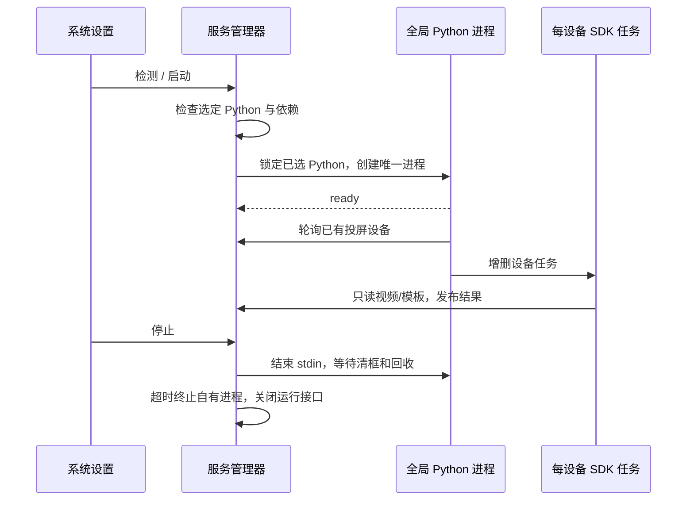

# v1.23.0-feature：全局模板匹配服务

## 目标与边界

系统设置提供全局检测、启动和停止。启动前使用当前配置 Python 检查 3.10+ 与 已安装的同版本 mywebscrcpy-sdk（含 Vision API）、httpx、websocket、av、cv2、numpy 的实际导入。一个 Python 进程使用所选 Python 中通过 pip 安装的 SDK，每台已存在实时投屏会话的设备独立线程、会话与缓存。关闭播放器后释放对应匹配任务，不因识别连接自身而长期保活设备；不启动离线设备或重放会话。

Go 构造管理器不创建 Python 进程；不保存自动启动状态。总服务存活且无设备时显示运行中、匹配设备数 0。等待新帧为正常等待，单设备异常不影响其他设备。重新连线只重试读取/匹配，不发送任何动作。

模板面板未启动时提示「自动模板匹配未启动，前往系统设置启动」。外部 SDK 发布结果仍可绘框；启动服务不保证命中，显示开关继续保留。

## 架构与生命周期

公开 API 为 GET /api/matching-service/status、POST /check、POST /start、POST /stop。状态含 state、pid、error、environment、devices；checking/starting/stopping 时拒绝重复变更。依赖检查结果仅针对实际选定解释器，路径变化后启动必复查。

Python 使用独立本地回环接口和随机令牌，允许设备列表、相应设备的模板只读和 Vision。视频入口拒绝 action.request；无 ADB、模板写入、任意全局接口。每次运行独立令牌；退出关闭接口及所有视频连接。Go 收集 stdout 的严格状态事件，stderr 转发进程日志，导入警告最多保留 1500 字节；进程未 ready 不显示运行中，崩溃立即转 failed，无自动重启。

## UI

系统配置增加「匹配」页，展示环境检测、缺失项、全局启动/停止、设备状态。复用现有 UI 组件与主题，保留原型方案；模板面板单条提示可直达系统设置匹配页。

## 迁移、回滚与风险

沿用 v1.22 SDK，不改旧匹配 CLI 或既有脚本入口。停止新增服务即可回到当前资产管理与外部发布方式，模板数据不迁移。SDK 与旧多参考图算法能力有差异，本版只明确支持 SDK 的主图片与 TM_CCOEFF_NORMED。

Python 依赖不自动安装。macOS PyAV/OpenCV 的重复类警告、跨平台 wheel 与 CPU 开销分别验收。状态 API 不将进程存在当作匹配命中。多结果发布者可能覆盖同一设备框，不加入新的仲裁策略。

## 原型与验收

方案为 prototypes/cases/matching-service-v1；只用本地模拟；界面截图与事实见 prototypes/README.md。验证未自动创建进程、缺依赖阻止启动、唯一进程、动态多设备、停止/崩溃回收、只读访问边界、正式 UI 和只读真机。Windows/Linux 原生未测保持明确边界。

合并主分支时接入 managed Python 与 pip SDK 管理：依赖检测和运行进程使用同一解释器与导入环境（保留用户安装目录，过滤继承的 PYTHONPATH），运行期间阻止安装或清理。主程序 VERSION 保持不变，本次 Vision 新能力可通过源码/wheel 安装；正式 PyPI 发布需递增 VERSION，避免覆盖已发布的基础包。

调试与正式任务分工：系统配置入口显示「模板匹配」，服务面板常驻说明「调试时按需启动模板匹配服务；正式执行任务时，由任务脚本负责模板匹配」。全局服务用于调试，正式任务的匹配流程由脚本管理。
