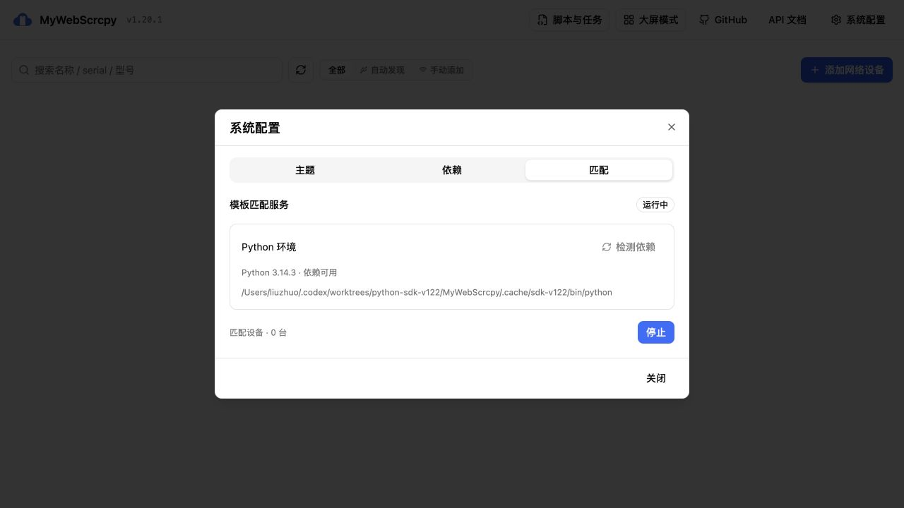
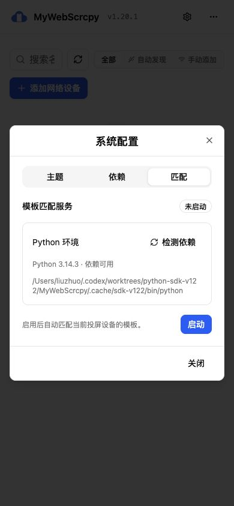
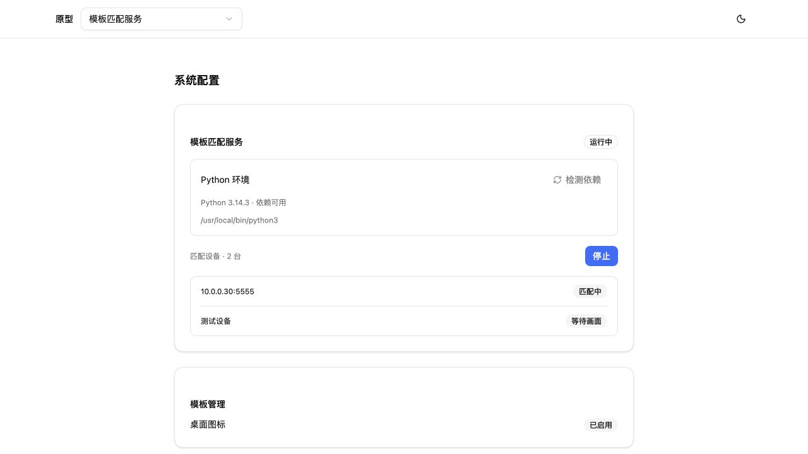
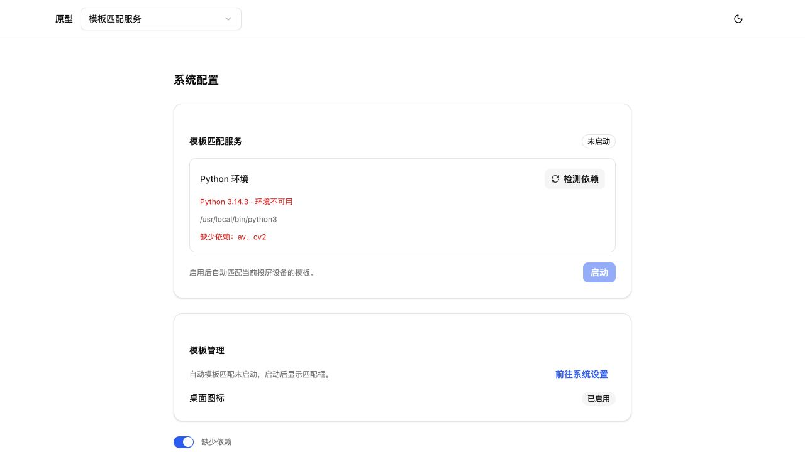
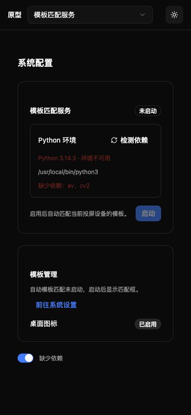

# 界面验收

- 正式界面：检测 Python、启动单个进程、运行中设备数 0、停止回到未启动。
- 原型：两设备状态、启停提示、缺少 av/cv2 时禁用启动、Enter 进入配置区域。
- 1280 像素桌面与 390×844 小屏实拍；浅色/深色，DOM scrollWidth 等于 innerWidth，无横向溢出。
- 原型复用正式 MatchingServiceContent，依赖和服务均为本地 Vue 模拟，不发送业务 API 或设备请求。
- 公网原型已建立临时隧道，但浏览器请求被客户端拦截（Network.loadingFailed / ERR_BLOCKED_BY_CLIENT）；未宣称公网浏览器验收成功。

本地预览：http://127.0.0.1:56323/#matching-service-v1 。本次公网隧道和独立正式测试服务已停止，本地原型保留。日志、进程记录和安全停止脚本位于独立工作区 prototypes/artifacts/remote-preview/v123/；停止本次预览可在该工作区执行 `python3 prototypes/artifacts/remote-preview/v123/stop-preview.py`，脚本先核对进程身份。
