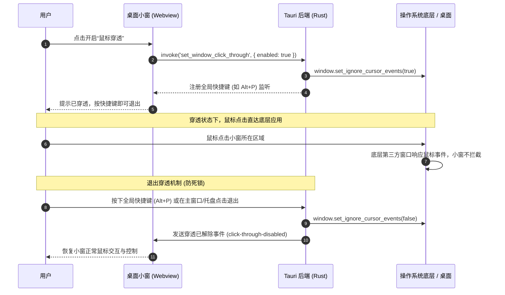
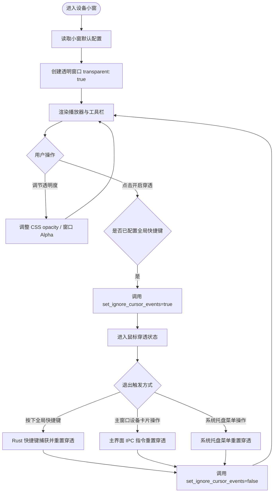

# v1.24.0-feature 设计文档：GUI 小窗透明度与鼠标穿透

## 背景

在桌面客户端（Tauri v2）中，设备投屏已支持独立桌面小窗（`player-*`）。用户在桌面端将小窗置顶或悬浮在其他工作窗口（如代码编辑器、浏览器或游戏）之上时，提出两项增强需求：
1. **调节小窗透明度**：使用户可以在观察手机屏幕内容的同时透视小窗下方的桌面背景。
2. **设置鼠标点击穿透**：使用户在点击小窗区域时，鼠标事件直接传递给小窗底部的操作系统桌面或其他应用，实现“只看画面不阻挡操作”的悬浮参考模式。

## 目标与非目标

**目标：**
- **小窗透明度调节**：
  - 桌面小窗窗口支持透明渲染，支持平滑调节整体透明度（20% ～ 100%）。
  - 提供轻量滑动条或快捷档位（如 100%、75%、50%、25%）。
- **鼠标穿透控制**：
  - 支持开启与关闭鼠标穿透（`set_ignore_cursor_events`）。
  - **核心防呆与退出机制**：穿透开启后，窗口内部无法再响应鼠标点击。必须配套**全局系统快捷键**（如 `Option/Alt + P`）以及主窗口/系统托盘的控制项，确保用户随时能一键退出穿透。
- **状态提示与防死锁引导**：
  - 在开启穿透前提供明确的快捷键提醒，开启后浮窗显示穿透状态指示，避免用户产生操作失控感。

**非目标：**
- 不对 Web 浏览器端（普通网页环境）模拟桌面级穿透（浏览器沙箱不支持点击穿透到操作系统桌面；Web 端仅支持页面内透明度预览）。
- 不破坏现有小窗拖拽、等比缩放、工具栏控制与 scrcpy 投屏流解码逻辑。

## 架构与核心时序

### 1. 穿透与退出时序（Mermaid 时序图）

### 2. 透明度与穿透控制流程（Mermaid 流程图）

## 关键决策

### 1. 窗口透明度实现方案
- **决策**：在 Tauri 创建设备小窗（`open_device_window`）时，WebviewWindow 开启 `.transparent(true)`。
- **原因**：若窗口本身不是透明窗口，调整前端 CSS 透明度只会露出窗口默认的黑色或白色底色，无法透出操作系统桌面。开启 `.transparent(true)` 后，可通过纯 CSS 调节容器 opacity 或通过原生 IPC 动态控制，既轻量又跨平台兼容良好。

### 2. 鼠标穿透与防死锁设计
- **决策**：严禁在缺少非鼠标恢复路径的情况下单独开启鼠标穿透。必须同时实现：
  1. **全局快捷键**：使用 `tauri-plugin-global-shortcut` 注册全局热键（如 `Option+P` / `Alt+P`）。
  2. **主窗口控制兜底**：主界面设备卡片在检测到对应小窗处于穿透状态时，提供“解除鼠标穿透”按钮。
  3. **小窗开启前确认/提示**：首次开启时简要告知恢复热键。

## 风险与权衡

| 风险点 | 影响 | 缓解方案 |
| --- | --- | --- |
| 鼠标穿透导致死锁无法退出 | 用户无法点击小窗的任何关闭或恢复按钮 | 必须在开启穿透的同时激活系统级全局快捷键，并在主窗口设备卡片与系统托盘提供双重恢复入口。 |
| Windows 平台下透明窗口的文字抗锯齿弱化 | WebView2 在透明窗口下可能使用灰度抗锯齿 | 仅在小窗内容区域透明，工具栏文字保持高对比度与清晰背景。 |
| Linux X11 无合成器环境透明度显示黑底 | 少数未开 Compositor 的 Linux 桌面无法半透明 | 在桌面端判断平台能力，不支持时给予优雅降级说明。 |
| 全局快捷键冲突 | 快捷键可能被第三方系统软件拦截 | 允许配置备选快捷键，并在主界面提供图形化一键解除按钮。 |

## 待确认问题
1. 全局快捷键的默认键位定义（推荐：`Alt + P`，Windows/Linux 下为 `Alt+P`，macOS 下为 `Option+P`）。
2. 透明度调节是仅降低投屏画面（Canvas）的透明度，还是包含小窗顶栏/边框一起半透明（建议：画面半透明，顶栏悬浮半透）。

## 迁移与回滚计划
- **迁移**：作为可选功能增量加入小窗顶栏扩展菜单，默认关闭，不改变现有用户使用习惯。
- **回滚**：若出现某些平台兼容性异常，直接在构建开关或小窗能力中禁用对应 IPC 命令即可，对主投屏链路零影响。
