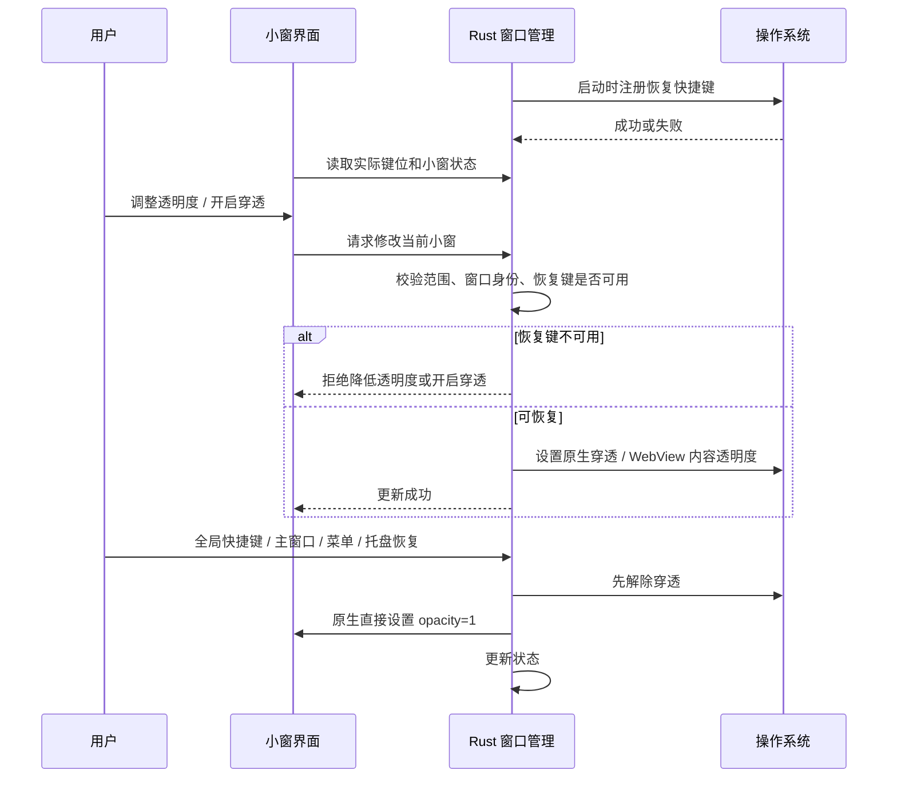
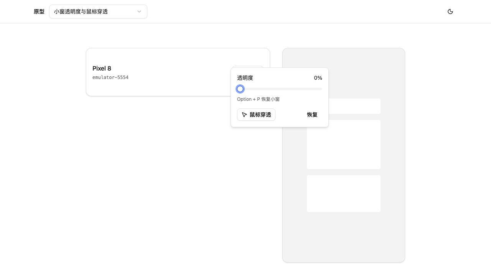
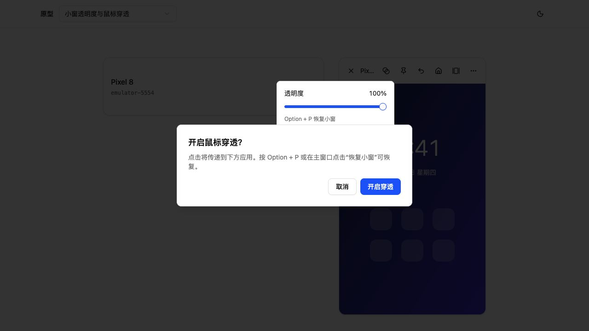
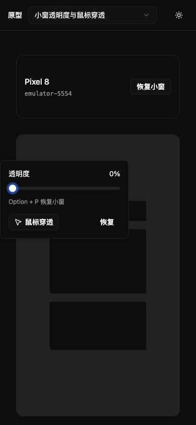

# v1.24.0-feature 设计文档：GUI 小窗透明度与鼠标穿透

## 背景与目标

设备投屏独立小窗需要在其他应用上方作为参考画面，同时允许操作下方应用。

- 透明度为 0%～100%，100% 正常显示、0% 内容完全透明，步长 1%。
- 支持原生鼠标穿透。透明度与穿透独立控制，默认 100%、不穿透。
- 恢复操作同时恢复到 100% 并解除穿透，覆盖内容不可见和无法点击两种情况。
- 默认 Option/Alt + P 恢复所有小窗；注册冲突时尝试 Control + Option/Alt + P，并显示实际注册的键位。
- 主窗口设备卡片恢复对应小窗，应用菜单和系统托盘恢复所有小窗。

## 非目标

- 普通浏览器网页不提供桌面透明度或原生鼠标穿透。
- 不修改解码、录制、设备控制、置顶、原生窗口标题栏和现有网页小窗行为。
- 本次不发布安装包，不更新正式版本号或标签。

## 界面与状态

小窗工具栏增加一个“透明度与鼠标穿透”图标。弹出面板包含滑块、当前百分比、实际恢复快捷键、鼠标穿透开关及恢复按钮。开启穿透前提示恢复方式。

透明度应用于整个 Web 内容，包括工具栏和画面；原生系统标题栏保留用于移动和关闭。弹出控件传送至 body，独立保持可见，便于在 0% 时继续调整。主窗口卡片仅在透明度低于 100% 或已穿透时显示“恢复小窗”。

状态由 Rust 的 `PlayerWindows` 按窗口标签维护，返回确定的 `serial`、`opacity`、`clickThrough`、`revision` 字段。透明 WebView 配合透明的 html/body 和 `#app` 的 opacity 显示桌面背景。macOS 启用 Tauri 所需的 `macos-private-api` 与 `macOSPrivateApi`。

前端多个设备卡片共享一个轮询，每秒同步一次，不连接网页端 IPC；拖动时只保留最新待执行值，恢复请求优先并取消排队中的透明度与穿透操作。异步响应带请求序号，防止旧快照覆盖更新。修改请求携带入队时的窗口 revision；恢复会递增 revision，原生拒绝恢复前的排队请求，避免恢复后再次变透明或穿透。

## 原生恢复流程

全局快捷键、应用菜单与托盘直接调用 Rust 恢复函数，不依赖小窗 Vue 是否仍在运行。批量恢复逐窗执行，单窗失败不阻止其他窗口。快捷键插件初始化或所有候选键位注册失败时禁用相关效果，应用继续正常启动。

关闭窗口移除状态；重新创建默认正常。再次打开已存在小窗时先恢复，再显示和聚焦。页面导航/刷新开始时解除穿透；新页面默认正常显示，避免在加载完成后才恢复而覆盖用户刚进行的调整。已建立投屏的设备断线时，`usePlayer` 通过可选的 `onDisconnect` 回调排队执行恢复，不依赖轮询快照是否已经更新；不使用也会在旋转等动作中变化的显示状态 `live` 判断断线。

## 原型与实拍

- 源码：`prototypes/cases/window-effects-v1/`，复用项目 Vue、shadcn-vue 与正式的纯界面控件 `WindowEffectsControl`，使用本地模拟状态。
- 预览：`pnpm --dir frontend proto`，本次复用现有 `http://127.0.0.1:5174/#window-effects-v1`，未重启该进程。
- 已操作：键盘 Home 到 0%、增量调整、恢复、穿透确认/取消与开启、主窗口恢复、明暗主题。
- 视口：桌面 1280×720、小屏 390×844；浏览器未记录 warning/error。
- 此处实拍说明交互方案，原生能力另由独立桌面测试验证。实施任务仅本地验证，未另行创建公网预览或替换运行中的正式客户端。

## 验证与边界

- Rust 边界测试覆盖 0、1、20、99、100、101、255，以及恢复键不可用时的限制。
- 前端并发测试覆盖网页不调用 IPC、共享轮询、最新滑动值、操作中恢复、卸载清理。
- `native-verify` 功能构建包含真实 WebView/IPC 验证，生产构建不包含测试脚本；使用不存在的测试 serial，不对真实设备发送控制命令。
- 自动化可验证计算后的 CSS、IPC、状态与恢复路径；画面透出桌面的合成效果、真实鼠标落点、真实全局按键与视频质量仍需桌面验收。
- Windows/Linux 尚未原生实测，不能由本机 macOS 结果推定通过。

## 风险与处理

| 风险 | 处理 |
| --- | --- |
| 0% 后内容不可见或开启穿透后无法点击 | 注册恢复键后才允许改变效果，主窗口/菜单/托盘可恢复 |
| 快捷键冲突或桌面环境不支持全局快捷键 | 尝试明确的备选键位，失败则禁用相关效果并在面板说明 |
| 半透明 WebView 在部分桌面合成器下显示异常 | 保留三平台原生验收项，不宣称已跨平台验证 |
| 页面加载或异步队列覆盖用户操作 | 加载开始时恢复；恢复优先、滑动值合并、快照序号校验 |

## 迁移与回滚

不保存透明度/穿透到磁盘，无数据迁移。首次打开和重开均为正常显示。现有功能保持原路径。需要回滚时整体回退本版本新增窗口效果模块、命令权限及界面入口，保留现有投屏逻辑。

## 待验收问题

- 使用真实键盘验证 Option/Alt + P 在其他应用前台时能恢复全部小窗。
- 验证鼠标点击确实到达窗口下方应用，以及透明合成、视频/录制、三平台表现。

实现依据：[Tauri Global Shortcut](https://v2.tauri.app/plugin/global-shortcut/)，以及本机锁定版本 Tauri 2.12.3 源码中的 `transparent` 与 `set_ignore_cursor_events`。
