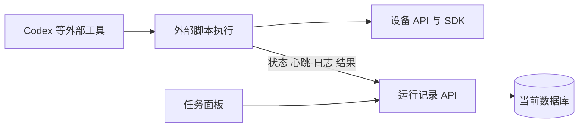

# v1.25.0-feature 设计

## 已确认范围

用户要求将编排、定时、AI 交互和脚本执行交给 Codex 等外部工具。项目只提供设备能力，并接收外部运行状态、日志与结果。2026-10-15 后续确认：早期阶段不做数据库兼容，直接重置；不要旧脚本导出，也不要专用任务上报令牌。以下方案覆盖早期计划中的迁移、备份、旧历史查看和令牌管理方案。

## 数据

- 旧数据库 user_version=0：单事务删除旧表，创建 devices、operation_logs、task_runs、task_run_logs 及当前 OCR 使用的 system_configs，写入版本 12500。重置包含设备记录、旧运行、脚本、操作日志和模型配置，不生成旧数据备份或迁移产物。system_configs 重新建立为空表，仅供当前功能存储配置，不保留旧模型配置。
- 新数据库版本 12500：正常打开保留数据，不能每次启动清空。未知非零版本报错，不自行猜测或改写。
- 无旧脚本导出、旧运行查询、旧报告生成、脚本执行与 Cron 接口。旧 `/scripts` 页面下线。
- 数据库之外的模板、手动录制、用户业务脚本、全局 Pi 与个人技能不删除。旧应用依赖选择 schema 1 重置为 ADB/Python 的 schema 2；新配置严格读取，未知结构报错。

## 运行契约

详见 `docs/task-runs.md` 与 `web/openapi.json`。写入无需新增专用令牌或配置。客户端标识去重、连续日志确认、终态冻结和结果冲突拒绝仍属于运行记录的必要一致性约束。

- 一个运行对应一个明确设备序列号；source 是说明。
- 执行状态：running、succeeded、failed、cancelled。60 秒无心跳派生 disconnected，不伪造失败或成功。
- 服务不启动、恢复、停止或排他调度外部进程。
- SDK 有界缓存、分批上传、后台保活，结束前确认日志；失败落盘并明确报错。
- 面板提供分页、筛选、日志下载、结果查看。报告安全渲染，禁止脚本与嵌入媒体。
- 不增加接入配置面板、旧数据导出或开发说明文案。

## 验证边界

使用隔离数据库与假 ADB 测试重置一次、重启保留、未知版本拒绝、直接上报与状态一致性；生产构建后使用真实浏览器验证。临时服务不接触用户真实数据库或设备。不将本机测试视为 Windows/Linux 原生、远端 CI、真机业务或 Codex 实际定时执行的验收。
