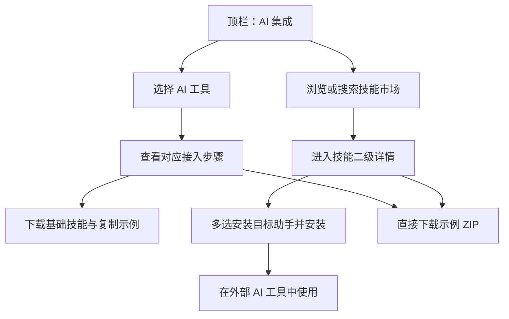
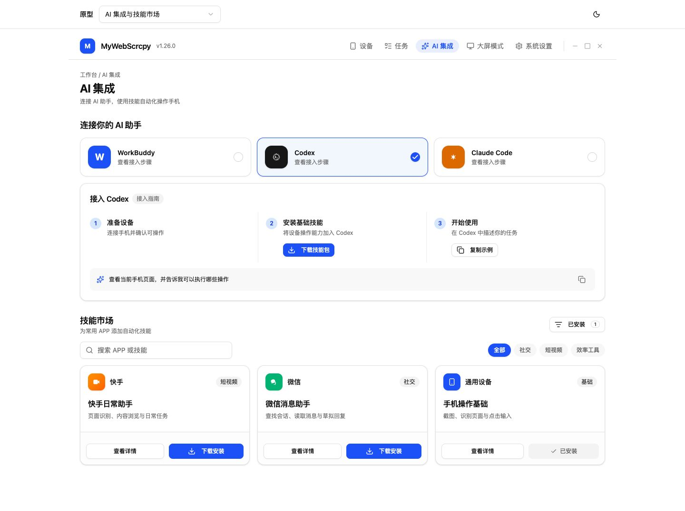
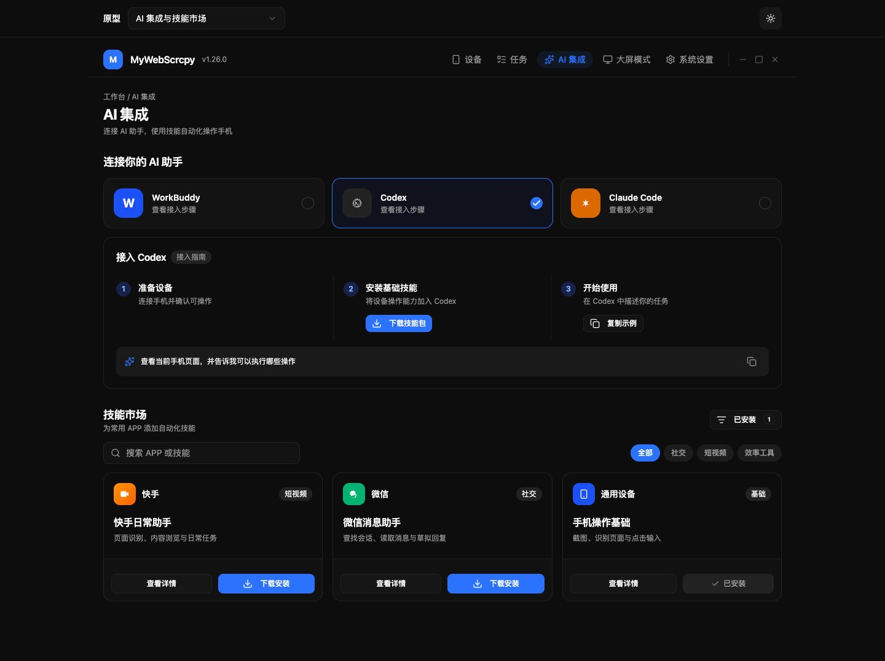
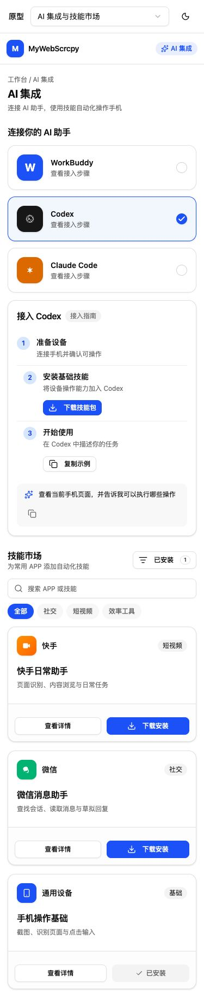
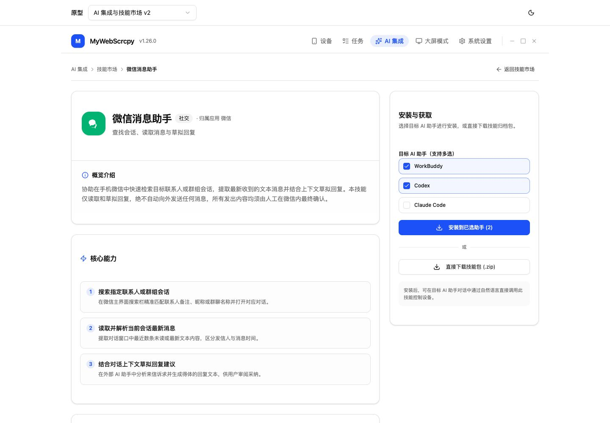
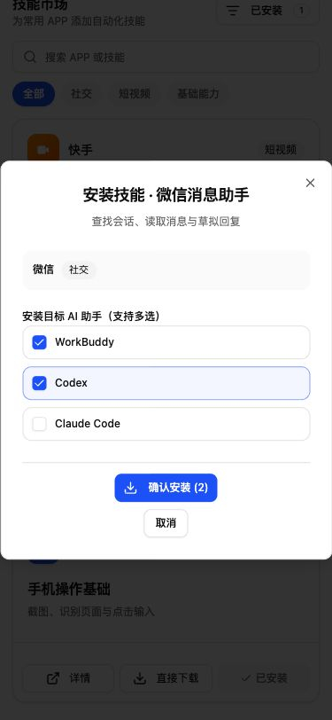

# v1.26.0-feature：AI 集成与技能市场

## 背景

设备能力由 MyWebScrcpy 提供，AI 对话、编排与执行沿用外部工具。用户需要从应用内找到接入方式，并获取常用 APP 的自动化技能。

## 目标与范围

1. 顶栏新增“AI 集成”入口，展示 WorkBuddy、Codex、Claude Code 的接入指引。
2. 提供技能市场，支持查找、查看详情、下载与安装 APP 自动化技能。
3. 首轮使用内置 imagegen 制作视觉概念图；2026-10-16 用户追加授权开启仙人模式，由 agy 制作项目内可交互原型。

当前范围为视觉设计与本地模拟交互原型。不实现正式页面、接入逻辑或安装器，不修改正式版本号，不把示例理解为已上架技能或已验证兼容性。

## 关键决策

- 延续 `frontend/src/components/layout/AppHeader.vue` 的顶部导航结构与 `frontend/src/style.css` 的白底、蓝色强调主题。
- AI 集成、技能市场直接在同页呈现，减少进入路径；本轮不确定正式路由或组件文件名。
- 上半区展示三种 AI 工具选择卡；选择后在下方显示对应接入步骤，示意阶段以 Codex 为例。
- 指引顺序为准备设备、安装基础技能、开始使用；提供下载技能包与复制任务示例入口。真实命令、文件落点与配置需在实施前核对各工具官方契约。
- 下半区展示技能市场，包含搜索、分类、查看详情、下载安装与已安装入口。
- 示例卡片为快手日常助手、微信消息助手、手机操作基础。文案只说明候选能力，不表示这些技能已经发布。
- 微信示例为查找会话、读取消息、草拟回复；外部发送动作需要明确授权。
- 不增加内置 AI 聊天、模型密钥配置或脚本调度器；延续已有外部工具执行边界。

以上为候选用户流程；安装目标、权限、来源与错误处理需要在正式实施设计中确定。

## 界面概念图

首轮按用户要求采用 imagegen 生成效果图；随后按新增授权推进可交互原型。生成图不作为浏览器验证证据。

- 方案版本：v1，同页 AI 接入与技能市场。
- 页面状态：选择 Codex，市场展示三个示例技能。
- 生成方式：内置 image_gen。
- 图片：`prototypes/ai-integration-market-v1.png`。
- 完整提示词：`prototypes/imagegen-prompt-v1.md`。
- 已目视检查生成图：AI 工具名称、步骤、搜索分类与下载安装入口清楚，关键内容无裁切。兼容性与已安装状态均为示例。
- 未测交互：工具切换、搜索筛选、详情、下载、安装及已安装管理。

## 风险与待确认问题

- WorkBuddy、Codex、Claude Code 的真实技能格式、作用域、安装路径和重新加载方式尚未核对；不能据图片宣称互相兼容。
- 技能市场的内容来源、发布维护方式、分发服务与版本契约待确定。
- 需明确“下载安装”是保存包文件、安装到应用管理目录，还是直接安装到选定 AI 工具；下载成功不能视为安装成功。
- 第三方技能执行权限、覆盖更新、卸载与失败恢复方案待正式实现阶段收敛。
- AI 生成图可能存在字体与细节偏差，正式界面需以项目组件落地，并做真实交互验证。

## 可交互原型推进

- 用户授权：仙人模式，使用 agy 继续原型设计。
- 执行机器 / 工具 / 模型：本机 / Antigravity / `gemini-3.8-flash-high`，来自工具实际历史并经当前项目模型查询校验。
- 原型源码目录：`prototypes/cases/ai-integration-v1/`；使用项目 Vue、shadcn-vue 与主题，独立于正式应用。
- 已实现并独立验证的原型交互：切换三种 AI 接入指南、复制任务示例、搜索与分类、空结果重置、详情弹窗、选择目标工具、内存模拟安装、按工具查看已安装技能。
- 预览入口：`https://demo.wskj.work/#ai-integration-v1`，已从公网独立验证。
- 本地入口：`http://127.0.0.1:5174/#ai-integration-v1`，复用已确认的项目预览进程。
- 安装流程只修改原型内存；v2 允许浏览器保存示例 ZIP，仍不写入真实工具安装目录，不调用设备/API 或发送消息。

### 原型实拍与验收

- 方案：`ai-integration-v1`，由 Antigravity 实施，Codex 独立审查并在同一原生会话返工一次。
- 原型检查与构建：`pnpm --dir frontend proto:check`、`pnpm --dir frontend proto:build` 均由 Codex 独立重跑通过。
- 桌面实拍视口 1440 × 1000，默认 Codex、市场全部分类；375 × 812 手机视口无横向溢出，390 × 844 安装弹窗无横向溢出。
- 已测：工具切换与 Space/Enter 操作、搜索与分类交集、空结果重置、已安装过滤、详情进入安装确认、取消不改状态、按工具隔离安装记录、重复安装禁用、目标切换、复制内容与剪贴板一致、切换工具清理复制提示、深浅主题、Escape 关闭弹窗。
- 公网资源检查覆盖最终稿 86 个响应，仅使用 `demo.wskj.work`，无失败或 HTTP 4xx/5xx；WebSocket 握手为 101，临时元信息变更经公网自动生效并完整恢复，HMR 通过。
- 最终修正后未捕获新的控制台 warning/error；组装中间文件时的历史错误不作为最终稿结果。
- 图片中的已安装状态是原型内存示例，刷新即可重置。未验证真实 AI 工具接入、包下载、文件安装或设备业务结果；复制失败分支仅代码审查，未人为修改浏览器权限注入失败。
- 运行记录与停止脚本位于 `prototypes/artifacts/remote-preview/20261016-ai-integration-agy/`。运行 `bash prototypes/artifacts/remote-preview/20261016-ai-integration-agy/stop.sh` 仅停止本次隧道，保留复用的 Vite 服务。

安装弹窗、手机安装弹窗和空状态实拍分别为 `prototypes/ai-integration-v1-install.jpg`、`prototypes/ai-integration-v1-mobile-install.jpg`、`prototypes/ai-integration-v1-empty.jpg`。

## v2：直接下载、二级详情与多目标安装（原型已独立验收）

2026-10-16 用户新增要求：在下载技能包处增加直接下载；技能详情内容更丰富，进入二级页面；安装目标助手支持多选。

- 保留 v1；新增 `prototypes/cases/ai-integration-v2/`，同一 1.26 版本内保留两份原型用于对照。
- 指南保留现有技能包安装入口，增加“直接下载”，不经安装弹窗保存示例 ZIP，不改变安装记录。详情页也能下载当前技能对应的示例包。
- ZIP 是有效的原型示例文件，包含对应技能的 `SKILL.md` 与说明；文件名带 `example`，包内说明示例边界，不宣称提供真实自动化实现或已验证的工具兼容。
- “查看详情”改为二级页面：面包屑与返回市场、应用与技能信息、概览、核心能力与解释、典型场景、可复制任务示例、准备条件和使用步骤；桌面右侧为安装操作，小屏纵向布局。
- 二级页使用原型内独立导航状态与 URL 查询参数，支持分享、刷新及浏览器返回/前进；未知技能给出未找到状态，禁止替换为其他技能。返回保留市场筛选与工具选择。
- 目标助手安装使用 Checkbox 多选，弹窗与二级页一致；默认选择当前助手，空选择禁用安装，已安装目标防重复，确认仅更新所选未安装助手的内存记录，取消不写入。
- 外部任务仍只授权新原型目录，由本机 Antigravity `gemini-3.8-flash-high` 实施；已有业务改动、v1 源码与截图保留，版本文档由 Codex 维护。
- 最新市场入口：`https://demo.wskj.work/#ai-integration-v2`。
- 微信详情示例：`https://demo.wskj.work/?skill=wechat-helper#ai-integration-v2`，可直接刷新打开。

### v2 验收结果

- Codex 独立重跑 `proto:check`、`proto:build` 通过。原型源码与三份静态 ZIP 一起构建，未接入正式应用。
- 浏览器真实下载基础、快手、微信三份示例包至下载目录，逐字节比对源文件，CRC 及 `SKILL.md` 内容检查通过。直接下载不打开安装弹窗、不改变安装记录。
- 安装弹窗及详情安装卡均验证：默认当前助手、空选择禁用、两目标选择、取消不写入、确认只更新选中目标、已安装目标勾选并禁用、重复安装禁用；Space 键多选可用。
- 详情页验证：介绍、核心能力、场景、任务示例、准备和步骤完整；任务复制与剪贴板一致；返回保留搜索文本、分类、已安装筛选、所选 AI 工具及滚动位置；浏览器前进后退与详情刷新通过；未知技能显示未找到并可返回市场。
- 桌面 1440 × 1000、375 × 812 手机市场和安装弹窗、375/390px 详情页均无横向溢出，浅深色主题均保存实拍。
- 最终页面完整加载记录未截断：93 个响应仅来自 `demo.wskj.work`，无 HTTP 4xx/5xx 或失败请求，WebSocket 101，最终稿无新增控制台警告或错误。
- 外部调用边界：agy 已生成代码并在同一会话修正一次，但初轮与续接的原生结束回执均因 API stream EOF 为 ERROR；未把其自述或退出码作为成功依据。上述原型验收来自 Codex 的独立构建、文件与浏览器证据。
- 运行及验收记录：`prototypes/artifacts/remote-preview/20261016-ai-integration-v2-agy/`。旧隧道已退出，确认固定端口为空后创建本次隧道；继续复用原 Vite 服务。停止本次隧道：`bash prototypes/artifacts/remote-preview/20261016-ai-integration-v2-agy/stop.sh`。
- 保留 v1 及原有改动，未提交、推送、合并或部署；没有附加工作区可清理。

完整详情、深色详情、手机详情及市场实拍分别保存在 `prototypes/ai-integration-v2-detail-desktop.jpg`、`prototypes/ai-integration-v2-detail-dark.jpg`、`prototypes/ai-integration-v2-detail-mobile.jpg`、`prototypes/ai-integration-v2-market-desktop.jpg`、`prototypes/ai-integration-v2-market-mobile.jpg`。

## 迁移计划

本轮只新增设计资料，无数据迁移。正式新增核心功能时，同步更新术语字典；不改动已有脏文件中的术语记录。

## 回滚计划

设计阶段可弃用本方案并新增后续方案，保留已有图片和记录；正式功能回滚需依据最终实现另行设计。
