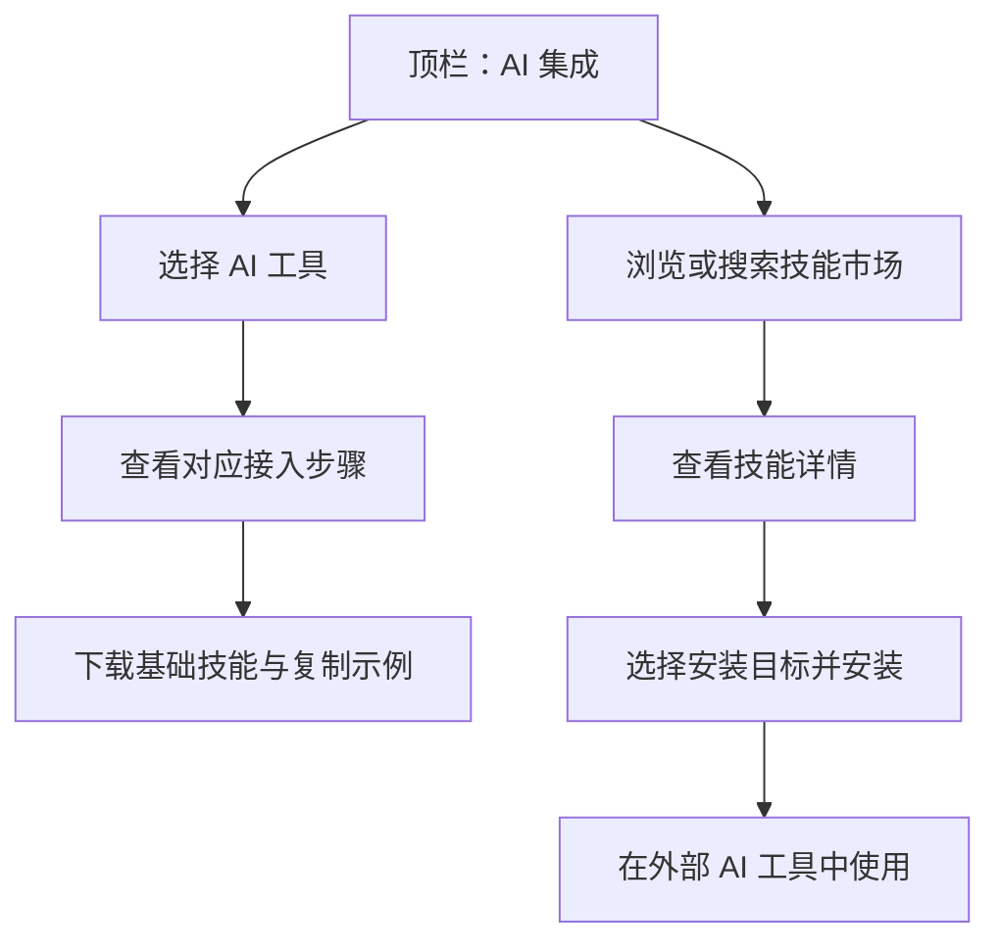
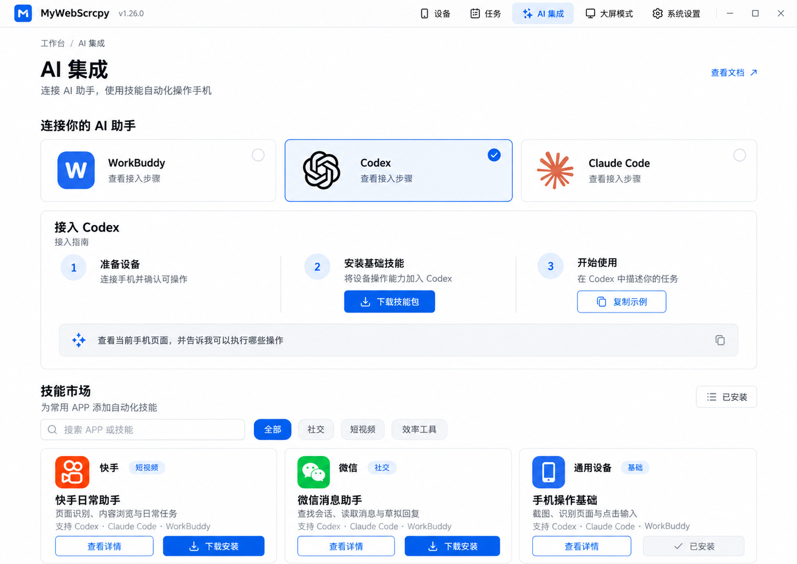

# v1.26.0-feature：AI 集成与技能市场

## 背景

设备能力由 MyWebScrcpy 提供，AI 对话、编排与执行沿用外部工具。用户需要从应用内找到接入方式，并获取常用 APP 的自动化技能。

## 目标与范围

1. 顶栏新增“AI 集成”入口，展示 WorkBuddy、Codex、Claude Code 的接入指引。
2. 提供技能市场，支持查找、查看详情、下载与安装 APP 自动化技能。
3. 本轮先用内置 imagegen 制作视觉概念图，保留可继续讨论的版本记录。

本轮不实现正式页面、接入逻辑或安装器，不修改正式版本号，不把图片中的示例理解为已上架技能或已验证兼容性。

## 关键决策

- 延续 `frontend/src/components/layout/AppHeader.vue` 的顶部导航结构与 `frontend/src/style.css` 的白底、蓝色强调主题。
- AI 集成、技能市场直接在同页呈现，减少进入路径；本轮不确定正式路由或组件文件名。
- 上半区展示三种 AI 工具选择卡；选择后在下方显示对应接入步骤，示意阶段以 Codex 为例。
- 指引顺序为准备设备、安装基础技能、开始使用；提供下载技能包与复制任务示例入口。真实命令、文件落点与配置需在实施前核对各工具官方契约。
- 下半区展示技能市场，包含搜索、分类、查看详情、下载安装与已安装入口。
- 示例卡片为快手日常助手、微信消息助手、手机操作基础。文案只说明候选能力，不表示这些技能已经发布。
- 微信示例为查找会话、读取消息、草拟回复；外部发送动作需要明确授权。
- 不增加内置 AI 聊天、模型密钥配置或脚本调度器；延续已有外部工具执行边界。

以上为候选用户流程；安装目标、权限、来源与错误处理需要在正式实施设计中确定。

## 界面概念图

用户明确要求 imagegen，本轮采用 AI 生成效果图，不生成可交互原型，也不以生成图替代浏览器验证。

- 方案版本：v1，同页 AI 接入与技能市场。
- 页面状态：选择 Codex，市场展示三个示例技能。
- 生成方式：内置 image_gen。
- 图片：`prototypes/ai-integration-market-v1.png`。
- 完整提示词：`prototypes/imagegen-prompt-v1.md`。
- 已目视检查生成图：AI 工具名称、步骤、搜索分类与下载安装入口清楚，关键内容无裁切。兼容性与已安装状态均为示例。
- 未测交互：工具切换、搜索筛选、详情、下载、安装及已安装管理。

## 风险与待确认问题

- WorkBuddy、Codex、Claude Code 的真实技能格式、作用域、安装路径和重新加载方式尚未核对；不能据图片宣称互相兼容。
- 技能市场的内容来源、发布维护方式、分发服务与版本契约待确定。
- 需明确“下载安装”是保存包文件、安装到应用管理目录，还是直接安装到选定 AI 工具；下载成功不能视为安装成功。
- 第三方技能执行权限、覆盖更新、卸载与失败恢复方案待正式实现阶段收敛。
- AI 生成图可能存在字体与细节偏差，正式界面需以项目组件落地，并做真实交互验证。

## 迁移计划

本轮只新增设计资料，无数据迁移。正式新增核心功能时，同步更新术语字典；不改动已有脏文件中的术语记录。

## 回滚计划

设计阶段可弃用本方案并新增后续方案，保留已有图片和记录；正式功能回滚需依据最终实现另行设计。
