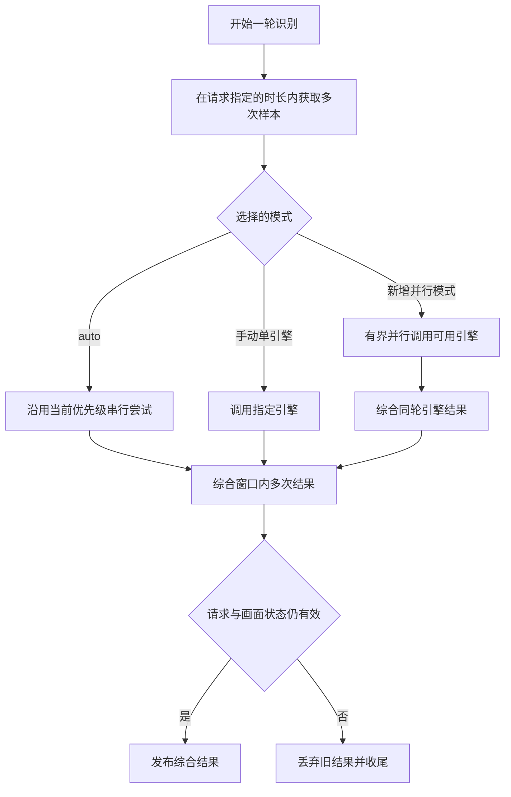
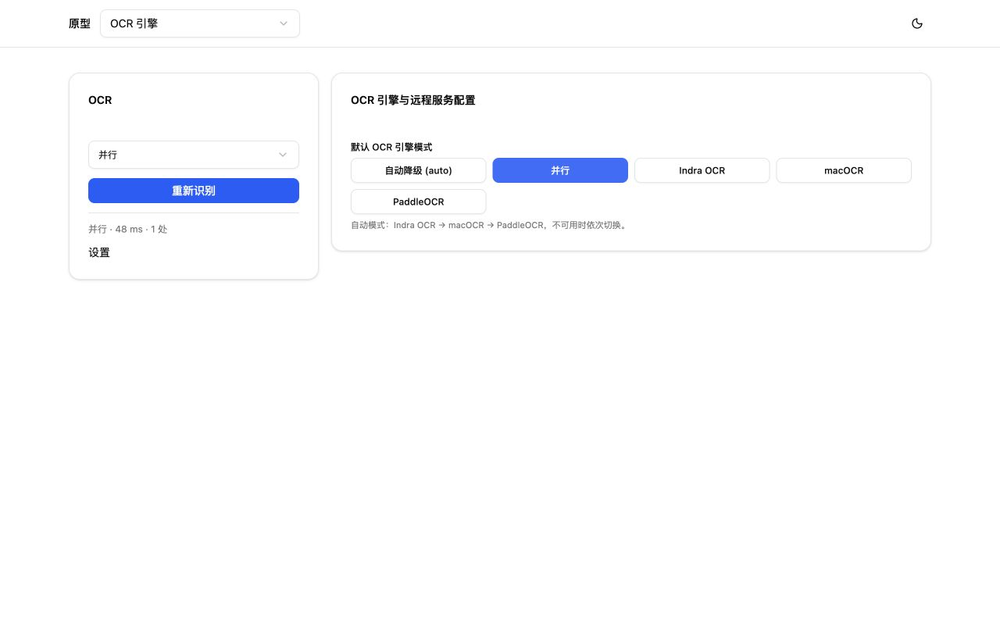
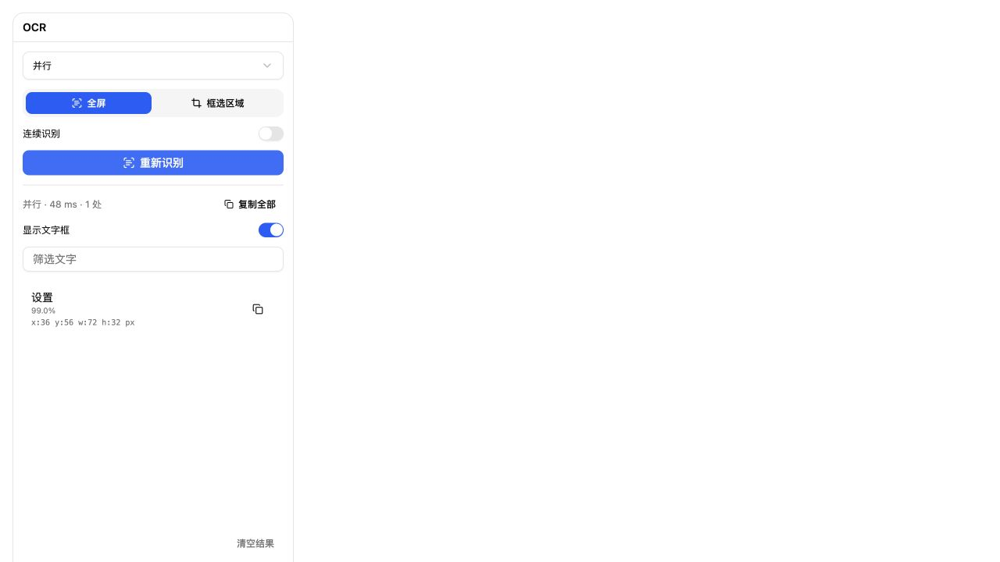
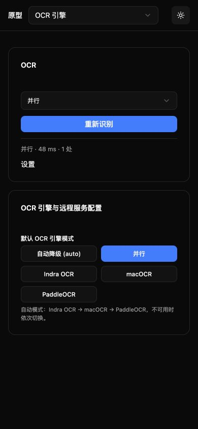

# v1.28.0-feature：OCR 防抖与并行模式

状态：功能已实现，自动化回归与浏览器组件验收通过；真机验收待指定设备，未合回主线。

## 背景

用户反馈 OCR 结果抖动，要求在 0.5 秒内连续获取多次识别结果后综合。当前 `internal/ocr/service.go` 的 auto 按 Indra OCR → macOCR → PaddleOCR 串行尝试，检查器一次请求提交一张截图。

## 目标与已确认决策

1. OCR 接口新增抖动时长参数，由调用方指定一段时间内的连续识别与结果综合；原先 0.5 秒作为使用示例，不再写死。
2. 保留 auto 当前按优先级串行尝试引擎的行为。
3. 新增独立“并行模式”：多个 OCR 引擎可用时并行识别，并综合结果。
4. 明确区分采样、各引擎输出与最终结果；不能把简单拼接、重复框叠加视为综合识别。

## 非目标

- 不调整正式版本来源，不部署或重启现有线上服务。
- 不引入新的 OCR 引擎，不改变现有手动指定单引擎的含义。
- 仅同步受影响术语、接口和调用方，不修改无关业务。

## 抖动时长参数

- 已确认需求：`POST /api/vision/ocr` 接受调用方指定的抖动时长，在这段时间内连续获取 OCR 结果，最后返回综合结果；不是仅把单次识别的网络超时调大。
- 确定字段 `stabilization_ms`，整数毫秒，范围 0～5000，例如 `500` 表示 0.5 秒窗口；省略或 0 为单次识别。源码、OpenAPI、SDK 与调用方同步。
- 时长与引擎模式分别设置：auto 继续串行选引擎；独立并行模式调用多个可用引擎。两种模式均可按时长综合，不用模式值替代时间参数。
- 非法数值、null、负值与超过 5000 的时长均返回参数错误，不能静默改成其他时长。
- 普通 OCR 路由新增 JSON 或无 file 的 multipart 设备模式，使用 serial 连续截图；上传图片继续支持单次识别，上传 file 且时长大于 0 返回 400。

## 实现边界

下列规则已按当前代码落实，验收状态另见会话和任务清单。

- 时间采样与多引擎综合分开处理：前者解决跨样本抖动，后者处理同轮不同引擎的差异。HTTP 设备模式使用 ADB 新截图，SDK 使用 Vision 新帧；上传单张图片只能做单次引擎识别。
- 对同一设备、区域与有效画面状态采样，综合前统一已确认的坐标与文本结构。按位置匹配区域，以文字票数选择文字，获胜文字的坐标取中位数，不比较跨引擎置信度；阈值仍待真实样本评估。
- 并行模式对三个配置引擎并发发起实际识别，以有效响应判断可用性，不启动服务或另猜测健康检查接口；单引擎最多 5 秒。部分失败返回成功结果及原因，全部失败显式报错。
- 并发数、每个引擎的在途请求数、窗口内采样数与超时均应有上限；慢引擎不能无限拖延结果或累积后台请求。取消后完成收尾，日志不阻塞主要识别。
- 结果发布前核对请求、设备会话、区域、尺寸、旋转与画面新鲜度；取消、断线、换区或旧轮次结果不能覆盖新结果。页面切换不能因防抖而保留上一页面文字。
- 新模式需要同步引擎选择入口、后端校验、OpenAPI、SDK 与相关文档。字段值、响应来源标识及部分成功表达必须以实施时确认的 Schema 为准。

图示表达采样、引擎调度与两层综合的关系；实际每轮取样后立即识别，轮次串行。窗口与请求总预算独立。

## 已确定的运行约束与待验收项

- 时间窗口控制新采样启动：轮次最小间隔 50ms，上限 101；总请求另有 30 秒预算，慢引擎可能只完成一次采样，响应返回真实 samples。
- 同一服务最多 2 个设备采样/并行请求；parallel 每轮最多 3 个引擎并行，每引擎最多 5 秒，并发超额返回 429。超时返回 504，取消返回 408，全部引擎失败返回 502。
- 区域按 IoU ≥ 0.3 匹配，同一来源每区域最多一票；文字多数票、同票使用最新候选，坐标中位数。时序结果必须在最新轮出现且覆盖至少半数轮，文字候选也限定于最新轮。
- 窗口内画面尺寸变化拒绝整轮结果，取消后不发布；关键词筛选在综合之后执行。
- 仍需真实设备验证稳定性、准确性与延迟；现有 fixture 与单元测试不能代替真机证据。

## 风险

- 多样本叠加多引擎会增加 CPU/GPU、内存与网络负载；必须测量端到端延迟和取消后资源释放。
- 单纯并集会引入重复或错误文字，过强投票可能漏掉短暂出现的有效文本。
- 防抖可能增加显示延迟，或把旧页面识别结果带入新页面；需在稳定性和及时性之间基于样本验证。
- 不同引擎的置信度与文本切分不一定可直接比较，融合前需核对真实契约。

## 迁移与回滚计划

- 设计阶段先核对现有配置、请求和响应；新增模式保留 auto 及现有单引擎配置含义，现有配置无需自动迁移。
- 已同步术语、接口、SDK 与 UI 选择入口；界面只增加“并行”选项，不新增时长输入框。原型与正式组件 fixture 均使用现有组件独立验证，未进入正式路由。
- 回滚限定在本版本变更范围内，先制定配置和响应契约回退方案，保留其他任务改动；不通过关闭必要能力或忽略错误制造成功。

## 界面与证据

- 原型源码：`prototypes/cases/ocr-parallel-v128/`；复用现有 Select、Button 与 Card，方案 v1。
- 原型入口：`/#ocr-parallel-v128`，使用项目独立原型预览；正式组件 fixture 位于同目录的 `verification/`，由 `serve-fixture.mjs` 启动，使用本地模拟数据。具体端口与运行记录见 `session.md`。
- 实拍覆盖原型桌面 1280×800、正式组件桌面 1280×720、小屏 390×844、明暗主题、并行和自动切换；正式组件 fixture 验证选择值与结果来源显示，属于浏览器组件验收，不代表真实设备识别。

