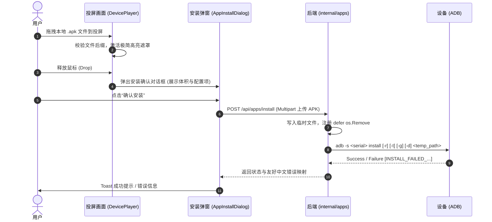
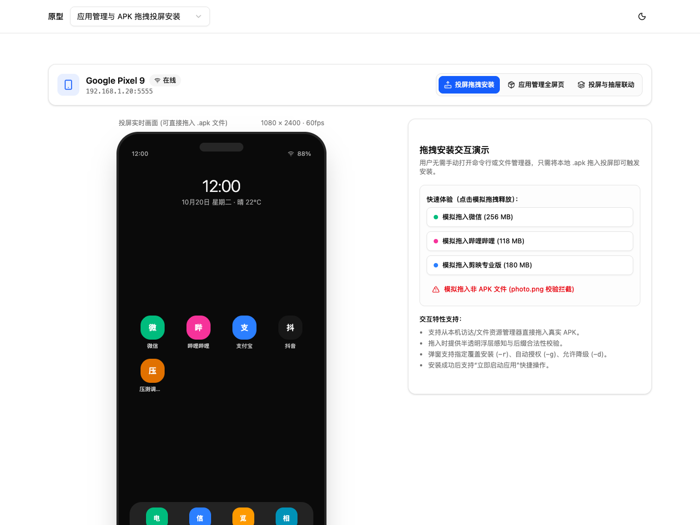
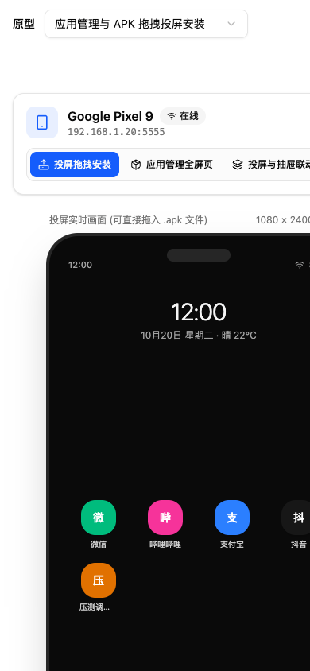

# v1.30.0-feature 设计文档

## 背景

MyWebScrcpy 当前已具备投屏流传输、交互控制、文件管理、ADB 终端和视觉识别等能力。目前若需安装本地 APK，通常需要打开终端执行 `adb install` 或通过文件管理器上传至手机后再手动点击，缺乏与投屏画面的直观交互。

本版本专门实现**投屏拖拽安装 APK**，用户直接将电脑本地的 `.apk` 文件拖入投屏画面上方，即可触发安装确认弹窗并完成向设备的安装部署。

---

## 目标与非目标

**目标：**
1. **投屏拖拽感知**：
   - 投屏画面容器（`DevicePlayer.vue`）支持原生 HTML5 与 Tauri 桌面端文件拖放；
   - 仅对 `.apk` 扩展名激活极简半透明高亮遮罩（“松开以安装应用”），非 APK 文件友好提示拦截。
2. **安装确认与参数配置**：
   - 释放文件后弹出模态安装确认对话框，展示包体名称与格式化体积；
   - 提供核心安装参数选项（`-r` 保留数据覆盖安装、`-g` 自动授予运行时权限、`-d` 允许降级安装）。
3. **安装执行与结果反馈**：
   - 前端通过 XHR 监听上传进度，流式暂存到服务端临时文件；
   - 后端调用 `adb install` 执行安装，无论成功或失败均自动清理临时文件；
   - 将 ADB 返回的失败代码（如 `INSTALL_FAILED_VERSION_DOWNGRADE` 等）精准映射为友好中文描述；
   - 安装完成后提供即时反馈提示。

**非目标：**
- **不做应用管理/应用市场**：根据用户最新指令，全面移除应用列表展示、系统/用户应用分类扫描、详情查看及启停卸载等功能；
- 不在投屏界面上堆砌多余文字说明或教学卡片，保持界面整洁纯粹。

---

## 关键决策

### 1. 投屏拖拽事件流与安装闭环
- **决策**：投屏区域监听 `dragover` / `dragleave` / `drop`。释放后先弹窗展示应用信息与参数开关，用户确认后才发起上传与 `adb install`。
- **原因**：避免误拖拽导致意外安装未知文件，给用户留出取消与参数配置的控制权。

### 2. 临时文件生命周期与安全清理
- **决策**：上传的 APK 写入系统临时目录，在安装命令执行结束时立即通过 `defer os.Remove` 删除。
- **原因**：避免大体积安装包堆积在服务端占用磁盘存储。

### 3. ADB 错误码中文精准映射
- **决策**：解析 ADB 输出中的 `INSTALL_FAILED_...` 标记，映射为用户可理解的中文提示（例如版本过低建议勾选降级、存储空间不足、架构不兼容等）。

---

## 业务流程与架构

### 投屏拖拽安装时序

---

## 界面原型

- **方案**：投屏拖拽安装 v1；源码位于 `prototypes/cases/app-management-v1/`。
- **预览**：`pnpm --dir frontend proto` · 公网访问 `https://demo.wskj.work/#app-management-v1`。
- **桌面实拍**：1280×960，投屏操控与拖拽感知：
- **小屏实拍**：390×844，响应式布局：
- **已验证**：拖拽激活半透明层、释放弹窗、参数配置、进度指示与错误拦截。

---

## 风险与权衡

- **[风险 1] 跨平台文件拖放差异**：Tauri 原生小窗模式下部分 Web drop 事件可能被系统拦截。
  - **缓解**：结合标准 HTML5 拖放事件与 Tauri 原生文件拖放监听，保证 Web 与桌面端无缝兼容。
- **[风险 2] 临时文件清理**：大体积 APK 上传后若安装中断，可能残留在服务端临时目录。
  - **缓解**：安装完成后（无论成功或失败）立即使用 `defer os.Remove` 清理临时文件。

---

## 迁移与回滚计划

- **迁移**：新增 `internal/apps` 模块的 `POST /api/apps/install` 接口，在 `DevicePlayer.vue` 中接入拖放监听，不影响现有投屏视频流与任何已有控制指令。
- **回滚**：若出现异常，只需注销 `/api/apps/install` 接口并移除 `DevicePlayer.vue` 的 drop 监听，完全不影响核心投屏与控制功能。
