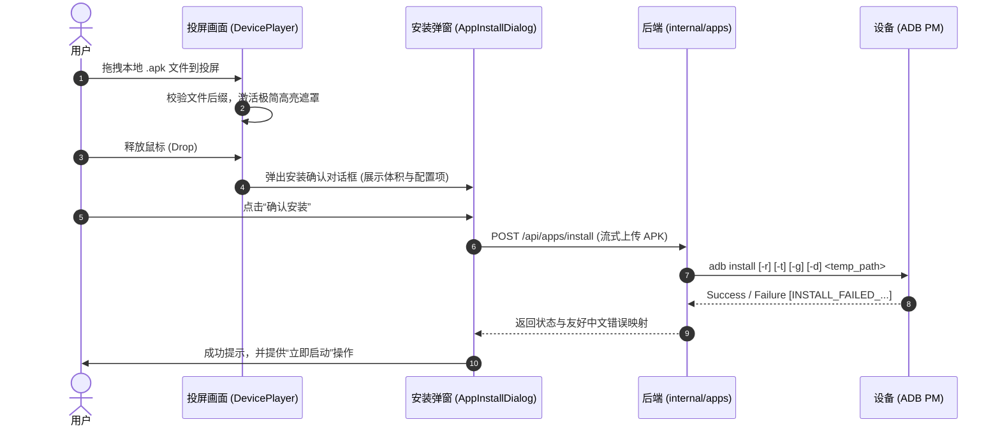
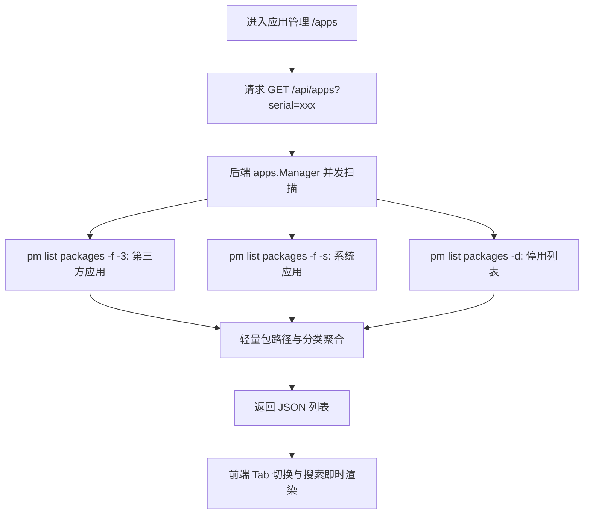

# v1.30.0-feature 设计文档

## 背景

MyWebScrcpy 当前已具备投屏流传输、交互控制、文件管理、ADB 终端和视觉识别等综合能力。目前在应用安装与运维场景中，用户通常需要切换到系统 ADB Shell 手动输入命令，或在第三方文件管理器中来回拷贝 APK，体验割裂。

本版本引入**应用管理**与**投屏拖拽安装 APK**，打通从电脑桌面直接向投屏投放安装包的直观交互，并在 Web 端实现对设备应用的集中化管理。

---

## 目标与非目标

**目标：**
1. **投屏拖拽安装 APK**：
   - 投屏画面支持原生 HTML5 / 桌面端拖放，拖入 `.apk` 文件即时激活高亮；
   - 释放文件后弹出安装确认对话框，展示包体大小并提供常用安装参数（`-r` 保留数据覆盖、`-g` 自动授权、`-d` 允许降级）；
   - 执行后台 ADB 安装并反馈结果，提供“立即启动应用”快捷按钮。
2. **应用管理面板**：
   - 清晰区分**用户应用（第三方）**与**系统应用（内置）**，支持分类切换与按包名/名称搜索；
   - 支持高频操作：一键启动、强制停止、清除数据、导出 APK、停用/启用；
   - 针对系统应用提供安全防范机制，禁止误卸载关键核心组件。
3. **架构对称**：
   - 沿用文件管理（FilesView）的成熟模式，同时支持 `/apps?serial=<serial>` 独立大页与投屏详情页右侧抽屉内嵌模式。

**非目标：**
- 不自建独立 APK 应用商店或下载中心（仅服务于本地 APK 安装与设备已有应用管理）；
- 不侵入修改 scrcpy-server 的视频编解码及控制传输主协议；
- 不在投屏界面上堆砌使用说明或功能介绍，遵循后台 UI 极简设计原则。

---

## 关键决策

### 1. 投屏拖拽事件流与安装闭环
- **决策**：投屏区域监听 `dragover` / `drop`，拦截非 `.apk` 后缀；释放后先弹窗确认并配置选项，用户点击确认后方发起上传与 `adb install`。
- **原因**：避免误拖拽普通大文件或意外直接安装未知文件；给予用户覆盖安装、授权或取消的明确控制权。

### 2. 双阶段应用列表加载（防卡顿优化）
- **决策**：首屏列表仅使用 `pm list packages -f -3`、`pm list packages -f -s` 和 `pm list packages -d` 获取包名、APK 路径和分类状态（响应时间 < 200ms）；复杂应用详情（权限、SDK 版本、更新时间）在点击“详情”时按需单包查询。
- **原因**：设备中系统与用户应用常有 200+ 个，全量执行 `dumpsys` 解析会导致数秒接口阻塞，破坏用户体验。

### 3. 系统应用保护策略
- **决策**：UI 针对系统内置应用展示“系统内置”徽章，并在操作菜单中禁用或警告直接卸载，优先提供“停用”功能。
- **原因**：避免小白用户或误操作卸载导致设备系统关键服务崩溃（Bootloop）。

---

## 业务流程与架构

### 1. 投屏拖拽安装时序

### 2. 应用管理查询流

---

## 界面原型

- **方案**：应用管理与投屏安装 v1；源码位于 `prototypes/cases/app-management-v1/`。
- **预览**：`pnpm --dir frontend proto` · 公网访问 `https://demo.wskj.work/#app-management-v1`。
- **桌面实拍**：1280×960，投屏与拖拽安装主控：
- **小屏实拍**：390×844，响应式布局：
- **已验证**：拖拽激活半透明层、释放弹窗、进度模拟、分类 Tab、关键词搜索与二次确认；正式 API 接口待实施。

---

## 风险与权衡

- **[风险 1] 跨平台文件拖放差异**：Tauri 原生小窗模式下部分 Web drop 事件可能被系统拦截。
  - **缓解**：结合标准 HTML5 拖放事件与 Tauri 原生文件拖放监听，保证 Web 与桌面端无缝兼容。
- **[风险 2] 临时文件清理**：大体积 APK 上传后若安装中断，可能残留在服务端临时目录。
  - **缓解**：安装完成后（无论成功或失败）立即使用 `defer os.Remove` 清理临时文件。

---

## 迁移与回滚计划

- **迁移**：新增 `internal/apps` 模块与 `/apps` 路由，不改变既有文件管理、投屏与终端模块，向前完全兼容。
- **回滚**：若出现异常，只需从路由注销 `/apps` 并撤销 `DevicePlayer.vue` 的更多菜单入口与 drop 监听，完全不影响核心投屏功能。

---

## 待确认问题

- 暂无阻塞问题，用户已确认界面无需多余说明文案，入口按抽屉为主、首页卡片可进全屏双模式推进。
