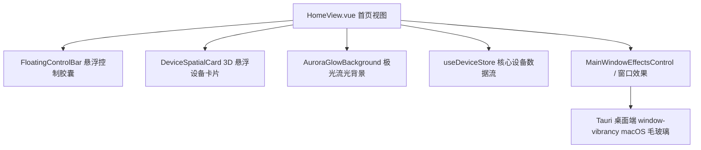

# v1.31.0-feature 架构与设计说明

## 1. 架构目标

将实验性的全息悬浮流（Holo Deck）正式落地到主工程，保持既有数据流与 Store 结构不变，提升首页科技感，并打通 macOS 桌面端的主窗口原生毛玻璃底色。

## 2. 界面设计规范与文案调整

- **移除指标**：不展示 FPS 帧率信息。
- **术语规范**：统一将“空间”转为“设备”标准口径：
  - “空间设备矩阵” -> “设备矩阵”
  - “空间在线” -> “设备在线”
  - “空间投屏” -> “设备投屏”
  - “空间无线” -> “无线连接”
  - “空间画中画” -> “画中画微窗”
- **全屏毛玻璃与暗黑自适应**：
  - 首页强制声明暗黑沉浸底色，并开放 `bg-transparent`，当桌面端开启毛玻璃时，背景与极光层半透明透出桌面模糊画面；在纯浏览器端呈现深海微光背景。
