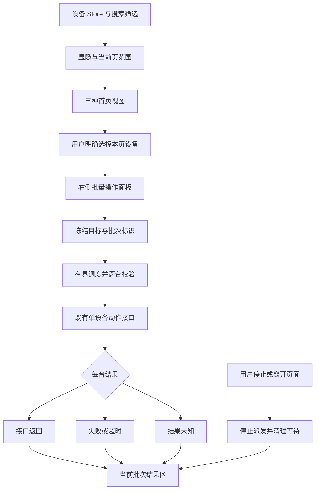

# v1.32.0-feature · 首页手机视图与批量操作设计与实施

状态：本版功能已完成代码实现与单元自测，独立原型已获真实浏览器验证；真实双机交互验收由主管实测推进中（部分验证）。日期：2026-10-21。正式版本维持 `v1.29.0`。

## 背景与证据边界

效卫将设备墙、设备选择和批量操作集中在一个工作区。用户希望参考这一流程，将 MyWebScrcpy 现有大屏监控能力整合到首页，增加手机视图与右侧批量操作面板。

当前正式 `VERSION` 为 `v1.29.0`，源码基线为 `ec0019b`，包含 v1.30 拖拽安装与 v1.31 首页视觉改动；版本记录、源码、发版与部署状态分别判断。

竞品依据为已视觉查看的官网图片/动图与官方手册，不是客户端实测。“1000 台”宣传与功能手册“500 台”存在口径差异；短语、文件传输展示部分属于概念示意，不作为性能或实际界面验收依据。

## 功能对照

“已有”仅指本次检查到正式源码，不代表本轮运行验收通过；“未发现”限定于所列数据模型、路由和前端模块。

| 能力 | 效卫公开展示/说明 | MyWebScrcpy 当前证据 | 规划结论 |
| --- | --- | --- | --- |
| 多设备实时投屏 | 设备墙与放大单机同时展示 | `frontend/src/views/DashboardView.vue`、`frontend/src/components/dashboard/DashTile.vue` 已实现设备墙；首页尚未整合 | v1.32 首页新增第三种手机视图，复用现有投屏能力 |
| 显示与设备选择 | 调整尺寸、选中设备、分组选择 | 大屏已有显隐、尺寸、铺满和全屏；首页仅有搜索和来源筛选，未发现批量操作选择模型 | v1.32 区分每页显示台数、显示范围和批量操作范围 |
| 基础批量操作 | 选多台统一执行 | `internal/automation/routes.go`、`types.go` 有单设备事件/按键接口，未发现首页批量入口 | v1.32 增加批量返回、主页、最近任务和逐台结果 |
| 实时同步群控 | 一台触控，多台同步 | `DashTile.vue` 为单设备输入，未发现跨设备输入分发器 | v1.33，在 v1.32 的选择模型上增加显式群控开关 |
| 标签分组 | 标签、组内筛选和排序 | `internal/device/manager.go` 的 Device 与 `internal/db/db.go` 的 DeviceRecord 未含标签 | v1.33 新增持久化分组，不复用已移除的任务分组 |
| 快捷短语与文本分发 | 常用语、不同设备不同文字 | 单机文本输入与剪贴板已存在：`frontend/src/scrcpy/useClipboardSync.ts`、`internal/automation/types.go` | v1.34 增加短语资产、批量输入和明确的设备映射 |
| 文件/APK 分发 | 双向传输、批量安装、差异化文件分发 | `internal/files/handlers.go`、`frontend/src/api/files.ts`、`internal/apps/handlers.go` 为单设备范围 | v1.34 复用单机传输与安装，增加有界批处理及失败重试 |
| 动作录制与回放 | 录制操作，多设备重复执行 | `internal/ws/recording.go` 和 `replay.go` 是视频录制/播放；`frontend/src/inspector/opLog.ts` 是操作日志 | v1.35 新建动作序列能力，不改名冒充现有录屏 |
| 条件自动化 | 公开页主要强调动作录制与脚本执行 | 本项目已有 OCR、UI XML、视觉条件、SDK、AI/技能集成；见 `internal/automation/`、`internal/ocr/`、`internal/skillsmarket/` | 保留现有能力，v1.35 首先复用接口做条件等待 |
| 手机通知定位 | 提示音与设备标记 | 未发现设备系统通知采集与授权模块；设备音频不等于通知订阅 | 后续技术验证，通过后再分配正式版本 |
| 手机分享 | 双方客户端登录、分享码、期限、撤回 | `internal/ws/registry.go` 有共享视频订阅，不具备完整的按设备外借权限模型 | 候选研究，不进入首批承诺 |
| 多接入方式 | USB/Wi-Fi/OTG/ROOT/无障碍/安全模式 | 当前设备管理以 ADB 为基础；HID 是输入通道，不等于独立投屏连接模式 | 维持已确认能力，其他模式单独做技术验证 |
| 应用管理/市场 | 手册列启停、卸载与清缓存 | v1.30 明确排除应用管理/应用市场；当前 `internal/apps` 仅注册安装接口 | 不纳入本轮路线图，避免恢复用户已裁减范围 |
| API、商业化与 OEM | API、设备数量权益、品牌定制 | 本项目已有公开 API、SDK 和技能集成；未据此确认完整商业化能力 | 复用现有接口，不安排会员/OEM/云手机开发 |

官方依据：[产品页](https://www.xiaowei.xin/android)、[主要功能](https://www.xiaowei.xin/android/support/341)、[执行任务](https://www.xiaowei.xin/android/support/185)、[分享说明](https://www.xiaowei.xin/android/support/561)。

## 分版本路线图

v1.32 是本轮建立的版本记录；后续编号是建议排期，尚未创建版本分支、排期日期或实施承诺。每版以依赖版验收通过为入口，可独立调整范围。

| 顺序 | 建议版本 | 核心交付 | 完成标准 |
| --- | --- | --- | --- |
| 1 | v1.32 · 首页手机视图与基础批量操作 | 三种首页视图；大屏能力迁入；右侧批量操作面板；每页台数；基础设备按键与逐台结果；移除大屏导航入口 | 原有两种视图与全部大屏交互不退化；只操作明确选中的设备；翻页/视图切换不泄漏订阅 |
| 2 | v1.33 · 标签分组与实时群控 | 标签持久化、组内筛选/排序；显式开启同步控制；主控设备、跨分辨率坐标映射、临时单控、停止同步 | 至少两台不同尺寸真机证明同步动作；旋转/掉线后安全停止；一台失败不拖住其他设备 |
| 3 | v1.34 · 短语与文件分发 | 常用语保存/导入导出；统一输入与按设备映射；批量文件/APK；按设备展示进度、失败重试 | 中文/多行输入、单台失败、大文件取消、APK 安装失败均有真实结果，不重复操作已成功设备 |
| 4 | v1.35 · 动作录制与条件回放 | 点击/滑动/按键/等待动作序列；序列编辑、循环和设备间隔；OCR/XML 条件等待；有限执行与停止 | 手机真实执行而非视频播放；页未就绪、超时、取消与断连均能结束并记录结果 |
| 候选 | 验证后定版本 | 系统通知采集、授权式设备分享、非 ADB 接入 | 先形成可复现实验与运行前提，明确权限、传输和维护成本后再立版本 |

v1.35 不包含恢复旧任务中心、内嵌 Pi、任意 JS/BAT 执行或完整后台 Cron 平台。定时执行是否在外部工具承接，留待该版专门设计。

## v1.32 目标与非目标

### 已确认目标

1. 首页增加手机视图，与既有 `deck`、`compact` 并列，显示真实手机画面和设备标识。
2. 将大屏监控的实时画面、显隐、尺寸、铺满、全屏、单机输入、设备按键和播放器入口迁入首页。
3. 右侧为批量操作面板：选择目标、发起统一操作、查看逐台结果；显示设置为其中一个分区。
4. 移除 Web 桌面导航、移动导航及桌面原生菜单中的独立“大屏监控”入口。
5. 选择每页显示台数并记住偏好；设备数超过上限时分页，只为当前页在线真实设备订阅视频。

### 本版非目标

- 不重做现有首页视觉，不删除 `deck`、`compact`；沿用当前组件、主题与小窗能力。
- 不把选择多台直接解释为开启实时同步群控；首版只批量执行面板中明确点击的离散操作。
- 不加入标签持久化、短语资产、批量文件或动作录制的占位按钮。
- 不承诺任意台数的运行性能，不以竞品宣传数量作为本项目指标。
- 用户明确要求移除入口，尚未明确要求删除 `/dashboard` 路由。本版移除所有导航入口，不修改旧地址；删除或跳转另列待定范围，不阻塞首页整合，也不自动添加兼容逻辑。

## 首页与批量操作面板

### 布局与职责

- 顶部保留现有搜索、来源筛选和三种视图切换，名称沿用“设备列表”。顶部搜索/筛选控制中枢占满整行，不因右侧批量面板被挤压变形。
- 来源筛选仍按已确认的 `source=auto/manual` 工作，不能仅凭自动发现或手动添加就推断 USB/Wi-Fi 物理连接类型。
- 主区域展示当前视图；手机视图使用轻量手机外框、实际画面比例、唯一设备标识与编号徽章（01..N），避免大量装饰占用画面。
- 批量操作面板位于设备卡片主展示区右侧（预留专属宽度，桌面端并排不遮挡设备卡片；窄屏自然上下流式堆叠，无幽灵 modal 遮罩，关闭后入口可恢复）。
- 面板全面组件化拆分：面板壳（`BatchPanelShell`）、编号设备显隐选择区（`BatchDeviceGrid`）、批量勾选范围（`BatchTargetScope`）、离散按键动作（`BatchActionButtons`）、显示设置（`BatchDisplaySettings`）、逐台结果（`BatchResultList`）。
- 选择复选框与触控画面分离；点击画面仍是单机操控，不能因多选而广播触摸。

### 显示数量与编号方块选择器

- 原手机视图每页台数/分页/显隐 popover 整条已被面板内所有真实设备的编号小方块选择器替代。
- 编号与 serial 保持稳定映射（按 serial 字典序稳定排序），不按动态数组索引执行控制，真实设备有多少台就展示多少编号，不伪造 60 台空块。
- 点编号切换对应设备显隐，提供“全显”（恢复全部设备显示）与“只显已选”（仅显示当前批量勾选的设备快照）。
- 编号设备池不因隐藏卡片而丢失按钮，确保隐藏后始终有恢复入口；“只显已选”与选择清理具有快照保护，不产生递归互相清空。
- 保留小/中/大与铺满布局；当前可见且在线的真实设备才挂载投屏；离线/未授权设备显示可识别状态，不循环启动失败会话。开发 Mock 只用于布局，不向 `/ws` 发起假设备请求。

### 选择与执行范围

- 全选仅选择当前页可操作设备；支持单选、全选本页、清空。
- 翻页、改变筛选、改变每页台数或切换视图时清空待操作选择，避免隐藏设备继续接收新操作。
- 发起批量操作时冻结去重的 serial 快照；随后新上线设备不自动加入。
- 执行中允许观察画面，但禁止再次提交同一批次。执行结果保留该次目标快照，不随新的页面筛选挪用到别的设备。
- 已发送的设备操作无法因浏览器取消而保证撤销。取消只阻止未派发项、终止可取消等待；结果无法确认时标记未知，不冒报已取消或成功。

### 首版批量动作

- 返回、主页、最近任务。
- 复用 `POST /api/v1/actions/events` 的已存在请求模型 `EventRequest`：`serial`、`event`、`expires_ms`；事件值为 `back`、`home`、`app_switch`。
- 现有单机点亮/熄屏按钮仍迁移。批量电源动作暂不使用简单 `power` 翻转键，防止亮屏和灭屏设备得到相反结果；显式目标状态能力核对后另行安排。
- 初始调度建议：同批最大 64 个目标、并发 4、每台 15 秒超时、整批 120 秒截止；超时即停止新派发。参数是待实现验证的设计值，不是已有接口保证。
- 每台分别记录等待、执行、接口返回、失败、超时、未执行/取消、结果未知；HTTP 成功仅表示该接口报告动作执行结果，实际手机页面变化须在真机验收中验证。
- 日志与统计不阻塞控制；结果按批次标识和请求代次写回；离开页面后结束本页调度、清理计时器及订阅。

该图只描述离散批量动作。实时触控同步属于 v1.33，不混入首版调度器。

## 实现边界与复用

| 范围 | 已有文件/拟新增职责 | 边界 |
| --- | --- | --- |
| 首页宿主 | `frontend/src/views/HomeView.vue`、`frontend/src/components/home/HomeControlCapsule.vue` | 扩展视图类型，组合视图和面板；不把视频连接及批调度塞进页面 |
| 手机视图 | `frontend/src/components/dashboard/DashTile.vue`、`frontend/src/utils/monitorGrid.ts`、`frontend/src/utils/phoneGrid.ts`；`frontend/src/components/home/HomePhoneView.vue` | 紧密设备墙规格（小/中/大/铺满同档位同宽同高，相邻横纵间距锁定 2px，画面黑底 contain 等比居中填充黑边、不拉伸不裁图，黑边不发触控） |
| 显示/选择状态 | `frontend/src/stores/devices.ts`；拟新增 `frontend/src/composables/useHomePhoneView.ts`、`useDeviceSelection.ts` | 首页设备列表单一事实来源；偏好持久化不持久化危险的批量选中状态 |
| 面板/调度 | 拟新增 `frontend/src/components/home/BatchOperationPanel.vue`、`frontend/src/composables/useDeviceBatch.ts`、`frontend/src/api/deviceActions.ts` | API 封装按当前契约读取；不假设存在批量后端接口 |
| 原导航入口 | `frontend/src/components/layout/AppHeader.vue`、`desktop/src/menu.rs` | 移除桌面、移动与两处原生菜单入口；路由处置待明确 |
| 术语与测试 | `docs/glossary.md`、`frontend/tests/monitorGrid.test.mjs`、拟新增相关状态与批调度测试 | 实施时更新现有术语指向；规划术语不冒充已实现 |

拟新增文件是任务边界，不代表文件或能力已经存在。实现中沿用 Vue/Pinia/VueUse 与现有 UI 组件；不为首版引入队列平台或新 UI 库。文件不超过 1000 行、方法不超过 400 行。

现有 `DashTile.vue` 为每个磁贴直接维护 WebSocket、解码器和输入监听；迁移需保留销毁清理。首页当前 Store 使用 3 秒轮询，大屏独立 5 秒轮询；新首页不得双重轮询。多个页面可能共享服务端同一设备会话，调整画质/帧率前需核对会话协商，不能把全局重启影响隐藏成局部设置。

## 原型与验证计划

本轮只记录规划，原型尚未生成。实施前使用项目 `ui-prototype` 技能，在独立原型中验证三种视图、面板收放、每页台数、设备多选和逐台结果，保存真实浏览器截图；不以竞品图或模拟成功提示作为正式验收。

- 桌面 1440×900、窄屏 390×844；验证 0/1/9/超过一页设备、离线、未授权、全部隐藏和加载失败。
- 覆盖鼠标、触控、滚轮、返回、主页、最近任务、单机电源、横竖屏、单机全屏、页面全屏、投屏详情与小窗打开/恢复。
- 多选后点击画面只影响该台；翻页/筛选后旧选择不接收新操作；执行中到来的旧响应不覆盖新批次。
- 至少两台真机证明批量动作和未选中设备不受影响；单台断线、请求超时和取消分别验收。
- 4/9/16/25/36 档以可用设备逐级测首帧、CPU/内存与停止后资源回落；不足台数时仅报告实际规模，Mock 不能证明容量。
- 检查 Web 桌面、移动菜单和桌面原生菜单都没有独立大屏监控入口；原生行为只由对应平台运行验收确认。

## 风险、迁移与回滚

- **误操作范围**：用本页选择、目标快照和显式操作按钮限制；实时群控另行开启，不能默认为开。
- **资源占用**：每页上限、按需订阅、单一轮询与退出清理；关闭显示不停止其他窗口仍需使用的服务端会话。
- **交互丢失**：按现有大屏交互逐项迁移与真机验收，不以只显示缩略图代替迁移完成。
- **偏好数据**：已确认旧键为 `mywebscrcpy.view_mode`、`dash_size`、`dash_hidden_devices`；实施时按确切格式校验，新增字段用新模型，不猜测相似字段或静默替代来源。
- **数据保护**：v1.32 不需要数据库迁移，不重置设备、模板、配置或操作日志；后续标签版新增模型另立迁移方案。
- **迁移顺序**：先完成原型与行为清单，再共享显示状态与磁贴能力，接入手机视图和批量动作，最后移除各端导航入口并回归。
- **回滚**：业务实施后以本版精确提交回退，恢复原导航与视图映射；新增偏好键可保留为未使用数据，不删除用户数据。不得靠关闭必要投屏/控制功能掩盖失败。

## 待确认与候选研究

1. `/dashboard` 旧地址删除、跳转或其他处置：用户目前只明确移除入口，本版不改旧地址。后续需要下线或跳转时单独确认，不作为本版首页整合的阻塞项。
2. 每页台数预设、默认值和最大值：以原型和实际容量测量定稿。
3. 手机分享：官方手册确认跨客户端外借，但未明确公网网络条件。对本项目先研究按设备授权、有效期、撤回、控制互斥、访问审计及连接方式；共享流和可访问同一服务不等于已完成设备外借。
4. 系统通知：先验证所需 Android 权限、采集方式和支持版本，不能把音频播放当作通知事件。
