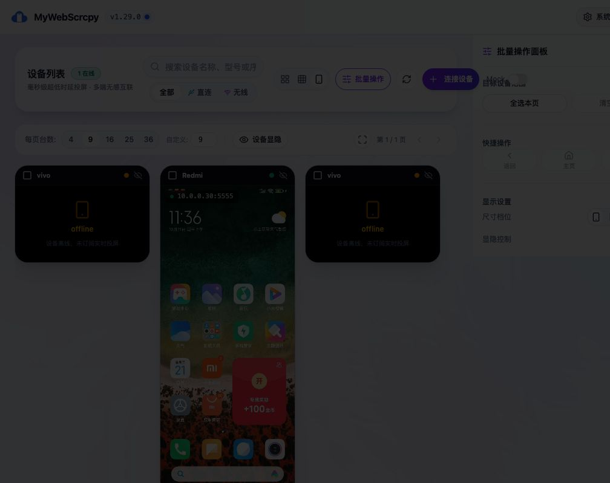
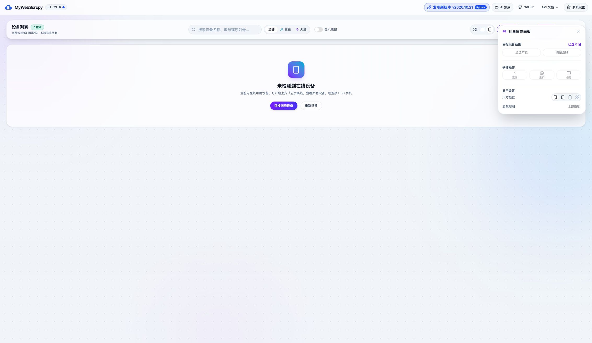
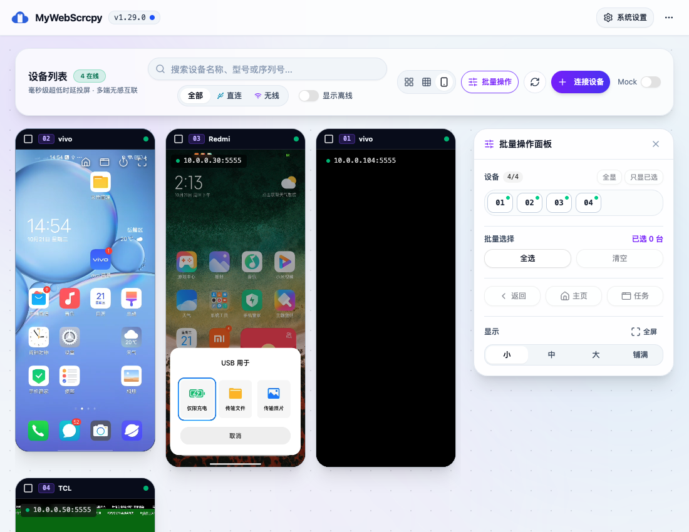

# v1.32 主管独立验收（2026-10-21）

当前结论：右侧预留面板、编号显隐与组件化重构已通过主管独立验收；2026-10-22追加修复已解决发布CSS缺失，正式构建的四档统一格子、横纵2px及在线画面黑边检查通过。本轮样式缺陷关闭，v1.32完整批量真机、横屏控制、容量与原生运行验收仍待完成；未提交、合并、推送或部署。历史失败证据保留如下。

## 实施与监控

用户授权 Pi 实施，Codex 主管亲自测试。执行机器 local，模型 `opencodex/google-antigravity/gemini-3.8-flash`，运行/原生会话 ID `3bb59a83-971d-4a63-8fc5-063d882858d1`。首轮连接错误中断，随后完成两轮返工；外部 completed 不等于主管 accepted。

已实现首页第三手机视图、分页与显隐、批量基础按键、逐台结果、有界调度、导航入口移除及原型。旧 `/dashboard` 路由保留。原有 5 个脏业务文件 SHA256 与派发前一致，暂存区为空，历史 session 内容完整保留。未新增附加 worktree；本次无附加工作区可列为清理对象。

## 独立自动化结果

- `node --test frontend/tests/*.test.mjs scripts/sync-version.test.mjs`：37 项通过。
- `pnpm --dir frontend build`：类型检查和生产构建通过，既有分块体积提示仍存在。
- `pnpm --dir frontend proto:build`：原型类型检查与构建通过。
- `go test ./...`：全部通过。
- `cargo check --manifest-path desktop/Cargo.toml --locked`：通过。
- `node scripts/sync-version.mjs --check`：通过，正式版本仍为 1.29.0。
- `git diff --check`：通过，无未合并项。

## 浏览器与真机证据

原型：9台页全选7台在线、排除离线与未授权；改每页台数清空选择；模拟6成功1失败；390宽抽屉打开。截图 `prototypes/home-phone-batch-v1-{desktop,mobile}.png`。

正式页：Mock无视频canvas且批操作禁用；Mock分页可用，已恢复Mock关闭和每页9台。精确阻断设备列表接口显示加载失败和重试；解除阻断后重试恢复。网络测试设置和临时视口均已恢复。掉线设备会从选中集合剔除。390宽Dialog焦点循环、Escape关闭及焦点回到入口已验证。

真机：114与30选中，104未选中。最近任务与主页各收到两条成功结果；Redmi画面从任务列表回到桌面。114未证实最近任务实际变化；104曾黑屏及离线，不能声称未选中真机行为完整通过。ADB连接反复波动，V03、容量、完整原生运行与输入迁移验收保持未完成。

## 阻塞缺陷

[P1] 桌面右侧面板打开时，窄屏Dialog同时open。`BatchOperationPanel.vue` 的Dialog直接绑定 `isOpen`，只通过 `lg:hidden` 隐藏DialogContent，模态遮罩和焦点隔离仍生效。1100px桌面实测：首页被暗色遮罩覆盖，AX仅剩通知区域；DOM存在1个role=dialog且display=none，无法操作首页。应按实际断点控制Dialog是否挂载/打开，并验证桌面打开、关闭、跨断点切换和窄屏焦点行为。

证据：

第二轮返工后仍存在该缺陷，按仙人模式最多两轮返工的规则停止继续派发，当前版本不能标记完成。

---

## 2026-10-22 下级 Agent 浮动改造与离线过滤实施记录（待主管复测）

### 修改核心
1. **彻底消除 P1 阻塞缺陷与页面形变**：
   - 彻底移除 `BatchOperationPanel.vue` 中的 Dialog 及其 `DialogOverlay`、`DialogContent` 与 `aria-hidden/inert` 机制；
   - 面板全面改走脱离文档流的浮动覆盖层（`fixed z-40 right-3 sm:right-6 top-20 sm:top-24 w-[calc(100vw-1.5rem)] sm:w-84 max-h-[calc(100vh-6rem)]`）；
   - 打开与关闭批量面板时，首页设备区域、控制胶囊、单机卡片宽度恒定为 100%，不挤压不形变；
   - 面板外完全无透明或暗色遮罩，外部卡片、勾选、视图切换及筛选完全自由交互；全局监听 Escape 键，支持键盘关闭。
2. **支持“显示离线设备”选项（默认关闭）**：
   - 首页新建 `frontend/src/composables/useHomeFilter.ts`，默认严格筛选 `state === 'device'` 设备；
   - 仅当控制胶囊中“显示离线”开关打开时，才在全量设备列表中纳入 `offline`、`unauthorized` 等状态；
   - 离线过滤置于分页与搜索之前，切换后自动清空当前选择，并保护页码回缩；
   - 持久化配置键：`home_show_offline_devices`，缺省为 `false`；未修改全局 store，其他页面语义不受影响。
3. **自动化测试与构建**：
   - 新增 `frontend/tests/homeFilter.test.mjs`，与既有测试组合执行 41 项测试全部通过；
   - `pnpm --dir frontend build` 与 `pnpm --dir frontend proto:build` 均构建通过；
   - `go test ./...` 与 `cargo check` 正常通过，版本号无误。
4. **待主管实测范围**：
   - 真实桌面浏览器实测浮动面板打开时外部页面点击/选择设备能力；
   - 390px 窄屏视口内面板无水平溢出与 Esc/关闭按钮交互；
   - 显示离线设备开关的真实渲染与切换表现。

## 预览进程

复用已有正式开发服务5173/8080，未重启。主管创建原型服务PID29157，入口 `http://127.0.0.1:5174/#home-phone-batch-v1`；归属记录 `/tmp/mywebscrcpy-v132-supervisor-preview/session.json`，日志同目录prototype.log。停止前须核对PID、命令和进程组，只停止本任务原型进程，不停止共享服务。未创建公网隧道。

## 2026-10-21 · 浮动面板与离线开关追加验收

- 用户要求面板浮动、不占页面空间，并增加离线显示选项，默认只显示在线设备。
- Pi在local使用原始模型 `opencodex/google-antigravity/gemini-3.8-flash` 实施，运行ID `72645cee-2427-4ebd-93ee-cbad576c75e9`。主管独立完成以下浏览器验收。
- 桌面面板开关前后main宽度均2265px，三个canvas宽度均222px；面板打开后仍能选择外部设备；modal/overlay均0。原桌面隐藏Dialog遮罩P1已关闭。
- 390px窄屏main与文档scrollWidth均390px，面板横向边界12至378px，无溢出。Escape可关闭。
- Mock默认4台在线，开启显示离线后增加第5台OnePlus离线设备；甲板、紧凑与手机视图一致。每页4台进入第2页后关闭离线显示，自动回第1页且只剩4台在线设备。Mock无视频canvas且禁止批操作。
- 搜索品牌Google实际成功；修复时复用原store.filtered，保留显示名/别名/品牌/型号/产品名/serial搜索与来源语义，不重写字段映射。
- 本轮独立运行 `node --test frontend/tests/*.test.mjs scripts/sync-version.test.mjs` 42项通过；frontend build、proto:build、版本一致性、git diff --check均通过。原保护业务文件及原生菜单哈希保持不变。
- 已恢复Mock关闭、显示离线关闭、每页9台和默认浏览器视口。没有发送真实批量动作，不据本轮UI验证补标完整真机通过。
- 最终截图：
- 当前仍在lz/v1.32.0-feature；未提交、未合并、未推送、未部署。无新增worktree；共享前后端和原型服务未重启。

## 2026-10-21 · 右侧预留、编号设备网格与组件化重构验收

用户确认：面板位于设备卡片区域右侧并预留位置、不遮挡卡片；每页台数/分页/独立显隐弹窗由面板内真实设备01..N编号方块替代；可点编号切换显隐、全显、只显已选。用户强调不要兼容旧逻辑，面板要组件化。

Pi实施记录：local，模型 `opencodex/google-antigravity/gemini-3.8-flash`，run/session `da13e380-e8cf-4ef7-935d-1a4bf3bc2271`。主管首次评审打回重复工具条、其他视图显隐不一致、窄屏不可达和复制算法的测试；一轮返工后独立复验通过。

### 代码和边界

- 面板组合文件93行，按面板壳、编号网格、批量选择、动作、显示设置、结果列表拆为6个组件；显示状态由独立composable管理。
- 首页卡片区与面板并列，顶部搜索独占整行；窄屏面板在卡片之前。手机视图不再保留分页/显隐工具条或重复卡片隐藏按钮。
- 首页相关源码无currentPage/pageSize/pagedDevices/PAGE_SIZE/PRESET_PAGE及无调用hideAllDevices；无旧分页偏好读取/迁移兼容分支。
- 编号按钮始终按serial传递目标；轮询换序编号映射测试通过。编号池包含当前搜索/来源/离线筛选匹配设备，隐藏卡片不会删除恢复按钮。
- 原受保护DeviceCard、设备API、internal/device以及桌面菜单哈希与派发前相同。会话原始历史保留。未新增worktree，不清理其他会话工作区。

### 主管浏览器实测

1. 四台实际设备生成01..04；点02隐藏对应设备，编号仍留；全显恢复。
2. 勾选Redmi后只显已选，保留该卡片和勾选目标；再隐藏最后一台，进入全部隐藏空状态，批量动作禁用，全显恢复可达。未发送设备按键。
3. 隐藏01后切到甲板与紧凑视图，三视图均只剩相同3台；紧凑视图勾选一台再只显已选，仅留下该台，批量范围同步。
4. 桌面1100px：顶部控制区宽1052px；右侧面板左边界756px，所有画布右边界最大727px，卡片不与面板相交；面板和卡片容器上沿对齐，无modal遮罩。
5. 窄屏390px：文档scrollWidth=390，面板左右边界16/374，上沿317.5px，排在设备列表之前，可直接操作。
6. 生产截图：`prototypes/acceptance-number-grid-desktop.png`、`prototypes/acceptance-number-grid-mobile.png`。新版原型v2也已实际点编号隐藏及全显恢复，实拍 `prototypes/home-phone-batch-v2-desktop.png`。
7. 已恢复真实设备模式、默认隐藏离线、全部设备显示、清空批量选择及默认浏览器视口。未重启共享服务。

### 最终独立校验

- `node --test frontend/tests/*.test.mjs scripts/sync-version.test.mjs`：44项通过，含生产useHomePhoneView与useDeviceSelection集成、无选中保护、掉线/Mock清选择和轮询编号映射。
- `pnpm --dir frontend build`、`pnpm --dir frontend proto:build`：通过，既有分块体积提示保留。
- `node scripts/sync-version.mjs --check`：通过，正式版本仍1.29.0；`git diff --check`通过，暂存区为空。
- 本轮只变更前端/原型/文档，未重复运行后端/原生检查；完整真机动作迁移、容量、跨平台原生运行仍沿用待验证状态，不据UI成功标版本全部完成。

## 2026-10-21 · 统一格子、2px间隔与等比黑边独立验收（未通过）

- 用户最新要求：手机视图格子同宽同高，水平与垂直仅留2px；不同比例及横屏画面等比居中、余区黑边，不拉伸或裁剪。
- Pi local / `opencodex/google-antigravity/gemini-3.8-flash`，run/session `32d86ca3-a20b-40cb-9b62-f8423195018f`。初轮探查停滞且未修改后中断，续接遭遇504并重试后实施；随后返工接入生产共用比例/坐标逻辑。主管再次反馈构建CSS缺陷时，调度器拒绝：`已达到两轮返工上限，请向用户报告受阻原因`。未规避调度限制。
- 主管独立自动化：`node --test frontend/tests/*.test.mjs scripts/sync-version.test.mjs` 50/50通过；`pnpm --dir frontend build`、`pnpm --dir frontend proto:build`通过；版本一致性仍1.29.0，`git diff --check`通过，无未合并项、暂存区为空。原DeviceCard/API/internal-device及桌面菜单SHA256均与本轮基线一致。
- 开发页实测（不能替代发布产物）：1100×850，小200×380、中270×508、大348×648、铺满355×710，两卡水平边界差均2px；390×844，四档均同宽同高，文档scrollWidth=390，大档卡片y差650=648+2，中档510=508+2，小档382=380+2，铺满178×704。实际画布等比居中。黑边坐标点击后Network.webSocketFrameSent为0。
- [P1] 发布CSS阻断：`phoneGrid.ts`将尺寸与gap类名动态拼接；独立重新build后，`web/dist/assets/index-B_qxV932.css`中没有 `.w-\[200px\]`、`.h-\[380px\]`、`.w-\[270px\]`、`.h-\[508px\]`、`.w-\[348px\]`、`.h-\[648px\]`、`.gap-\[2px\]`。开发服务器此前生成的类仍缓存，故开发截图与测试绿灯均不能证明发布可用。产物断言退出1，记录 `prototypes/acceptance-uniform-grid-css.json`。
- 后续必须修复动态样式输出并重新验证干净发布产物；当前不能标记本需求或完整版本完成。横屏真实设备、完整触控及原生运行未在本轮补验。
- 已恢复浏览器原视口、小档、Mock关闭及默认仅在线；保留本地预览。未重启共享服务，未新增worktree。
- 开发页参考实拍（带缓存，仅证明本地显示）：`prototypes/acceptance-uniform-grid-desktop.png`、`prototypes/acceptance-uniform-grid-mobile.png`。

## 2026-10-22 · 用户追加授权Pi两轮机会后的正式构建验收

- 用户明确要求继续Pi，再给两轮机会。新run/session `5a08bcf7-b473-4a5f-822d-23aa12d25c2a`，local，模型 `opencodex/google-antigravity/gemini-3.8-flash`。首次实施将动态类改为静态字面量；一轮评审返工清理仅测试引用的旧常量，统一到生产规格表。本批次在一次返工后完成，无需用尽两轮。
- 主管独立复测：49项测试全部通过，frontend build与proto:build通过，版本一致性1.29.0，diff check通过。旧常量/类型已清理；本批次除phoneGrid.ts、phoneGrid.test.mjs及任务/会话文档之外无额外文件变化，原有脏改动完整保留、暂存区为空。
- 正式构建CSS `web/dist/assets/index-Q2ktUPuU.css` 中七条固定宽高和gap精确规则全部存在；凭证 `prototypes/acceptance-uniform-grid-css-fixed.json`。此前失败凭证不覆盖。
- 独立正式预览 `http://127.0.0.1:5175/`，直接运行web/dist，不使用Vite开发样式缓存。1100×850：小200×380、中270×508、大348×648、铺满355×710；相邻水平边界均相差2px。390×844：小/中/大纵向位置差分别382/510/650px，扣除卡片高度后均2px；铺满178×704横向2px；document.scrollWidth=390，无横向溢出。
- 小档实际两台在线canvas：472×1024缩放为161×350、448×1024缩放为153×350，在相同200×380外格内居中，左右黑边可见。测量期间设备状态会反复离线，部分尺寸复测使用同一渲染路径的离线占位，未将其误记为实时画面。
- 用户要求“再试一下”后，刷新设备列表恢复两台在线，重新读取真实canvas矩形，在左侧黑边点击；操作前后AX仍保留两台画布，Network.webSocketFrameSent=0，黑边不发触控通过。末次截图Redmi画面黑色，不能据此声称两台业务动作结果均正常。未发送新的真实批量动作。
- 编号01隐藏使卡片2→1，全显恢复1→2。最终恢复仅在线、小档、全部显示、无勾选及原始浏览器视口。截图 `prototypes/acceptance-uniform-grid-production.png` 是最终正式构建实拍。
- 本轮发布样式P1关闭。横屏真机、持续拖拽实际结果、完整批量动作/容量及原生运行仍按原任务待验收，不标记完整v1.32完成。当前分支lz/v1.32.0-feature，未提交、合并、推送、部署，无新增worktree。
- 仅为本任务新启本机正式预览127.0.0.1:5175，进程PID81564（node/vite preview），exec会话21715；停止前须核对进程仍为本任务预览。共享5173/8080和原型5174未重启。
