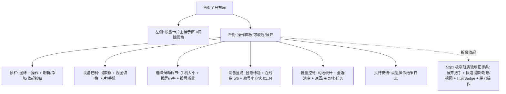
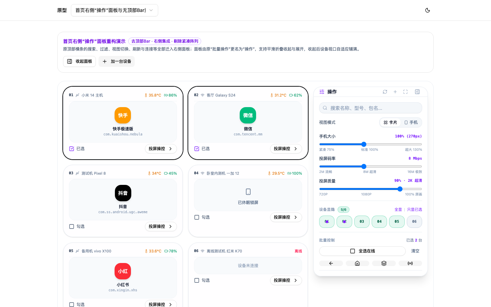
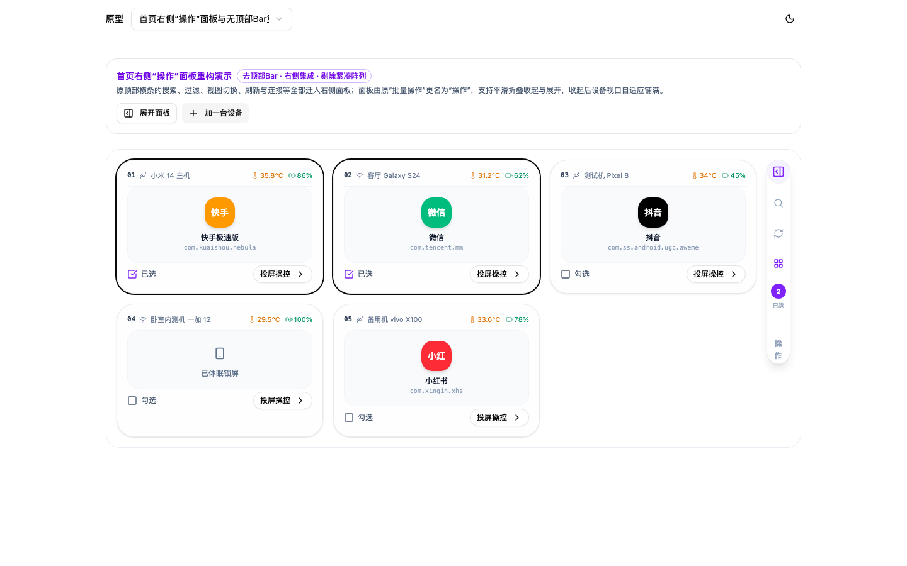

# v1.33.0-feature 设计文档：首页右侧“操作”面板与无顶部Bar重构

状态：需求原型已就绪并通过实测验证  
相关分支：`main`  
原型目录：`prototypes/cases/home-action-panel-v1/`  

---

## 1. 需求背景与痛点分析

1. **首屏纵向空间挤压严重**：
   - 旧版首页顶部常驻 `HomeControlCapsule` 大胶囊横条，占据了显著高度；
   - 筛选时又在卡片上方弹出一行“当前筛选显示 X / Y 台设备 · 清空筛选条件”，导致第一排设备卡片被严重下推，在大屏与笔记本上首屏可见卡片数量受限。
2. **“批量操作面板”定位狭隘**：
   - 现存的右侧“批量操作面板”默认隐藏，只在用户需要批量勾选发键时才打开，利用率偏低；
   - 首页的“搜索”、“视图切换”、“刷新列表”、“添加设备”等核心动作分散在顶部 Bar，与右侧的“显隐选择”形成割裂。
3. **“全部、直连、无线、离线”与“紧凑阵列”功能冗余**：
   - 来源与离线分类低频且占用空间，用户真正高频使用的是搜索与编号点选显隐；
   - 视图模式中的“紧凑阵列 (`compact`)”与新版拟物卡片及手机网格投屏定位重叠，用户要求剔除。
4. **缺乏动态感官调节**：
   - 缺乏对设备卡片大小的连续无级缩放；
   - 缺乏在首页对投屏码率与画面质量的就近快速滑块微调。

---

## 2. 核心设计方案

### 2.1 彻底去顶部 Bar，卡片 0 间隙顶格排布
- 完全移除 `HomeControlCapsule`；
- 移除设备主区域上方的任何筛选提示条；
- 设备卡片直接贴顶排布，视野极度纯净，极大提升视觉纵深感与沉浸感。

### 2.2 右侧面板更名为“操作”，支持两态平滑折叠
- **展开态 (Expanded，宽 320px~336px)**：
  - **Header**：左侧图标 + 标题“**操作**”；右侧放置刷新（带旋转动画）、连接设备（加号）、网页全屏切换（`<Maximize>`）、收起面板（`<PanelRightClose>`）。
  - **设备搜索**：去除多余的“设备控制”标题，直接放置支持名称/型号/包名/序列号模糊搜索的输入框（带一键清除 `X`）；紧跟视图模式单选（卡片 `deck` vs 手机 `phone`）。
  - **滑动调节组 (Sliders)**：
    1. **手机大小**：`70% ~ 140%`（步进 5%，对应基准宽 190px ~ 380px，默认 100% 270px），左侧卡片与网格实时无级放大缩小并自动流式折行；
    2. **投屏码率**：`2 Mbps ~ 16 Mbps`（步进 1，默认 8 Mbps），标注 `2M 流畅`、`8M 超清`、`16M 极致`；
    3. **投屏质量**：`50% ~ 100%`（步进 5%，默认 90%），标注 `720P`、`1080P`、`100% 原画`。
  - **设备显隐区**：标题“**设备显隐**”旁边放置在线设备数微缩胶囊（如 `5/6`），右侧放置“全显 | 只显已选”；下方排列 01..06 编号小方块。
  - **批量动作纯图标栏（无文字 + Hover 悬浮提示）**：
    - **彻底去除文字标签**：动作按钮不再展示“返回”、“主页”、“多任务”等文字，改用 4 个精致正方形/圆角纯图标按钮并排排列（`grid-cols-4`），消除多余字宽，鼠标悬浮时展示清晰的功能气泡提示（Tooltip）；
    - **新增“同步操作”按钮**：
      - **业务定义**：通过操控任意一台主控手机，将其所有的屏幕触控事件（点击、滑动、长按）、硬件按键及输入指令，实时同频同步广播并注入至所有当前“已选择（Selected）”的设备；
      - **交互体验**：纯图标展示（`<Radio>` / `<Repeat>`），支持点击切换开启/关闭；未勾选任何设备时置灰禁用并给出提示；激活状态下按钮呈紫色高亮，已勾选从属设备卡片展现同步联动呼吸态；
    - **四键纯图标组合**：
      1. `返回 (Back)`：`<ArrowLeft>`，Hover 提示“返回 (Back)”
      2. `主页 (Home)`：`<Home>`，Hover 提示“主页 (Home)”
      3. `多任务 (AppSwitch)`：`<Layers>`，Hover 提示“多任务 (AppSwitch)”
      4. `同步操作 (Sync)`：`<Repeat>` / `<Radio>`，Hover 提示“同步操作：将对当前主控机的操作实时同步至所有已选设备”
    - **去除执行反馈长日志**：彻底移除原底部“执行反馈”历史列表，批量操作与同步切换统一采用即时轻量 Toast 反馈，面板底部紧凑平整。
- **收起态 (Collapsed，宽 52px 极窄竖条)**：
  - 停靠在屏幕右侧，包含大号展开按钮（`<PanelRightOpen>`）、快捷搜索展开、快捷刷新、视图直切；
  - 已选设备数微缩紫色 Badge（如已选 2 台时提示）；
  - 竖向居中排版文字“操 作”，点击整个把手区均可丝滑滑出展开。

---

## 3. 实拍效果图证据

### 3.1 面板展开状态 (Expanded)

- 顶栏极简：“操作”标题与动作组；
- 三项连续滑动条精美直观，实时联动左侧设备视口尺寸；
- 在线数 `5/6` 完美归位到“设备显隐”旁边；
- 设备列表完全顶格排布。

### 3.2 面板收起状态 (Collapsed)

- 52px 细长侧边把手条，占用横向宽度极小；
- 左侧设备区自适应铺满全宽，桌面端自然扩展为 4~5 列卡片。

---

## 4. 源码交接与实施边界 (Implementation Boundary)

正式接入主干时，需进行以下文件的改造与收口：

1. **移除组件**：
   - 废弃并删除 `frontend/src/components/home/HomeControlCapsule.vue`。
2. **重构面板**：
   - 将 `frontend/src/components/home/BatchOperationPanel.vue` 升级为全局 `ActionPanel.vue`（或在其基础上重构）；
   - 在面板头部集成展开/收起切换逻辑，移除原关闭弹窗逻辑；
   - 移除“全部/直连/无线/离线”相关按钮与参数；
   - 增加 `phoneScale`、`bitrate`、`quality` 三个滑块及双向绑定与本地持久化。
3. **主页面适配**：
   - 修改 `frontend/src/views/HomeView.vue`：移除顶部横条引用，卡片区域绑定动态列宽网格样式；
   - 视图模式类型迁移：由 `'deck' | 'compact' | 'phone'` 精简为 `'deck' | 'phone'`。
4. **术语字典同步**：
   - 在 `docs/glossary.md` 将“批量操作面板”重命名登记为“操作面板/操作”。
