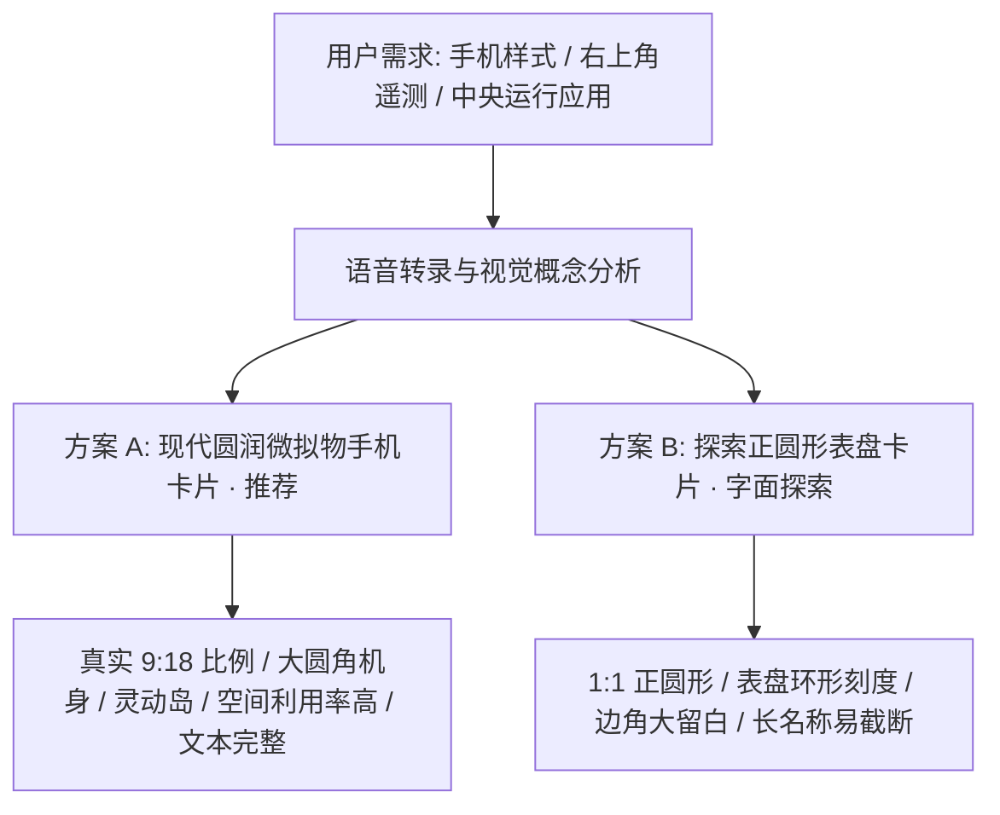
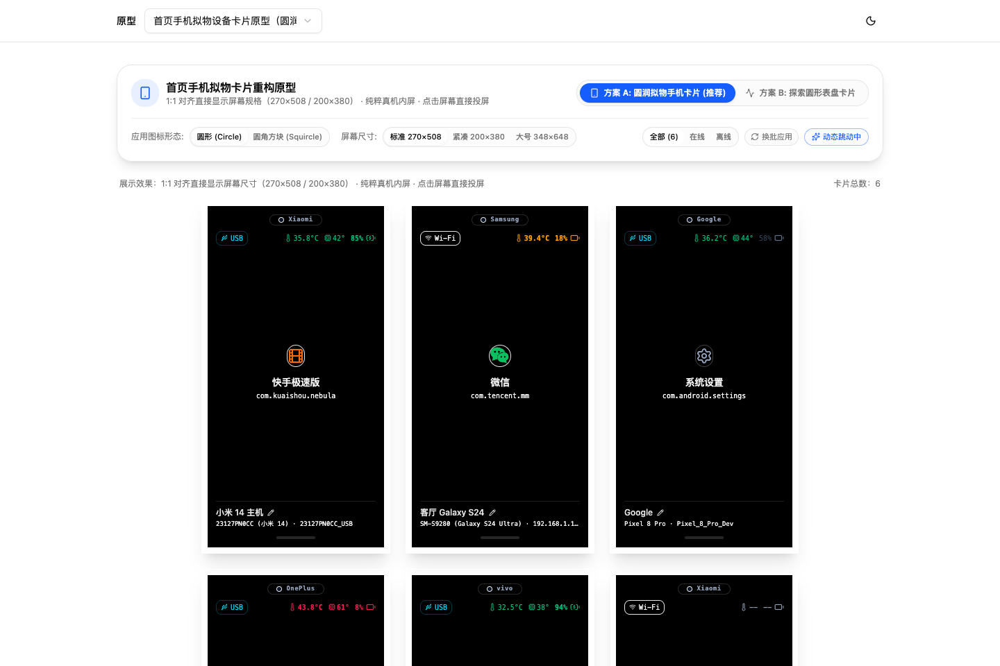
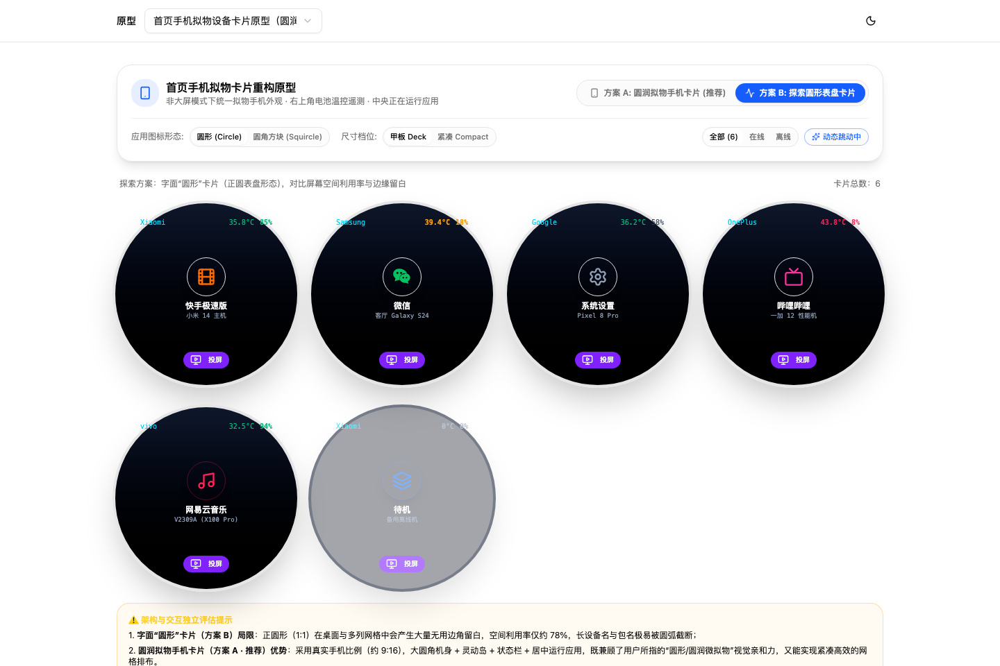

# v1.33.0-feature 设计文档：首页手机拟物卡片重构

状态：需求原型已就绪，等待方案评估与选定
相关分支：`codex/prototype/device-phone-card`

## 1. 需求背景与目标

当前 MyWebScrcpy 首页的普通设备卡片（Deck 与 Compact 视图）采用传统 Web 仪表板扁平卡片布局。用户希望将其重构为**逼真的拟物手机样式**，即使用户不在手机大屏或多机监控视图下，普通首页设备列表也呈现为一台台立体的手机。

### 核心功能需求点

1. **1:1 对齐直接显示屏幕尺寸**：卡片严格按系统既有真机投屏（`HomePhoneView.vue` / `phoneGrid.ts`）的真实规格构建：
   - 标准 Medium：`270 × 508 px`（对齐真实手机 9:16.9 纵向比例）
   - 紧凑 Small：`200 × 380 px`
   - 大号 Large：`348 × 648 px`
2. **纯粹真机内屏 · 无按钮极简交互**：
   - 彻底移除“投屏控制”、“详情”及“画中画”等一切按钮，消除冗余操作栏对机身内屏的挤压；
   - 点击屏幕任意位置即直接唤醒 Scrcpy 投屏，保持最纯粹的手机锁屏/熄屏美学；
   - 底部保留设备名称/序列号与 Android 悬浮手势横条（Home Indicator），呼吸间距充足。
3. **右上角状态栏遥测集成**：
   - 电池电量（0-100%）与动态充电指示（分级变色：充电中翡翠绿，<=10% 红色告警脉冲，<=20% 暖黄预警）。
   - 电池温度指示（°C，分级变色：<38°C 正常，38-42°C 预警，>=42°C 告警）。
   - CPU 核心温度指示（若硬件支持，<48°C 正常，48-58°C 温升，>=58°C 告警）。
4. **中央前台应用极简展示**：
   - 居中展示当前正在运行的应用彩色专属大图标（支持圆形与圆角方块切换）。
   - 显示应用名称与包名，移除了假弥散光斑与多余徽标，纯粹呈现真机质感。
5. **原型方案与圆形探索**：
   - 针对“圆形的版本 / 原型的版本”，提供方案 A（圆润拟物手机卡片 · 推荐）与方案 B（圆形表盘卡片 · 字面探索），帮助直观对比评估。

---

## 2. 方案对比与架构评估

| 维度 | 方案 A: 现代圆润微拟物手机卡片 (推荐) | 方案 B: 探索正圆形表盘卡片 (字面探索) |
| --- | --- | --- |
| **外观形态** | 智能手机机身（超大圆角 `rounded-[40px]`，内屏 `rounded-[30px]`） | 正圆形圆环（`rounded-full` 1:1 正圆） |
| **比例与排版** | 标准 9:18 手机纵向比例，网格对齐紧凑，多列排布自然流畅 | 1:1 正方网格，相邻圆之间存在约 22% 的空白浪费 |
| **遥测信息呈现** | 顶部状态栏右侧紧凑排列：电池温度 + CPU温度 + 电量图标 | 环形顶弧弧形排列，空间有限 |
| **前台应用展示** | 屏幕正中央高亮应用大图标（支持圆形/方圆切换），配环境微光 | 正中央圆形微标，视觉聚集但缺少机身纵深感 |
| **长文本容纳度** | 宽敞，设备别名、型号、包名可完整双行展示 | 较窄，长别名或包名容易被圆弧边缘截断 |
| **快捷操作** | 底部内置 Android 胶囊栏与一键投屏/画中画小窗 | 底部圆形孤岛按钮，操作热区偏小 |

---

## 3. 浏览器实拍效果对比

### 方案 A：现代圆润微拟物手机卡片（推荐方案）

- **设计特色**：
  - 逼真的左侧音量键、右侧电源键凹凸微雕；
  - 灵动岛居中打孔，带有前置摄像头微点与品牌微标；
  - 右上角电池与温度遥测分级动态变色；
  - 中央微信、快手、B站、网易云等彩色应用图标与运行状态脉冲；
  - 底部操作栏聚焦“投屏控制”与“画中画”。

### 方案 B：探索正圆形表盘卡片（字面形态探索）

- **独立评估结论**：
  - 正圆形在多列网格中留白过大，信息密度偏低；
  - 强烈建议采用**方案 A**，既满足了拟物手机外观与用户对“圆润”的亲和力期待，又保障了桌面端高效的设备管理体验。

---

## 4. 源码交接与正式实现边界

正式功能接入时，将原型中的组件逻辑适配至正式业务层：

- **原型源码目录**：`prototypes/cases/device-phone-card-v1/`
- **正式替换目标**：`frontend/src/components/device/DeviceCard.vue`
- **复用状态与 Composables**：
  - 状态：`batteryLevelStyle`、`batteryTempStyle`、`cpuTempStyle`、`foregroundApp`
  - 虚拟滚动适配：配合 `useDeviceGridVirtual` 的行高计算（按新高度适配）
- **正式构建隔离**：原型代码仅存在于 `prototypes/`，生产构建 `web/dist/` 不受任何影响。

---

## 5. 首页右侧「操作」面板与无顶部Bar重构设计

### 5.1 需求背景与痛点
1. **顶部空间浪费**：原 `HomeControlCapsule` 大横条占据显著首屏高度，压缩设备列表垂直可用空间。
2. **阵列冗余**：现有“紧凑阵列 (`compact`)”与新设计的拟物卡片及手机视图定位重叠，用户明确要求剔除。
3. **面板更名与定位升级**：原右侧“批量操作面板”只在操作多选时使用；将搜索、筛选、视图切换、刷新与连接等全局能力迁入后，面板正式改名为**“操作”**，并支持收起折叠与自适应展开。

### 5.2 交互形态与实拍效果

#### 展开状态 (Expanded)

- **面板顶栏**：图标 + 标题“**操作**” + 在线设备数徽章（`5/6`）+ 刷新按钮 + 连接设备 + 收起按钮（`<PanelRightClose>`）。
- **设备控制区**：搜索框、来源分段胶囊（全部/直连/无线）、显示离线开关。
- **视图模式切换**：收敛为“卡片视图 (`deck`)”与“手机视图 (`phone`)”，彻底去掉“紧凑阵列”。
- **设备显隐控制**：编号小方块网格（01..06），支持单选显隐、全显与只显已选。
- **批量控制与反馈**：全选/清空、返回/主页/多任务离散按键与执行反馈历史。

#### 收起状态 (Collapsed)

- 停靠在右侧的 52px 极窄轻质玻璃条。
- 顶部展开按钮（`<PanelRightOpen>`），配合快速搜索展开、快速刷新、视图切换图标与已选 Badge。
- 竖排微缩文字“操 作”，点击即流畅滑出展开。
- 左侧设备区自适应扩展宽度，容纳更多列卡片。

### 5.3 源码交接与实施边界
- **原型源码**：`prototypes/cases/home-action-panel-v1/`
- **正式替换目标**：
  - 移除 `frontend/src/components/home/HomeControlCapsule.vue`
  - 重构 `frontend/src/components/home/BatchOperationPanel.vue` 为 `ActionPanel.vue`（或在现有面板外壳上升级支持收起与全局控制）
  - 修改 `frontend/src/views/HomeView.vue` 布局结构
  - 视图模式类型迁移：由 `'deck' | 'compact' | 'phone'` 精简为 `'deck' | 'phone'`
- **术语字典同步**：在 `docs/glossary.md` 更新“操作面板”条目。
