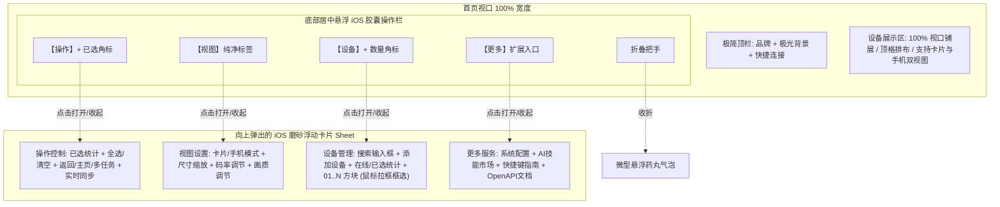
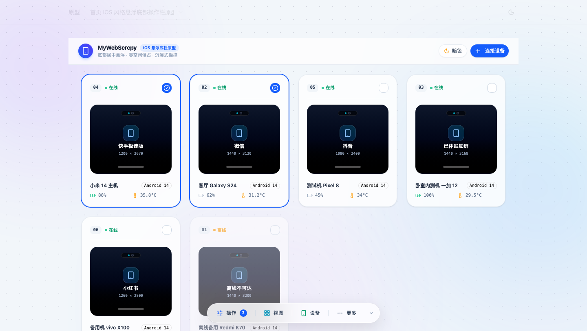
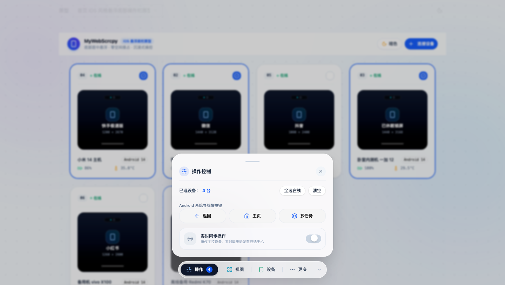
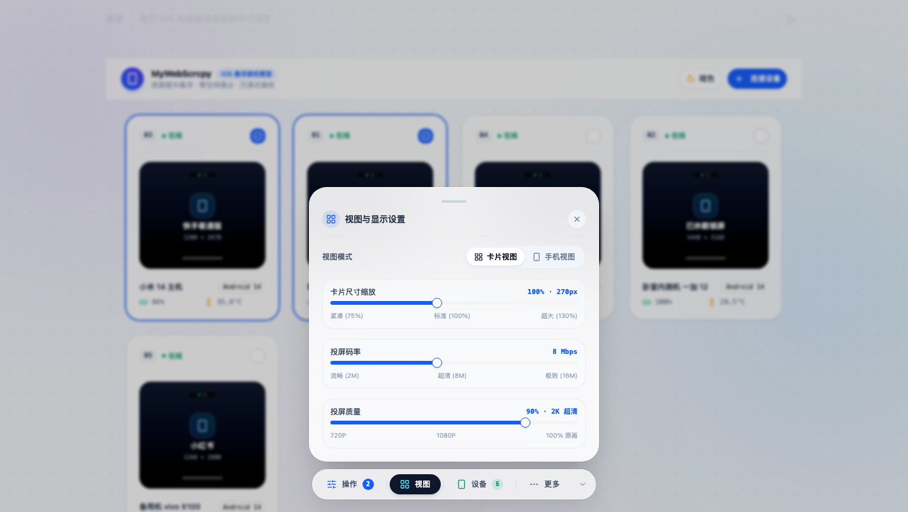
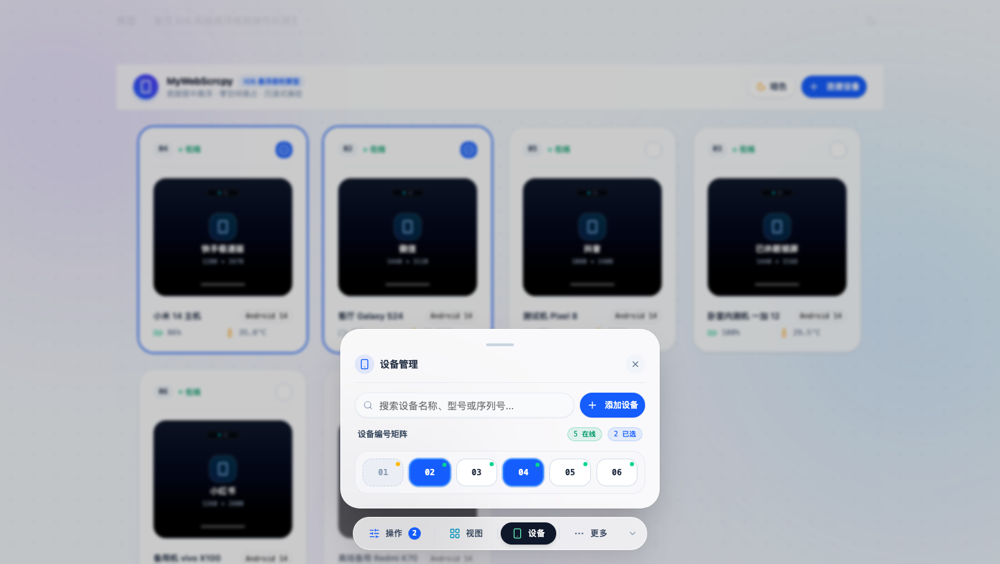
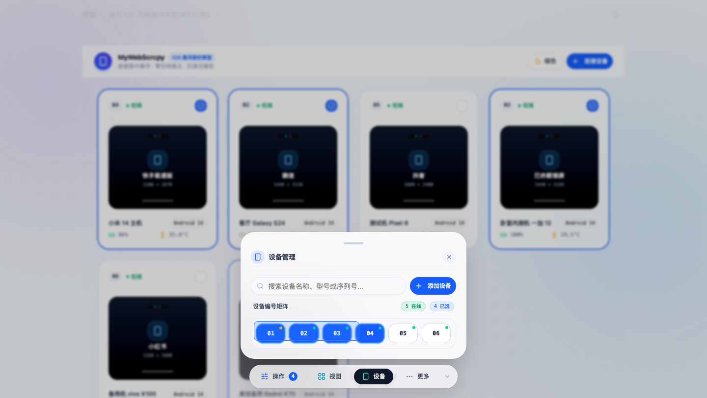
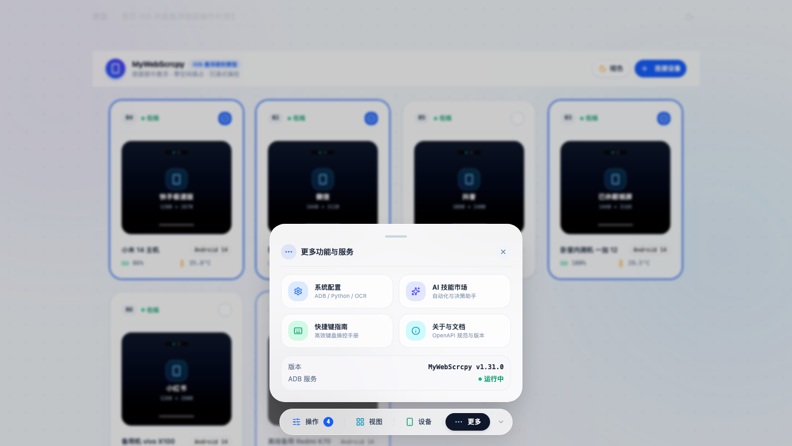
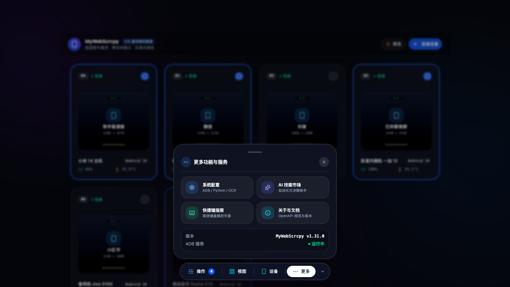

# v1.34.0-feature 设计文档：首页 iOS 风格悬浮底部操作栏与设备框选交互重构

状态：需求原型已就绪并通过实测验证  
相关分支：`main`  
原型案例：`prototypes/cases/home-ios-bottom-bar-v1/`  
公网预览：`https://demo.wskj.work/#home-ios-bottom-bar-v1`

---

## 1. 需求背景与痛点分析

1. **右侧固定侧栏侵占横向空间**：
   - 原首页将操作面板固定在屏幕右侧（占据 320px 宽度），即便是收起态也占用 52px 竖条；在大屏、分屏或小屏笔记本上，导致中央设备卡片主展示区被大幅压缩，一行能容纳的卡片数量受限。
2. **操作分散与功能重叠**：
   - 之前将“批量控制”与“操作”分开，两者的边界模糊且并列割裂；
   - 搜索与添加设备原本孤立在操作面板顶部，与设备池的编号矩阵没有形成“就近管理”闭环；
   - 存在“显示 6/6”、“全显”、“只显已选”等低频或歧义按钮，且充斥调试说明文案。
3. **缺乏高效批量选取能力**：
   - 原先设备编号网格只支持挨个单点点击，当连接 10~30 台设备时，多选操作效率低下，迫切需要类似操作系统文件管理器的“鼠标按住拉框框选（Marquee Box Selection）”能力。
4. **主题色偏离标准**：
   - 旧代码中直接手写了大量 `violet-*`（紫色）Tailwind 类名，与项目原本的蓝色主题色产生视觉冲突，需统一归正为 iOS 纯正灵动蓝（`#007AFF` / `blue-600`）。

---

## 2. 整体架构与布局流向



---

## 3. 详细交互与功能规格

### 3.1 底部 iOS 悬浮毛玻璃胶囊（Dock Bar）
- **定位**：`fixed bottom-5 left-1/2 -translate-x-1/2 z-50`，居中悬浮；
- **材质**：`backdrop-blur-2xl bg-white/75 dark:bg-slate-900/75 border border-white/60 dark:border-white/15 shadow-[0_12px_40px_rgba(0,0,0,0.12)]`；
- **4 枚分段按钮结构**：
  1. `操作`：带有当前已选设备数量微缩徽标（如 `2`），激活时为高对比度 iOS 深色药丸底（亮色下黑底白字，暗色下白底黑字）；
  2. `视图`：纯文字按钮，去除了冗余标签；
  3. `设备`：带有当前在线设备数量徽标；
  4. `更多`：收纳系统扩展。
- **最小化折叠**：右侧小箭头按钮，点击可将整条底栏收缩至右下角微型悬浮药丸气泡（带脉冲高光与已选角标），点击即刻还原。

### 3.2 浮动卡片（Floating Sheet Card）规格
- **位置**：`bottom-22 left-1/2 -translate-x-1/2`，居中浮动于底栏正上方；
- **iOS 抓手与关闭**：顶部正中配备 iOS 药丸抓手横条（支持点击收起），右上角配圆形微型关闭按钮；
- **遮罩层**：弹出时背景附带极其轻微的高斯模糊柔和遮罩，点击外部空白处即可关闭。

### 3.3 设备管理与鼠标框选（Marquee Box Selection）
在【设备】卡片内的 `01..N` 编号矩阵区，实现与操作系统桌面/文件管理器完全一致的拉框交互：

```mermaid
sequenceDiagram
    autonumber
    actor User as 用户鼠标
    participant Container as 编号矩阵区域
    participant Box as 蓝色半透明拉框
    participant Buttons as 01..N 设备方块
    participant Store as 设备选择状态

    User->>Container: 鼠标左键按下 (mousedown)
    Note over Container: 记录起始坐标 (startX, startY) 及当前已选项
    User->>Container: 鼠标拖拽拉伸 (mousemove)
    Container->>Box: 实时渲染矩形框选区 (left, top, width, height)
    Container->>Buttons: AABB 碰撞检测计算相交按钮
    Buttons->>Store: 实时高亮进入框选区的方块，更新已选台数
    User->>Container: 释放鼠标左键 (mouseup)
    Note over Box: 渐隐销毁框选框，固化选中状态
```

- **AABB 相交算法**：
  $$\text{Intersects} = \neg (Box.left > Btn.right \lor Box.right < Btn.left \lor Box.top > Btn.bottom \lor Box.bottom < Btn.top)$$
- **离线设备纳管**：在矩阵中完整展示离线设备（黄色状态点 + 虚线框指示），同样支持鼠标拖选与单选；
- **纯化指标**：彻底移除“显示 6/6”、“全显”、“只显已选”，仅保留 `X 在线` 与 `Y 已选` 两枚轻量胶囊。

---

## 4. 实证截图展示

### 4.1 首页全局（底栏默认悬浮）


### 4.2 操作控制面板（整合批量按键与同步）


### 4.3 视图与显示设置面板（连续三滑块）


### 4.4 设备管理面板（搜索+添加+在线已选统计）


### 4.5 设备方块鼠标拖拽框选过程


### 4.6 更多功能与服务面板


### 4.7 暗色模式自适应效果


---

## 5. 正式实施与交付边界

1. **首页布局改造**（`frontend/src/views/HomeView.vue`）：
   - 移除 `ActionPanel.vue`，彻底解放右侧布局约束；
   - 挂载 `HomeIosDockBar.vue` 居中悬浮组件；
   - 设备列表区底部增加 `pb-28` 安全内边距。
2. **新增组件**：
   - `frontend/src/components/home/HomeIosDockBar.vue`：封装贴底毛玻璃底栏与 4 组浮动卡片交互及鼠标框选逻辑。
3. **清理与废弃**：
   - 彻底废弃删除 `frontend/src/components/home/ActionPanel.vue`；
   - 更新 `docs/glossary.md` 中的“操作面板”与“底栏”术语定义。
