# v1.35.0-feature 设计：统一设备信息采集与前台应用图标缓存

状态：规划、未开发。本文参数和新增契约均为方案，实施前确认。

## 已核对的现状

| 对象 | 当前源码与契约 | 约束 |
| --- | --- | --- |
| 统一遥测入口 | `internal/device/telemetry.go` 的 `telemetryLoop` 每 6 秒调度 `pollOnlineDevicesTelemetry`，串行采集在线设备 | 优先扩展现有调度，不另起温度、电量、图标三套定时器 |
| 遥测与缓存 | `device.Manager` 持有 `hardwareCache`、`telemetryCache`；`attachTelemetry` 合并设备列表 | 复用结果，页面不另发逐卡片 ADB 请求 |
| 温度与电量 | `battery_level`、`battery_temp`、`battery_charging`、`cpu_temp`、`cpu_temp_supported`、`telemetry_updated_at` | 保留现有字段名称、空值含义和单位 |
| 当前应用 | `foreground_pkg`、`foreground_app_name`、`foreground_app_icon` | 当前包名来自前台状态，不能猜测为安装列表 |
| 现有图标 | `resolveAppInfo` 返回 `wechat`、`settings` 等分类字符串，`HomePhoneView.vue` 据此选择图形组件 | `foreground_app_icon` 当前不是图片内容或 URL，不能直接拿来当图片地址 |
| 卡片展示 | `frontend/src/components/home/HomePhoneView.vue` 的当前应用区 | 新图标只服务这一区域，不替换设备品牌信息 |

## 范围

同一调度器管理在线设备信息采集、前台应用识别、图标缓存到期检查与更新。温度和电量继续共用一次现有遥测结果；只有前台应用改变、资源版本改变或图标到期时才安排图标提取。设备熄屏、离线或锁屏不因后台采集而被唤醒，不使用投屏来获取图标。

本版不遍历全部应用提取图标，不实现应用市场或设备厂商图标库，不在浏览器里为每张卡片设置轮询定时器。

## 调度架构

图表源码保存在 [collection.mmd](collection.mmd)。

统一调度入口维护设备下一次遥测、前台应用检查、图标复核的到期时间。一次调度只将到期工作放入有界执行队列，任务不重入；同设备串行，不阻塞设备连接、投屏或输入。已有温度、电量、前台包名若能由同一 shell 采集获得，直接复用，不因字段数量增加命令次数。

当前实现仍是约 6 秒遥测周期，本轮不改代码；后续采用可调参数逐步迁移，先记录命中率、采集耗时和队列等待，再调整。以下均是建议默认值、待用户确认及测量调整，不是用户已定值：

| 数据 | 正在查看/操作的重点设备 | 后台设备 | 维度 |
| --- | --- | --- | --- |
| 温度、电量 | 缓存 30 秒 | 缓存 2 分钟 | 每台手机独立缓存 |
| 当前运行应用状态 | 缓存 5 秒 | 缓存 30 秒 | 每台手机独立缓存 |
| 当前应用图标 | 建议 TTL 24 小时 | 与重点设备共享同一包名缓存 | 全局包名共享 |

统一调度器按设备是否真实正在查看/操作及各字段到期时间合并任务，不把所有数据机械设为同频。500 台手机不能每 5 秒各发多次 ADB；只对重点设备快刷新，后台复用缓存，失联停止无效采集。初期优先沿用现有串行设备采集，有证据后再调整有界并发。图标未过期时不向第二台手机重复拉取；TTL 及更新机制可独立调整。

## 图标获取与缓存

1. 根据已确认的 `foreground_pkg` 精确查询当前应用，不用相似包名、应用别名或厂商名替代。
2. 实施前选取成熟的 Android APK 资源解析工具/库验证方案，覆盖普通、adaptive 与 vector 图标。优先复用项目已有依赖；若需要新增工具，核对许可、跨平台可用性、分发方式及输入限制。不得凭未核实的资源字段直接拼接路径。
3. **用户已确认：缓存主维度是全局包名 `package name`，不按设备序列号隔离，也不把包名/设备/版本组合作为主键。** 第一台手机取得微信图标后，第二台同包名手机直接复用；缓存存在且未过期时，新增设备不产生重复图标拉取。
4. 同包名的并发缺失或到期请求合并为一次在途任务；由统一调度选择一台当前可用设备取一次，其余设备等候或复用允许的旧值。获取来源设备、应用资源版本、生成/到期时间、内容摘要记录为元数据，不能借元数据之名偷偷从第二台手机再抓一次。
5. 每条缓存必须有过期和更新机制；TTL 建议默认 24 小时，待确认。缺失、到期或已检测到应用更新时才提取/复核并更新同一包名缓存。允许同一包名过期时先显示旧值、后台刷新；最多允许过期多久仍待确认，不得无限期保持旧值。缓存路径、容量、单图尺寸与失败退避也须明确上限。
6. 包名变化时设备卡片立即映射到新包名的共享缓存，不把 A 应用图标当 B 应用。更新缓存使用原子写入、内容摘要或版本化 URL，避免客户端继续使用旧图；失败不能被当作成功续期。
7. 应用更新/卸载、设备移除的触发需要核对现有安装与设备操作结果；没有更新事件时，TTL 到期复核仍是保障。选择的来源设备离线时，在同一个在途任务内重新选择可用来源，不能启动同包并发提取。
8. 同包不同版本或渠道可能存在图标差异；本版按用户决定接受同包共享、由最近一次合法更新覆盖同一记录的取舍。来源和版本仅用于追溯与已检测更新，不因此改为设备隔离或暗中预取全部版本；需要多版本图标时另行确认需求。
9. 设备温度、电量、当前包名状态仍按设备缓存；设备删除不应删除其他设备仍引用的全局包名图标。引用与容量清理也由统一调度管理。后台错误使用通用占位/有限旧值与可观察状态，不给每张卡片弹重复提示。

## 拟议契约（尚未实现）

保留现有设备遥测字段和 `foreground_app_icon` 分类语义。建议新增独立的 `foreground_icon_url` 及图标状态/更新时间字段；名称、类型、空值与版本化 URL 路径在后续接口设计时确认并同步 Go、TypeScript 和 OpenAPI。前端只读取新契约指定的图片字段；字段不存在时按明确的加载/失败状态处理，禁止把旧分类字符串、其他层级的 `icon` 或相似名称当作备用字段猜测。

图标响应建议使用受控图片类型、内容摘要 ETag 和明确的缓存有效期。文件路由必须只接受索引中的缓存标识，防止任意路径读取；不向客户端暴露本机缓存路径。

## 生命周期与旧结果隔离

每轮采集携带设备和前台应用的请求代次；回写前核对设备仍在线、包名/资源版本仍匹配、服务未停止。旧应用提取稍后返回时，只能更新对应包名的共享缓存，不能覆盖该设备已切换的新包名状态。

关闭服务时停止统一调度、取消队列与外部命令，等待有界收尾；删除设备时取消其待执行任务，按全局引用与保留策略清理不再使用的缓存。缓存清理纳入同一调度体系，不再设置第三个独立清理定时器。日志只记录任务类型、耗时、缓存命中/到期和错误，不记录图片内容或敏感应用数据。

## 验证与待确认

- 温度、电量和图标检查只由一个调度入口启动；各自周期可不同，同设备任务不重叠。
- 同包名跨手机复用，未过期时零重复拉取；并发缺失/到期仅取一次，到期及检测到更新后刷新同一记录。
- A→B→A 快速切换及异步倒序返回，不出现错图；离线、权限拒绝、资源解析失败、损坏缓存和磁盘写入失败均有可观察状态。
- 数据量达到 500 台时队列、命令并发和缓存大小有界，不因图标提取拖慢投屏或输入；实施后再制定性能验收预算。
- 真机覆盖至少普通图标、adaptive/vector 图标与应用升级场景；Mock 只用于卡片渲染，不冒充真机资源获取证据。
- 开发前确定 TTL/允许过期展示上限、缓存容量/位置、资源解析工具和新增字段；本轮没有执行这些操作。
