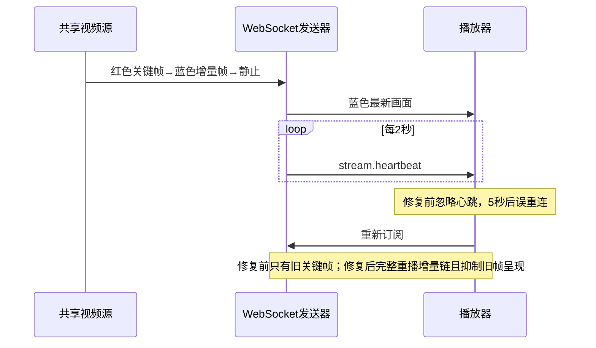

# v2026.11.5-3-fix 本地修复

基线：`main` / `bbf41be`，`VERSION=v2026.11.5-2`。遵循项目日历版本规则；v1.35.0-feature 是独立未实施规划，非下个正式发行号。当前为本地修复工作，未提交、未推送、未发布，VERSION 在发布收口前不变。

## 任务

- [x] 详情投屏缩小并上下留白。
- [x] 小窗工具栏半透明覆盖且显隐不改变画面尺寸。
- [x] 小窗按真实视频比例贴合，无额外顶栏空间。
- [x] 移除全程序无边框切换入口，保持默认外观。
- [x] 添加设备弹窗固定尺寸。
- [x] 提前生成真实配对二维码，处理终止、过期与重开。
- [x] 定位与验证标签切换卡顿。
- [x] 分段 IPv4、多范围、真实网卡默认值、校验及扫描。
- [x] 卡片拖动排序、统一编号及持久化。
- [x] 回归已固定顶部工具栏（用户已现场确认修好）。
- [x] 恢复“只显示已选”“显示全部”，按 serial 保持设备身份。

- [x] 修复离线/不可选设备夹在中间时卡片与编号错位；所有入口共用 serial 与全量编号映射。
- [x] 卡片与数字编号共用右键菜单：隐藏、删除、打开小窗、进入详情；删除限定现有手动设备条目，不删除手机数据。
- [x] 手机视图复用 screen_on/screen_locked 展示锁图标与“已锁定”。
- [x] 卡片去掉 Wi-Fi/USB 连接类型标志。
- [x] 卡片底部只显示真实 serial/连接地址，不重复型号。
- [x] 操作面板增加幂等锁屏动作（不使用电源切换键）。
- [x] 群控模式开关独立一行，与返回/主页/多任务/锁屏分开。
- [x] 所有底部胶囊展开面板点击外部/操作手机不自动收起，保留关闭、胶囊切换及 Esc。
- [x] 群控仅回归“选中设备”前提，不改动已确认正常的遥控路径。

- [x] 独立排查系统设置 → 投屏设置切换卡顿：用户明确复现通用→投屏、服务→投屏更明显，服务/依赖切换时快时慢。与添加设备标签跳动分开；停止现场采样，不要求用户重复操作，在独立测试环境分析挂载、渲染、状态同步与外部调用。

用户最终确认：遥控疑似异常由未选设备造成，功能正常，取消该疑似缺陷，不再等待补充现象。顶部工具栏由用户现场确认已固定；自动化回归独立记录。

## 基线证据

浏览器 1523×957 下地址/二维码/扫描弹窗高度为 324/208/360px，标签 y 坐标为 379/437/361px。5 次双帧绘制采样为 37.5～51.3ms，无观测到的 >50ms 主线程长任务；布局跳动已复现，秒级阻塞未复现。代码中切标签清空任务和二维码，停止请求虽可等待 5 秒但未被前端切换等待，不能宣称是已证实的阻塞原因。

## 验证与限制

本地实现及下列验证已完成，完整机器可读证据见 [verification.json](verification.json)。任务勾选代表本次实现和对应自动化验证完成，不代表手机扫码或全部平台验收。

| 验证 | 结果与范围 |
| --- | --- |
| Go 全量 | 461 项 / 35 包通过；发现、配对、范围与网卡定向 race 20 项通过 |
| Rust | 5 项通过；macOS ARM64 原生测试构建及窗口 IPC 回归通过 |
| Node | 61 项通过；小窗、主窗口效果、群控、发现生命周期、检查器、解码器 CJS 6 组通过 |
| 前端 | 类型检查与生产构建通过；版本同步检查通过，VERSION 仍为 v2026.11.5-2 |
| 原生小窗 | 原生系统窗口无边框状态、1080×2400 比例适配、画布贴边、工具栏显隐不改变尺寸、透明度/穿透独立恢复、关闭重开及菜单恢复通过 |
| 网页布局 | 合成元数据 1080×2400 下，小窗画布与舞台均 360×800，工具栏 absolute 且显隐尺寸恒定；详情画布 369×820，上下各40px留白 |
| 编号与选择 | 三设备 a在线/b离线/c在线，卡片 c与编号均03；选b无效，选c只作用于c。拖动后c为01，选择身份不变；只显示已选/显示全部、持久隐藏及独立恢复通过 |
| 右键与锁屏 | 卡片/编号菜单通过；排序后删除条目不残留。HTTP/WebSocket 测试夹具验证删除仅调用目标手动条目API，锁屏只发目标KEYCODE_SLEEP并检查screenOn=false；没有执行用户真机操作 |
| 添加设备 | 480×620固定尺寸切换不变；真实网卡en0的10.0.0.10/24得到10.0.0.1～254默认范围；预生成真实会话二维码，跨标签保留、停止、重建及关闭取消通过；双回环地址范围+端口1真实扫描2/2结束 |
| 顶部栏 | 500条Mock记录、441张在线卡片，列表滚动3000px前后header.y均为0；与用户现场确认分开记录 |

## 卡顿定位与修复证据

- 添加设备标签：已复现的原因是内容高度不同导致居中弹窗与标签位置跳动（324/208/360px），没有复现秒级JS阻塞，也不把未被await的停止请求误写为阻塞根因。修复后固定480×620，内容v-show保留，配对与扫描独立轮询；同视口标签位置不变。
- 系统设置→投屏设置：源码及DOM观察确认Tabs默认卸载隐藏内容、依赖页切出又重建普通容器。修复后复用Reka的unmountOnHide=false，普通容器v-show；投屏设置四个选择器在通用/服务/依赖往返时保持同一DOM实例，订阅用VueUse共享，未修改画质/帧率偏好。
- Chromium同视口4倍CPU限速的本次采样：切入投屏设置最终回归首次约63ms、后续约30/42/39ms（前一轮首次93ms、后续35/29/29ms）；暂停前基线首次约209ms、重复108/55ms。是隔离开发环境的少量对照样本，不代表所有机器的性能保证。原生WebView八次切换采样32～35ms，控件身份保留。
- 回归还发现并修复排序后的残留卡片：Sortable原先移动右键组件片段内节点，破坏Vue片段边界；现在以独立有key的DOM容器为拖动项，复原顺序时保持Vue的列表结束标记在卡片之后。排序→隐藏/恢复→删除→重新加入的实际浏览器用例已通过，DOM顺序与Store数据顺序一致。
- 上次Node共享用例失败已核对VueUse源码：SSR刻意不共享实例。现在Node验证SSR隔离、真实浏览器验证同一共享引用与作用域释放；没有通过跳过必要行为来制造通过。
- 原生旧回归在关闭重开后受旧窗口测试消息干扰；广播增加窗口实例标识并在pagehide关闭，重新构建后的完整回归通过。

## 未覆盖与交付边界

- 真实手机扫码配对、视频解码/听感、实际锁屏效果及各厂商行为尚未执行本轮验收；合成夹具和窗口测试不冒充真机结果。
- 保留先前现场内存压力/换页/合成负载观察，但未证明其为唯一原因；未再抓取用户现场、停止投屏或降低用户画质。
- 未替换已安装应用，未提交、推送、发版或公证。当前本地便携构建仍携带正式基线VERSION；正式发布需另行授权及版本收口。
- 先前无关的frontend/docs/rules/coding.md、prototypes/AGENTS.md、generated-images/、prototypes/scripts/保持原样。

## 性能现场观察（用户新增）

协调端 OS 采样：GUI 约 1.3～4.6% CPU、后端约 2.1%，邻近 WebKit GPU 约 9.5～25.6%（归属尚未确认）；ego 某渲染器达 102.6～258%，另有两个约 43%；WindowServer 55～72%，整机后一次约 36% 忙。五条 scrcpy 会话中两条原始分辨率/16Mbps/60fps、三条 1024/2Mbps/15fps。均为观察数据，不作为已证实的缺陷原因。不停止用户投屏、不擅改画质、不关闭用户原有页面。暂停前测试页使用Mock卡片场景，未启动真实设备视频；恢复轮验证仅使用test-*夹具及合成元数据。专用服务与测试页在交付前停止，不影响用户原有程序。

第二轮现场采样（原生系统设置/投屏设置，16Mbps/60FPS未改）：GUI约1.5%、后端2.3%，WebKit GPU快照21.6%（区间8～24.8%）、WebContent4.2～7.5%。11逻辑核整机空闲49.18%/57.10%，WindowServer48.5～61.4%。18GiB物理内存，swap使用16804.81M，压缩5.9～6.3GB；memory pressure级别2（warn），3秒实测swapin11.28MiB/s、pagein83.15MiB/s、swapout0。GUI与WebContent主线程3秒采样分别253/254、239/242处于RunLoop等待，未抓到持续忙循环，但不能排除间歇卡顿。ego PID76035已退出，其他旧ego渲染器回到0%，不能无证据归因本测试页。证据支持系统内存压力/换页与合成负载可能共同参与，尚无对照证明唯一根因。采样文件位于协调聊天 work 目录。

## 追加：静止画面回退与冻结

- [x] 复现“动态→静止→等待”，沿真实H.264、WebSocket、解码与呈现链路修复，保留无关改动与用户现有投屏。

已通过隔离真实 H.264 链路复现并修复。用户当前运行的是17:49启动、标识为v2026.11.5-2的开发bundle，本轮未替换它；/Applications下的另一个安装包不是该运行实例。

### 复现与根因

FFmpeg/libx264生成160×96、5FPS的红→蓝输入：10张媒体帧，仅第一张为关键帧；蓝色最终由增量帧形成。通过生产`pumpSharedVideo`、真实WebSocket和生产`usePlayer`/`ScrcpyDecoder`在Chromium WebCodecs中解码，不使用模拟帧、不连接ADB。

- 修复前：最后蓝帧像素为`[0,0,255,255]`；约6.1秒后回到旧红帧`[254,0,0,255]`，随后重复重连；采样连接数达到4。
- 根因一：服务端每2秒发送`stream.heartbeat`，前端忽略该消息，静止5秒就被误判为断流。
- 根因二：浏览器新订阅仅重播缓存config/旧关键帧，遗漏后续增量帧；静止后没有新帧帮助它追上当前图像。

### 实现与验证

- 仅当前有效WebSocket的心跳刷新存活计时，保留无心跳/无数据超时、明确断开及解码错误恢复逻辑。
- 浏览器复用有界完整GOP缓存（16MiB/512包）；录制和Vision原有订阅契约保留。回放源也同步完整链，暂停后重新订阅不会只得到旧关键帧。
- 同一session_id重建解码器时按已呈现PTS抑制旧图像回退，仍解码其依赖；新会话、旋转、重复编码配置/重放循环可合法重置PTS。关闭解码器后迟到回调不再绘制，所有VideoFrame及时释放。
- 修复后：蓝色静止至少10秒，连接数保持1；主动切断测试连接后成功重新订阅，蓝色之后没有任何红色呈现；屏蔽测试客户端收到的心跳后，原有超时检查仍能触发第三次连接，最后仍为蓝色。
- 新增Go完整增量链/缓存溢出/暂停回放用例，新增解码器同会话PTS、旧实例回调、等待关键帧、新会话及重放重置回归；先验红再修绿。
- 本轮Go全量461项/35包通过，视频相关race 16项通过，Node 61项与CJS六组通过；前端生产构建及普通macOS ARM64桌面构建通过。
- 证据保存在`verification.json`的`static_video`字段；复现脚本为`scripts/verification/static-video-fixture.py`、`static-video-browser.mjs`、`static-video-assert.mjs`和显式启用的Go夹具。夹具使用独立21992/5192端口，不接触用户服务。

### 本轮边界

- 没有直接操控真机或复验用户原生WebView里的真实设备视频；已复现的是相同生产链路的可控H.264输入，不能宣称当前运行应用已经修好。
- 完整GOP若超过既有16MiB/512包上限，新订阅者等待下一有效关键帧，不把不完整的旧关键帧误当成最新画面。已有同会话且同尺寸的画面在等待期间保留；此资源限制明确保留。
- 未提交、推送、发版、替换安装应用或重启用户服务；本轮测试资源已结束。

