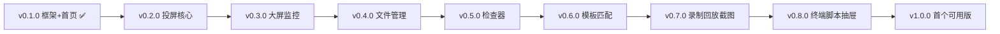

# v0.1.0-feature 设计文档

## 背景

- 老项目 `MyWebScrcpy`：Go 后端 + 原生 JS 前端（`web/`：`index / player / dashboard / files / scripts / api-docs` + 19 个 JS 模块），最新版本 `v1.10.0-feature`。
- 新项目 `MyWebScrcpyNew`：只做前端，Vue3 + Vite + TS + Tailwind v4 + shadcn-vue，后端继续沿用老 Go 服务（Vite 代理 `/api -> localhost:8080`）。
- 本版本已完成：框架骨架 + 首页（设备列表）。

## 目标与非目标

**目标：**

- 列出老前端全部功能迁移清单，按版本切分，后续逐版实施。
- 本版交付：框架 + 首页可用。

**非目标：**

- 不改后端接口与协议。
- 不在本版实现投屏、大屏、文件等后续页面。

## 老前端功能盘点（`MyWebScrcpy/web/`）

| # | 老页面/模块 | 说明 | 拟迁入版本 |
|---|-------------|------|-----------|
| 1 | `index.html` 设备列表 | `GET /api/devices` 轮询、别名重命名 | v0.1.0 ✅ |
| 2 | `player.html` + `decoder.js` + `control.js` | WebCodecs 解码、Canvas 渲染、鼠标/触摸/键盘控制、fps/状态/自动重连、音频开关 | v0.2.0 |
| 3 | 播放器工具栏 | 返回/Home/任务切换/锁屏/旋转/全屏/画中画/显示尺寸 | v0.2.0 |
| 4 | `dashboard.html` + `dashboard.js` | 大屏多设备同屏、小/中/大三档 | v0.3.0 |
| 5 | `files.html` + `files.js` | 浏览/搜索/上传下载/新建文件夹/移动/重命名/删除/撤销 | v0.4.0 |
| 6 | `ui-inspector.js` | 取色坐标+13×13放大镜、XML树+Xpath联动绿框、页面信息（包名/Activity/分辨率/DPI/旋转） | v0.5.0 |
| 7 | `template-match.js` | 模板CRUD、多参考图、多尺度、定位点击（sdk/adb）、绿框叠加 | v0.6.0 |
| 8 | `recording.js` / `replay.js` / `screenshot.js` | 受控MP4录制、录像回放、区域截图 | v0.7.0 |
| 9 | `adb-shell.js` + xterm / `scripts.js` / `right-panel.js` | Web ADB终端、脚本管理、右侧抽屉整合 | v0.8.0 |
| 10 | `toolbar-popover / touch-visualizer / toggle-green-boxes / op-log / audio / PiP` | 工具栏弹层、触摸可视化、绿框开关、操作日志、音频、画中画 | 随各版本归位 |
| 11 | `api-docs.html` + `openapi.json` | 接口文档页（直接复用后端静态资源或外链） | v1.0.0 |

## 迁移版本规划

- 每个版本独立四件套（session/design/tasks/version），本目录只跟踪 v0.1.0。
- 每个版本默认包含：API 对接、加载/空/失败态、窄屏适配、深色模式检查、`vue-tsc + build` 通过。

## 关键决策

### 1. 纯前端仓库，后端零改动

沿用老 Go 服务全部 `/api/*` 与 `/ws/*` 契约，新前端只做表现层重写；联调一律走 Vite 代理，避免 CORS 分支。

### 2. shadcn-vue 为组件唯一来源

表格/表单/弹窗/抽屉/命令面板优先用 shadcn-vue 官方方案（Data Table 走 TanStack Table，表单沿用 VeeValidate 二选一）；不自造基础组件，不全局替换主题 token。

### 3. 路由与老 URL 语义对齐

`/`、`/player?serial=`、`/dashboard` 与老页面一一对应，老书签与后端跳转可平滑过渡；文件/脚本页后续同理。

## 风险与权衡

- [投屏解码风险] WebCodecs + scrcpy 私有帧格式移植最复杂 → v0.2.0 单独一版，预留联调时间。
- [接口漂移] 老后端持续迭代 → 每版开工前先对 `openapi.json` diff，契约变化先记录再动手。
- [范围蔓延] 检查器/模板匹配容易做大 → 严格按“老功能平移”验收，新增能力另起版本。

## 迁移计划

1. v0.1.0：框架 + 首页（本版，已完成）。
2. v0.2.0 起按上表逐版实施，每版先写 design/tasks 再动手。
3. v1.0.0 收尾：全链路联调、深色/窄屏走查、README 与部署说明。

## 回滚计划

1. 新前端独立仓库，老项目不受影响；任何版本可整体停留在上一版。
2. 单版返工时只回滚该版新增文件（`src/views/*`、`src/api/*`、`src/stores/*`），不碰已发布版本目录。

## 待确认问题

- 首页当前无后端时是失败态：是否需要 Mock 开关方便演示？（用户上轮二选一待定）
- v0.2.0 是否直接真机联调，还是先用录制流/假帧占位？
