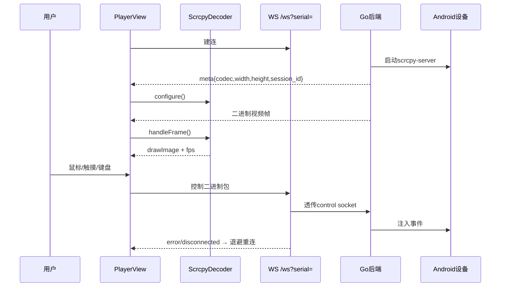

# v0.2.0-feature 设计文档

## 背景

- v0.1.0 已交付框架 + 首页；真机已就绪（`10.0.0.11`、`10.0.0.30` 在线）。
- 老投屏链路：浏览器 `WebSocket /ws?serial=` ↔ Go ↔ scrcpy-server；视频为 `[1B kind][8B pts BE][payload]` 二进帧（0=config，1=key，2=delta，3=session/尺寸），控制消息为定长大端二进制。
- 本版把解码、连接、操控、工具栏平移到 Vue3 + shadcn-vue，用户用真机联调验收。

## 目标与非目标

**目标：**

- 打开 `/player?serial=` 真机出画面，可点、可拖、可滚、可打字。
- 工具栏：返回 / Home / 任务切换 / 锁屏 / 旋转 / 全屏 / 画中画 / 显示尺寸 / 重启设备。
- 状态：连接状态文案、分辨率、fps；断线退避重连；灭屏提示；音频默认静音可开启。

**非目标：**

- 检查器、模板匹配、录制/回放/截图、终端、脚本、文件管理、大屏（后续版本）。
- Vision 识别绿框叠加（本版不订阅 `/api/vision/results`，overlay canvas 预留）。

## 交互时序

## 关键决策

### 1. 协议层逐字节平移，不重设计

`decoder.js` / `control.js` 逻辑成熟（Annex-B↔AVCC、旋转重 configure、静默重试 3 次亮红屏），TS 移植保持行为一致，只改模块形态（class → TS class + 组合式封装）。

### 2. 连接状态机收敛到 composable

`usePlayer(serial, canvas)` 内聚 WS 生命周期、重连退避（1s 起、5s 封顶、20 次上限）、3s meta 超时、1s 帧看门狗、10s 灭屏轮询；PlayerView 只负责渲染与工具栏。

### 3. 更多菜单用 shadcn DropdownMenu，显示尺寸用 Slider

- 符合 AGENTS.md 组件规范；`dropdown-menu`、`slider` 按需 `add`。
- 音频、画中画逻辑小，一并纳入（默认静音；PiP 优先原生，Document PiP 兜底沿用老逻辑简化）。

### 4. 键盘拦截沿用老排除规则

输入框/弹窗/终端/检查器内不拦截；Meta/Alt 组合放行浏览器；可打印字符走文本注入。

## 风险与权衡

- [解码兼容] 老设备 H.265/AV1 少见 → 本版先保证 H.265/AV1，h265/av1 codec string 保留，联调只验 H.264。
- [旋转黑屏] 旋转后新 config 包必须 reset+configure → 已在移植中保留，联调重点验证。
- [真机独占] 联调占用一台设备 → 用 `10.0.0.30`，不影响 `10.0.0.11`。

## 迁移计划

1. 新增 `src/scrcpy/`：`protocol.ts`、`decoder.ts`、`audio.ts`、`pip.ts`、`usePlayer.ts`。
2. 新增 `PlayerView.vue`，路由 `/player` 由 Stub 替换为真页面。
3. 真机联调：出画面 → 点击/拖拽/滚轮/键盘 → 工具栏逐个 → 旋转 → 断线重连（kill 重进验证）。

## 回滚计划

1. `/player` 出问题时路由指回 Stub，不影响首页。
2. 本版新增文件独立目录 `src/scrcpy/`，删除即回滚。

## 待确认问题

- 无（真机联调已授权）。
