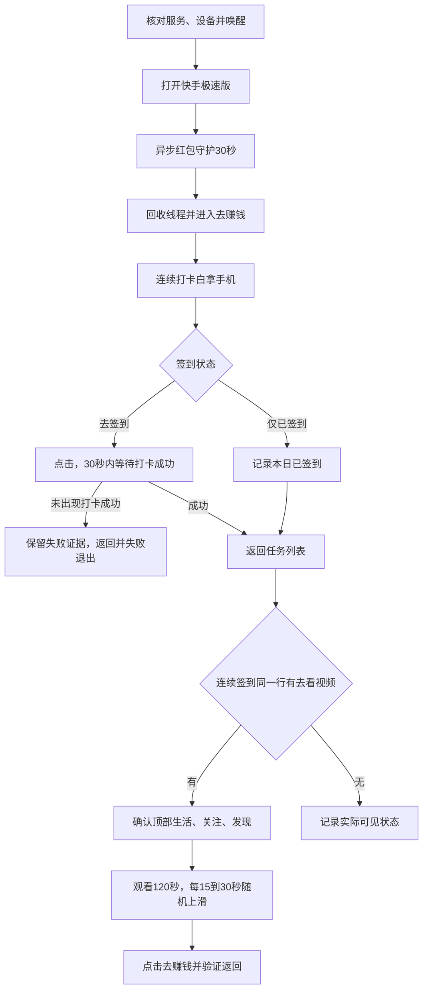

# 流程与边界

“超时30秒”解释为启动后弹窗监测总窗口。关键词严格使用用户给出的 `遊好友得大额红包`；出现且同屏“去领取”唯一时点击，随后确认消失，不盲目重发动作。

守护仅一个线程，识别、点击串行，不积压任务。主流程等待线程回收才换页；旧结果不跨阶段使用。签到或观看期间不继续抢占点击。

只执行这两个任务。登录、验证码、支付、下载、分享或其他任务出现时停止；已确认弹窗可以由视觉接管关闭，不点击分享/领奖广告入口。
