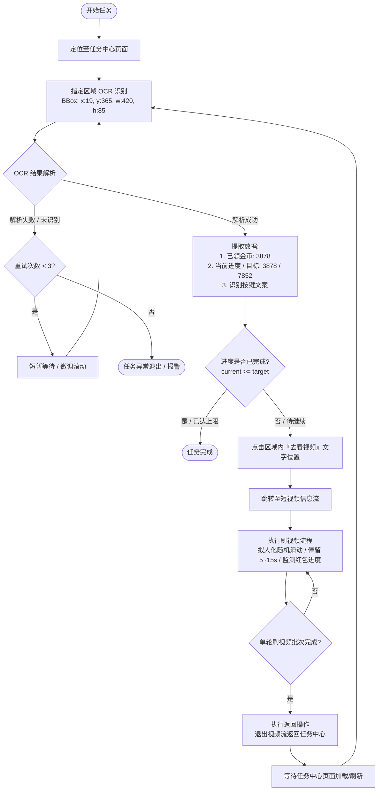

# 刷视频任务流程

本文档定义快手极速版“看视频得金币”任务的执行流程与状态流转。

## 流程图



## 详细步骤说明

### 1. 任务中心 OCR 识别与数据解析
- **目标区域（Bounding Box）**：
  - `{"x": 19, "y": 365, "width": 420, "height": 85}`
- **示例 OCR 文本**：
  ```text
  已领3878金币，继续看视频得金币
  3878/7852
  去看视频
  ```
- **字段提取与正则匹配规则**：
  - **已领金币**：`已领(\d+)金币` -> 提取数值（如 `3878`）
  - **任务进度**：`(\d+)/(\d+)` -> 提取 `current` (`3878`) 与 `target` (`7852`)
  - **完成判断**：
    - 若 `current >= target` 或 文案为“已完成”/无“去看视频”按钮，则标记该任务完成。

### 2. 触发“去看视频”
- **定位**：在指定区域 `{"x": 19, "y": 365, "width": 420, "height": 85}` 内命中“去看视频”字样对应的子区域坐标，或点击按钮默认锚点。
- **动作**：触发 Tap 点击事件，等待页面跳转进入短视频播放流。

### 3. 刷视频流程执行
- 调用通用短视频消费动作（如 `watch_video.py`）。
- 每条视频拟人化停留 5 ~ 15 秒，随机执行轻微上下滑动与金币轮盘进度监测。
- 按设定批次（如刷 5~10 条或看满特定时长）为一周期。

### 4. 返回并复核进度
- 调用 `try_return.py` 或返回键，回到“任务中心”。
- 重新触发第 1 步 OCR 识别，比对 `current` 进度增长情况与完成状态。
- 若进度已达标则结束任务；否则进入下一轮循环。
